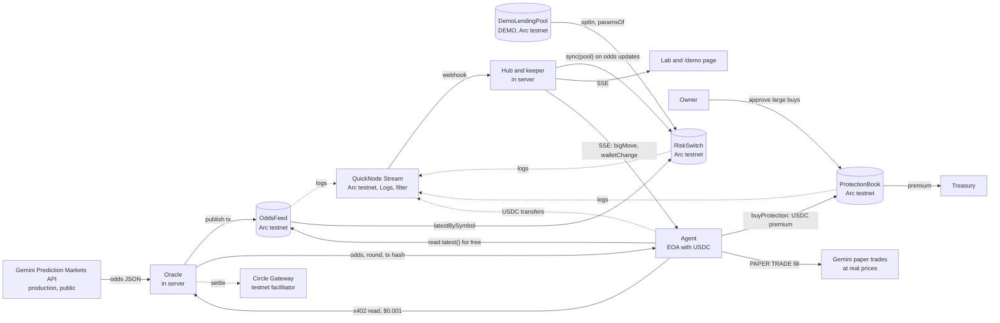

# Hedgehog — plan

> **A probability oracle that lets AI agents insure themselves.**
> UBC 2026 (University Blockchain Conference). "Hedgehog" is a working name; rename any time.
>
> Deadline: **Fri Nov 20, 12:00 pm CST = 10:00 am Pacific.** Target: submitted by 9:00 am CST (7:00 am Pacific).

## Where we are (Wed Nov 18)

- **Built and running:** Phases 1 to 7. The oracle posts about 100 Gemini markets on Arc; the agent pays per read over x402 and buys cover; the risk switch moves our demo pool's limit onchain; a QuickNode Stream drives both. Four judges' pages: Overview (`/`), Oracle (`/oracle`), BTC pools (`/pools`, with our pool's replay at `/pools/ours`), Agents (`/agents`: the desk live, and the agent replay at `/agents#replay`). The Lab (`/lab`) is the workbench.
- **This batch (Phase 8.0):** 8.0 cleanup, 8.0b README for judges, 8.0c the agent insurance desk as a plan (`docs/plan-agent-desk.md`).
- **Agent desk (8.0d to 8.0j, built Nov 18):** `/agents`, the fourth tab; 8.0j redesigned it as one stage and merged the agent replay in. Two ways in, one desk underneath: a demo agent made on the page, and your own agent over MCP (`src/desk/mcp.ts`). Orders are tickets plus sandbox orders. No limits of any kind yet.
- **Phase 9 (done Nov 18, an unattended batch):** 9.0 cleanup; 9.1 the oracle audit (`docs/oracle-audit.md`: two bugs fixed, tests 13 → 29); 9.2 pools over time (one real month; a year is BLOCKED by Gemini's data); 9.3 `npm run preflight` and `npm run demo:reset`, and all three demos through `stream:demo`; 9.4 README, `docs/submission.md`, `docs/video-script.md`, a clean-copy setup test; 9.5 `docs/hosting-plan.md`.
- **Phase 10 (done Nov 18, a batch):** 10.1 only the publisher can post and nothing above 100% (new feed, switch and pools; the first set kept as v1); 10.2 thin books are not posted and stale values are marked; 10.3 the Stream webhook verifies QuickNode's signature. Everything was rerun afterwards.
- **Next:** the video and submission (10.4).
- **Not built:** the agent guardrails: budgets, max price, owner approval (Phase 11, planned).
- **History:** `LOG.md` has every change, `LESSONS.md` every surprise. Sections 0 to 2 below are the research, decisions and design from Nov 15 to 16; where they differ from the code, the code and `CLAUDE.md` are right.

---

## 0. Research findings (checked Nov 15, 2026)

Items marked ⚠ could block us. Items marked *unverified* get proven in a Day 1 unit.

### 0.1 Gemini Prediction Markets API

- **Market data is public, no key.** `GET https://api.gemini.com/v1/prediction-markets/events?status=active&category=…&limit=…` lists events. `GET /v1/prediction-markets/events/{eventTicker}` returns one event. There are also endpoints for strike price, categories, newly listed, recently settled and upcoming events. Volume: `GET /v1/prediction-markets/volume/{date}` and `/hourly`.
- Each contract has an `instrumentSymbol` (example `GEMI-FEDJAN26-DN25`). Always take it from the API. Never build it from the title.
- Contracts carry a `priceHistory` array, which gives us history without a separate candles call. Order book: the existing book API with the `instrumentSymbol`. Live prices and depth come over `wss://ws.gemini.com`.
- **Prices** run from $0.01 to $0.99 per contract and approximate the probability. A winning contract pays $1 and a losing one pays $0.
- **Trading.** REST `POST /v1/prediction-markets/order` takes symbol, `orderType: limit`, side, quantity, price and outcome. Related endpoints: `/order/batch`, `/orders/active`, `/orders/history`, `/positions`. WebSocket `order.place` also works.
  - The Prediction Markets terms must be accepted first (`GET /v1/prediction-markets/terms/status`, `POST /v1/prediction-markets/terms/accept`). Otherwise orders fail with `TERMS_NOT_ACCEPTED`.
  - Auth is HMAC-SHA384, with the payload in `X-GEMINI-PAYLOAD` and an empty body.
  - The API key must be scoped to the trading account, have the Trading permission and use a time-based nonce.
  - The official TypeScript SDK `@gemini-markets/sdk` handles signing and supports `env: "sandbox"`.
  - **Confirmed in unit 3.3 (Nov 16), and what differs:** we use signed REST, not the SDK (a master key needs `account` on every prediction-market call, which the SDK can't send). Terms status is a signed `GET`; orders, positions and order lists are signed `POST`s. The nonce is the time in seconds. Order IDs are 18-digit integers and must be kept as strings. `clientOrderId` is accepted and echoed although the reference omits it from the request. There is no get-one-order endpoint. The sandbox lists 97 events (crypto and commodities, no Economics), with strikes that differ from production.
- **Sandbox** (Gemini also calls it the demo environment): `exchange.sandbox.gemini.com`, `api.sandbox.gemini.com`, `wss://ws.sandbox.gemini.com`.
  - It needs a separate account and runs on test funds, with bots simulating order books. For 2FA, set the cookie `GEMINI-SANDBOX-2FA=true` and enter `9999999`.
  - The Prediction Markets docs say auth, endpoints and messages are identical to production. Gemini also says to confirm each product is supported there.
  - *Unverified:* which prediction markets exist in sandbox. Unit 3.3 proves this on Day 1.
- ⚠ **Eligibility (production).** US users only, 18+, KYC. Third-party reviews disagree on state coverage (all 50 vs 42–44 states). We trade in production only if you already have a verified US account.
- **Rate limits.** Public endpoints allow 120 requests/min (1 per second recommended). Private endpoints allow 600/min (5 per second recommended). We stay far below both.
- **Categories** seen in the docs: politics, crypto (including BTC 5-minute up/down), sports, economics (Fed decisions), commodities, weather.
- ⚠ **Republishing terms.** The Market Data Agreement allows personal, internal and informational use. It prohibits using the data to create or price financial products, to build benchmarks or indexes, or to sell or license it. Redistribution needs a separate agreement (marketdata@gemini.com or bizdev@gemini.com), with attribution "Data provided by Gemini". An onchain feed sold per read is redistribution.
  - → Ask the Gemini bounty team to OK it for the hackathon (testnet only, attributed). This doesn't block Phase 1.
- **Demo market context.** The live story is the Dec 8–9 FOMC decision. Polymarket priced a 25 bp hike at about 85% on Nov 11, so "hike odds climbing" is real but mostly priced in already.
  - The scripted demo replays the real climb from `priceHistory` (Unit 7.3).
  - The live market is probably the Jan 2027 meeting or a BTC price threshold. Unit 2.1 confirms what Gemini actually lists.

### 0.2 Arc testnet

| Item | Value |
|---|---|
| Chain ID | `5042002` (mainnet `5042` has been live since Sep 16, 2026; we stay on testnet) |
| RPC | `https://rpc.testnet.arc.io`, wss same host. Older docs use `rpc.testnet.arc.network`. Alternatives: QuickNode `rpc.quicknode.testnet.arc.io`, Blockdaemon, dRPC |
| Explorer | `https://explorer.testnet.arc.io` (Blockscout). Older docs: `testnet.arcscan.app` |
| Faucet | `https://faucet.circle.com` → Arc Testnet → USDC. Guides report 10–20 USDC per request |
| USDC | ERC-20 interface at `0x3600000000000000000000000000000000000000` with **6 decimals**. Native gas is USDC with **18 decimals**. They are **one balance** |
| Blocks | About 0.5 s, deterministic finality, no reorgs. `block.timestamp` can repeat, so order by block number. `PREVRANDAO` is always 0 |
| Gas | Minimum base fee 20 gwei, about 0.00042 USDC for a plain transfer. An oracle publish is roughly 0.001–0.002 USDC |
| Tooling | viem ships `arcTestnet`. The standard Foundry deploy flow works (per Arc's tutorial). Arc docs recommend **Arc Foundry** (`arc-forge`, `arc-cast`, `arc-anvil`) because stock anvil can't mimic Arc. We test against the real testnet instead of a local fork |

**Circle tools on Arc testnet today:**

- **Agent Wallets**: Circle CLI, Arc testnet supported. ⚠ Spending policies are mainnet-only; testnet chains are rejected.
- **Nanopayments** through Gateway: a hosted testnet facilitator is available. The buyer must be an EOA, not a smart-contract account.
- **Facilitator Service**: a keyless trial runs on Arc testnet.
- **Contracts** and dev-controlled wallets are also available.
- **Paymaster** isn't needed, since gas is already USDC.

### 0.3 x402 on Arc

There are two working Circle options on Arc testnet:

- **A. Gateway Nanopayments (batched)**: our choice.
  - Seller: `createGatewayMiddleware({ sellerAddress, facilitatorUrl: "https://gateway-api-testnet.circle.com" })`, then `gateway.require("$0.001")` on a route.
  - Buyer: `new GatewayClient({ chain: "arcTestnet", privateKey }).pay(url)`.
  - Packages: `@circle-fin/x402-batching`, `@x402/core`, `@x402/evm`, `viem`.
  - The buyer needs a Gateway balance, which takes one deposit. Circle's reference app (`circlefin/arc-nanopayments`) lists no Circle API key.
  - Payments are signed offchain authorizations that Gateway settles onchain in batches.
- **B. Facilitator Service (exact scheme, EIP-3009)**: fallback.
  - One onchain transfer per payment. A keyless trial works on Arc testnet; production needs a Circle API key.
  - Every call needs a fresh `Facilitator-Seller-Proof` EIP-712 header, which means more code.
- **Why A:** it is the least code, and it is the exact "x402 + Nanopayments" pairing the main track recommends.
- **Tradeoff:** single reads don't show up as separate onchain transfers. The Stream sees Gateway deposits and settlements, and the payments ledger comes from settle responses. If A blocks us, B makes every read visible onchain at the cost of per-call signing.
- **Confirmed in unit 3.1 (Nov 16), and what differs from the notes above:**
  - Package versions: `@circle-fin/x402-batching` 4.0.0, `@x402/core` and `@x402/evm` 2.31.0. Imports come from `@circle-fin/x402-batching/server` and `/client`.
  - The middleware accepts every Gateway network unless `networks` is set; we set `"eip155:5042002"`.
  - The 402 response offers two options, `GatewayWalletBatched` versions 1 and 2, both against the Gateway Wallet contract `0x0077777d7eba4688bdef3e311b846f25870a19b9`. The price $0.001 is `amount: "1000"` (6 decimals).
  - The deposit is two transactions (approve, then deposit), and the balance shows up in Gateway within seconds.
  - "Settle" in the middleware means Gateway accepted the authorization. The onchain batch comes later; the per-payment status is readable with `GatewayClient.getTransferById(id)`.
  - Balances: `GatewayClient.getBalances()` for the wallet and Gateway balance, and `getBalance(address)` for anyone's Gateway balance, including the seller's.
- **Avoid:** the public `x402.org` facilitator and older x402 npm releases. One sample had to patch x402 v1.1.0 to add Arc.

### 0.4 QuickNode Streams

- **Arc Testnet is supported** for every EVM dataset (Block, Block with Receipts, Transactions, Logs, Receipts, traces). Validator Activity is the one exception.
- **Filter:** a JavaScript `function main(stream)`. Return data to deliver it, or `null` to skip the block.
- **Setup:** a Stream can be created in the dashboard or through the Streams REST API (`api.quicknode.com`, header `x-api-key`, filter sent as base64).
- **Destinations:** webhook and others; one stream can have several.
- ⚠ **Billing.** Credits are charged per block *processed*, and filters don't reduce them.
  - Arc makes about 2 blocks per second, roughly 173k blocks a day.
  - The free trial gives 10M credits for one month.
  - Ethereum blocks cost 20 credits each. At that rate, nonstop streaming uses about 3.5M credits a day, so the free trial lasts about 3 days. Arc's own rate isn't published; check the calculator.
  - Our answer: scripts create the stream at the latest block and delete it when idle. Also ask QuickNode for hackathon credits, or use the Build plan ($49, 80M credits).
- The webhook needs a public HTTPS URL. During development we use a cloudflared quick tunnel (no account needed).

### 0.5 The agent's decision

- **Rules decide. An LLM, if we use one, only proposes the threat map**: one call, cached, reviewed by you.
  - Rules are deterministic, testable, cheap and easy to document for the "decision loop" requirement.
- **Threat map:** each holding maps to (market, the outcome that hurts us, shock %). Illustrative example: ETH → "Fed hikes 25 bp in December", YES hurts, −12%.
- **Harm probability:** the feed carries YES only. `p` = YES when the market's `harmfulOutcome` is `"YES"`, and 1 − YES when it is `"NO"`.
- **Trigger:** buy when the probability `p` of the harmful outcome is at least `trigger` (default 0.50).
- **Sizing:**
  - `loss_if_event = exposure × shock`
  - `contracts = ceil(hedgeRatio × loss_if_event / $1) − already_held`
  - `premium ≈ contracts × the ask of the harmful side (YES ask, or NO ask)`
  - Example sized to faucet amounts: $60 exposure × 12% = $7.20 at risk → 8 contracts × $0.65 ≈ $5.20 premium.

### 0.6 The oracle contract

- `OddsFeed` keeps the latest `{probBps, observedAt, publishedAt, sourceHash, round}` for each market.
- `latest(marketId)` is a view function any contract can read for free.
- `marketId` = `keccak256(symbol)`, where the symbol is Gemini's `instrumentSymbol` (or a `test:` / `replay:` name). `latestBySymbol(symbol)` reads by name.
- Event: `OddsUpdated(marketId indexed, symbol, probBps, prevProbBps, observedAt, sourceHash, round, publisher indexed)`. Emitting `prevProbBps` lets the Stream filter spot big moves without keeping state.
- `sourceHash = keccak256` of the exact Gemini JSON snapshot used. Phase 10 stores the snapshots so anyone can recompute the hash.

### 0.7 Re-check (Mon Nov 16, 00:45 PST, from the build machine: WSL2 on the user's PC)

| Check | Result |
|---|---|
| `node --version` | `v22.23.1` (npm `10.9.8`) ✅ |
| `forge --version` | `1.8.3`; `cast` is installed too ✅ |
| `cloudflared` | installed ✅ (`jq` and `ngrok` are not; not needed) |
| Gemini `events?status=active&limit=3` | HTTP 200, no key ✅. 959 active events in total |
| `eth_chainId` on `rpc.testnet.arc.io` | `0x4cef52` = 5042002 ✅ |
| `eth_chainId` on `rpc.testnet.arc.network` | `0x4cef52` = 5042002 ✅ (the older host still answers) |

What the Gemini response showed, and what it changes:

- **The response is huge:** 1.3 MB for 3 events. Events nest sub-events (26 under one NFL game) and every contract carries a long rules text. → 2.1 filters by category, keeps `limit` small and prints only chosen fields.
- **Shape:** `{ data: [event], pagination: { limit, offset, total } }`. Prices sit at `contract.prices` as strings: `bestBid`, `bestAsk`, `lastTradePrice`, plus `buy.yes/no` and `sell.yes/no`.
- **`lastTradePrice` can be missing** (seen on player-prop contracts). The "mid, else last trade" rule in 2.3 needs a third case: no publish.
- ⚠ **No `priceHistory` in the list response.** §0.1 said contracts carry it. **Resolved in 2.1:** the single-event endpoint has none either, but `GET /v2/candles/<instrumentSymbol>/<1hr|1day>` returns real history, so 7.3 replays that.
- `quantityMinimum` varies by market (`0.01` or `1`). We size in whole contracts, so no change.
- The first page is all sports. Category values are capitalized (`"Sports"`); 2.1 confirms the filter values for economics and crypto.

---

### 0.8 Hackathon rules (from the organizers' guide, read Nov 16)

- **Submit on Devpost:** `ubc-hackathon-2026.devpost.com`. Deadline Friday Nov 20, 12:00 pm CST. Select one main track, one chain award (Solana, Arc or None) and every bounty, and opt in to the matching prizes.
- **Exactly one main track.** Bounties are optional and unlimited. One chain award at most: Best use of Solana **or** Best use of Arc, never both. All prizes stack except those two.

| Prize | Award | Who is eligible |
|---|---|---|
| Official UBC 2026 Hackathon Winner | 1st $2,500 plus 3 months of ElevenLabs Pro per member, 2nd $1,000, 3rd $500 | every submission, automatically |
| Track Winner | $2,000 per track (3 tracks) | every team, in the track it chose |
| Best use of Solana | $1,500 per track | Solana projects that select it |
| Best use of Arc | $1,000 per track | Arc projects that select it |
| Gemini Prediction Markets bounty | 1st $2,500, 2nd $1,000, 3rd $500 | teams that opt in |
| QuickNode Streams bounty | $500 | teams that opt in |
| ElevenLabs bounty | 3 months of ElevenLabs Scale per member | teams that opt in |
| Grok Bot bounty | mechanical keyboard per member plus swag | teams that opt in |
| Participation | 1 month ElevenLabs Creator, a $49/mo QuickNode plan, X Premium | complete, working submissions, at the judges' discretion |

- **Finalists:** up to 13 teams pitch in person on Saturday Nov 21: 3 from each main track (the top contender for Track Winner, Best use of Solana and Best use of Arc), the top 3 contenders for the overall winner, and the 1st place Gemini bounty team. Finalists are notified by Friday Nov 20, 11:59 pm CST. Each pitch is 5 minutes plus 2 minutes of Q&A.
- **In person on Nov 21:** teams must be present at the closing ceremony to qualify for any prize, including track and bounty prizes.
- **Our track, Agentic Payments and AI, requires:** agents that execute onchain transactions or read the blockchain (testnet is fine), and documentation of the agent's decision loop and the safety limits. It recommends x402 and Circle Nanopayments, per-request payments, budgets, allowlists and human approval for large transactions.
- **Best use of Arc requires:** core onchain functionality on Arc (testnet is fine), the contract addresses in the README, and a README explanation of how the project uses Arc.
- **Gemini bounty requires:** use of the Gemini Prediction Markets API (market data and/or trading endpoints).
- **QuickNode bounty requires:** Streams as a core data source, at least one Stream with a filter and a destination, and a README explanation of the Stream's network, dataset, filter logic and destination, and why.
- **What to submit:** project name, description and team; track, chain award and bounties; written answers (what did you build, what problem, how it works, what makes it unique, what next); technologies used; a public GitHub repo with source and setup instructions; a working demo or deployed app; a 2 to 3 minute demo video on Google Drive or YouTube; a README with technical documentation and an architecture overview.
- **Other rules:** projects must be substantially built during the hackathon. AI tools are allowed. Judging looks at technical execution, product and UX, innovation, impact and the demo.

## 1. Decisions

| Topic | Decision | Why |
|---|---|---|
| Chain | Arc testnet. RPC: your QuickNode Arc endpoint first, Circle's public RPC as fallback | Track requirement, USDC gas |
| Stay on Arc | We stay on Arc testnet and do not move to Solana (user's decision, Nov 16, after unit 0.4) | `docs/archive/solana-option.md`: a switch costs 14 to 20 extra hours for $500 more upside, and Circle Nanopayments does not run on Solana |
| Languages | TypeScript on Node 22 (`tsx`, `viem`) for services. Solidity with Foundry for contracts | As requested |
| Paid reads | Circle Gateway Nanopayments over x402 (fallback: Circle Facilitator Service) | §0.3 |
| Agent wallet | Plain EOA key in `.env`, not a Circle Agent Wallet | Agent Wallets need CLI login with an email code; their policies are mainnet-only; the Gateway buyer must be an EOA. The guardrails live in our own contract |
| Odds | Gemini **production** public API (real data) | Real data needs no account |
| Trading | `PAPER TRADE` at the real production price; the agent doesn't use the sandbox. The sandbox order API was proven in unit 3.3 and stays available through `npm run gemini:order` | User's decision, Nov 16: real Gemini odds always. §0.1 |
| Holdings | A `DECLARED HOLDING` portfolio valued at live Gemini spot prices. The agent's USDC, payments and premiums are real testnet USDC | Testnet has no real ETH or BTC exposure |
| Harmful outcome | Each market in `config/markets.json` says which outcome hurts: `"YES"` or `"NO"`. BTC threshold contracts are "$X or above", so the harm for a BTC holder is **NO**; for the Fed hike contract it is YES. The oracle stays neutral and publishes YES only. The agent (units 4.1 and 4.2) computes harm = YES, or 1 − YES, and buys that side on Gemini | Gemini lists no "BTC below X" contracts, and one neutral feed serves any reader |
| Premium flow | The agent pays the USDC premium onchain through `ProtectionBook` to a treasury address that stands in for funding the Gemini account. The Gemini order is the hedge itself | Keeps the money onchain and the guardrail enforceable |
| Oracle mode | Push and pull. A timer publishes every 5 min, which saves faucet USDC. A paid read also refreshes and publishes | The feed stays free to read onchain; the fee pays for freshness (fetch plus publish gas) |
| Demo | Everything real except the odds path in the 3-minute scenario, which replays real Gemini hourly candles (the `replay` entry in `config/markets.json`) under a separate `replay:` market ID, labeled `REPLAY` on screen | Real markets won't move on cue |
| Processes | 2 Node processes, no dev server. **server** runs the Lab page and its `/api` routes, the publisher, the x402 endpoint and SSE on port 8787, and the Stream webhook alone on port 8788. **agent** is the second | Few moving parts. Only 8788 is ever tunneled |
| Dashboard | Two plain pages served by the server, no framework, no build step, Chart.js from one CDN script tag. The Lab (`lab/index.html`) grows a panel per unit and stays as the behind-the-scenes view. The demo website (`demo/index.html`, at `/demo`, Phase 7) is the clean page for judges | You see and click each piece as it's built; judges see one story |
| Access control | `publish()` is open to any sender in Phase 2 (no allowlists yet, per the rules). Phase 10 limits it to the oracle address | Working rule 4 |
| Wallets | **Two keys only**, both generated in 1.1 and funded in one faucet visit. `DEPLOYER_KEY` is the deployer, oracle publisher, x402 seller, book owner and treasury. `AGENT_KEY` is the agent | 3.1 needs the agent key on Day 1, before 4.2. Fewer keys means fewer faucet trips |
| Deploys | One TypeScript script, `npm run deploy -- <Contract>` (runs `forge build --root contracts` first). It loads the artifact, deploys with viem and merges `{address, txHash, block, deployedAt}` into `deployments/arc-testnet.json`. Then verify on the explorer with the command in unit 1.2 | The key comes from `.env` like everywhere else, the address is recorded automatically, and there is no `.s.sol` file per contract |
| ABIs | Read at run time from Foundry's build output by `loadArtifact(name)` in `src/shared/artifacts.ts`. No hand-written ABIs anywhere. `addressOf(name)` in the same file reads `deployments/arc-testnet.json` | One source of truth, so an ABI can't drift from the contract. `npm run deploy` runs `forge build` first; a clean clone still typechecks without it |
| Logs | `logs/*.jsonl`, gitignored, appended with `fs.appendFileSync`. Each file is created by the first unit that writes it: `oracle` (2.3), `payments` (3.1), `stream` (3.2), `agent` and `paper` (4.2) | No logging library |
| BTC market | The agent watches and trades one contract: `GEMI-BTC2611302200-HI67500` (BTC $67,500 or above on Nov 30), harmful outcome NO. It replaced `-HI65000` in `config/markets.json` in unit 4.1 | It is a real production market and our replay source |
| Fed market | `GEMI-FED261211-HIKE25` (harmful outcome YES) is a threat like BTC: the oracle publishes it and the agent buys protection as a `PAPER TRADE` | With paper trades there is no need for a sandbox market |
| Track and prizes | Main track Agentic Payments and AI; chain award Best use of Arc; bounties Gemini Prediction Markets and QuickNode Streams | User's decision, Nov 16. See §0.8 |
| Hackathon guide | The organizers' PDF stays out of the repo (`docs/*.pdf` is gitignored). §0.8 carries no Telegram or Discord invite links | The repo is public |
| Two consumers | Keep the agent-insurance product, and add a second consumer of the oracle: a "risk switch" that DeFi protocols opt into, which changes their risk parameters automatically when prediction-market odds cross levels they set (Phase 6) | User's decision, Nov 16 (unit 0.5). One oracle, two uses |
| Demo pool | The lending pool is our own contract on Arc, labeled `DEMO`, with no real deposits | Existing Arc protocols can't read our oracle |
| Build order | The demo website (Phase 7) is built before the guardrails (Phase 10) | User's decision, Nov 16: the demo is playtested Wednesday evening |
| LLM threat map | Cut from the units (was 4.3) to "Later ideas" in §5, next to the Solana port | A static `threats.json` works |
| Markets | BTC (`GEMI-BTC2611302200-HI67500`, harmful NO) and Fed (`GEMI-FED261211-HIKE25`, harmful YES) stay | Confirmed in unit 0.5 |
| Max price | The agent refuses protection priced above $0.85 per $1 payout (planned: 11.1, with the budget) | Paying more than $0.85 to insure $1 is not worth it |
| Tests | `forge test` for contracts. `npm test` = `tsx --test` (Node's built-in runner), added in 2.1 | No test dependency |

---

## 2. Design

### 2.1 Components

- **Oracle** (in `server`): fetches Gemini odds and publishes them to `OddsFeed`. It serves `GET /odds/:symbol` behind x402.
- **OddsFeed** (Arc): the latest odds for each market, readable by any contract.
- **Agent**: holds testnet USDC. It values its declared holdings, pays per read for odds, decides, and buys protection: USDC premium onchain plus a Gemini order. It re-checks on a slow timer and whenever the Stream signals.
- **ProtectionBook** (Arc): the agent's checkbook for premiums. Phase 10 adds the daily budget, the max price and owner approval.
- **QuickNode Stream**: Arc testnet, Logs dataset, filter for our contracts and the agent's USDC transfers. It sends to the `server` webhook.
- **Server hub**: receives Stream webhooks and fans them out over SSE to the dashboard and the agent.
- **RiskSwitch** (Arc, Phase 6): the oracle's second consumer. A DeFi protocol opts in with its own levels; `sync` turns the latest odds into that protocol's current risk level and limits.
- **DemoLendingPool** (Arc, Phase 6, `DEMO`): our own pool, with no real deposits, that opts into the RiskSwitch. Its borrowing limit steps down as the harm probability rises. Existing Arc protocols can't read our oracle, so we show the pattern with our own.
- **Keeper** (in `server`): when the Stream delivers an odds update for the pool's market, it calls `RiskSwitch.sync(pool)`.
- **Lab and demo website**: the Lab is the behind-the-scenes view, a panel per unit. The `/demo` page tells the story for judges: odds, the agent's insurance, the pool's limit, a timeline and the payments ledger, all live.

### 2.2 Diagram



### 2.3 How data and money flow

1. **Data:** Gemini → oracle → `OddsFeed` on Arc. From there three paths read it:
   - any contract, through `latest()`, for free;
   - the agent, through a paid x402 read, which also refreshes the feed;
   - the Stream, which forwards the logs to the hub, then the pages and the agent;
   - the RiskSwitch, which reads `latestBySymbol` inside `sync` and sets the demo pool's limits.
2. **Money:**
   - **Reads:** the agent deposits USDC into Gateway once. Each read is a $0.001 nanopayment to the oracle's seller address, settled on Arc in batches.
   - **Protection:** the agent calls `ProtectionBook.buyProtection`, which moves the USDC premium to the treasury. The agent then places the Gemini YES order. Each contract pays $1 if the harmful event happens.
   - **Gas:** the oracle pays publish gas in USDC on Arc, funded in spirit by read fees.
3. **Signals:** a big odds move (≥ 5 points) or a USDC transfer touching the agent's wallet arrives through the Stream and triggers a fresh agent check. Any odds update for the pool's market triggers `RiskSwitch.sync(pool)`.

### 2.4 Repo layout (target; each unit creates only its own files)

```
hedgehog/
  PLAN.md  CLAUDE.md  README.md  LOG.md  LESSONS.md  docs/ (design mockups, screenshots, archive, plan-agent-desk.md)
  .env.example  .gitignore  package.json  tsconfig.json
  contracts/                   Foundry project (foundry.toml; no deploy scripts)
    src/  Hello.sol  OddsFeed.sol  ProtectionBook.sol  RiskSwitch.sol  DemoLendingPool.sol
    test/ OddsFeed.t.sol  ProtectionBook.t.sol  RiskSwitch.t.sol  DemoLendingPool.t.sol
  deployments/arc-testnet.json  contract addresses (committed)
  config/markets.json           markets the oracle publishes
  src/
    shared/  chain.ts  artifacts.ts
    oracle/  gemini.ts  odds.ts  publisher.ts
    server/  index.ts           8787: Lab page, /demo page, /api routes, x402 /odds, /events SSE · 8788: /stream webhook (also calls RiskSwitch.sync)
    agent/   portfolio.json  threats.json  policy.ts  policy.test.ts  inputs.ts  paper.ts  trade.ts  agent.ts
    desk/    desk.json  cover.ts  cover.test.ts  desk.ts  mcp.ts   the agent insurance desk (8.0d to 8.0g)
    stream/  filter.js
  scripts/   new-keys, check-arc, deploy, hello, markets, oracle, feed, gemini-order, agent-dry, agent,
             gateway-deposit, pay-read, stream-up, stream-down, approve, demo
  lab/       index.html         the Lab: the behind-the-scenes view, a panel per unit
  demo/      home.html  oracle.html  pools.html  agent.html  agents.html  demo.css  demo.js   the judges' pages
  logs/      *.jsonl (gitignored)
```

---

## 3. Phases and units

Every unit ends the same way (see `CLAUDE.md`): it runs end to end, the checks pass, the records are up to date, and you get a report with the git commands.

### Finished units (one line each; details are in `LOG.md`)

**Phase 1: Skeleton** (Nov 16)

- [x] **1.1** Repo, two keys in `.env`, Arc connection (`npm run check:arc`).
- [x] **1.2** `Hello` contract deployed with `npm run deploy`; addresses in `deployments/arc-testnet.json`.
- [x] **1.3** Lab v1: a local page with wallets, contracts and a ping button.

**Phase 2: Oracle** (Nov 16)

- [x] **2.1** Gemini reader and the market pick (`src/oracle/gemini.ts`).
- [x] **2.2** `OddsFeed` contract and tests.
- [x] **2.3** Publisher (`npm run oracle`) and the Lab's Oracle panel.

**Phase 3: Integrations** (Nov 16)

- [x] **3.1** Paid read over x402 with Circle Gateway Nanopayments: `GET /odds/:symbol` at $0.001.
- [x] **3.2** QuickNode Stream to the webhook (`stream:up`, `stream:down`).
- [x] **3.3** Gemini sandbox order (`npm run gemini:order`), signed REST.

**Phase 4: Agent** (Nov 16)

- [x] **4.1** Rules (`policy.decide()`), tests and the Agent panel.
- [x] **4.2** `ProtectionBook` and the first protection buy: USDC premium onchain plus a `PAPER TRADE` fill.

**Phase 5: Live wiring** (Nov 16)

- [x] **5.1** The agent pays per read; the read refreshes the feed.
- [x] **5.2** The real Stream filter: `oddsUpdated`, `bigMove`, `protectionBought`, `walletChange`.
- [x] **5.3** The agent re-checks on Stream events.

**Phase 6: DeFi risk switch** (Nov 16)

- [x] **6.1** `RiskSwitch` contract and tests.
- [x] **6.2** `DemoLendingPool` (`DEMO`), opted in with four tiers.
- [x] **6.3** The keeper: `sync(pool)` on each Stream odds update; the DeFi panel.
- [x] **6.4** Live advisor: Aave V4 on Arc mainnet, read only.

**Phase 7: Demo website** (Nov 16 to 17)

- [x] **7.1** Live updates over SSE (`GET /events`).
- [x] **7.2** The first `/demo` page (since replaced).
- [x] **7.3** The replay of real Gemini hourly prices under a `replay:` symbol.
- [x] **7.4** Home page.
- [x] **7.5** Agent demo.
- [x] **7.6** Protocol demo (ETH replay pool).
- [x] **7.7** Shared look from the mockups; new home page with live numbers.
- [x] **7.8** Agent demo page in the shared look.
- [x] **7.9** Protocol demo page in the shared look.
- [x] **7.10** Replays in about 30 seconds, 8 posts; caches so pages draw at once.
- [x] **7.11** Oracle tab.
- [x] **7.12** BTC pools tab: Aave V4, Aave V3 and Morpho, read only.
- [x] **7.13** `npm run stream:demo`: tunnel, Stream and cleanup in one command.
- [x] **7.14** Oracle tab as a live feed of about 100 markets, posted on Arc within a budget.
- [x] **7.15** BTC pools as an app: list, detail, "what if" slider, 7-day chart.
- [x] **7.16** Agent page: the workflow diagram and the payment coin.
- [x] **7.17** Protocol page: the workflow diagram and the tier ladder.
- [x] **7.18** Oracle feed: a result per row (insurance agents or lending pools), "Load more".
- [x] **7.19** BTC pools opens on a grid of cards; `/pools/:id` links one pool.
- [x] **7.20** Agent page as a five-step story.
- [x] **7.21** Protocol risk tab dropped; its replay runs at `/pools/ours` ("Our pool on Arc: enforced onchain").

### Phase 8.0: Cleanup, README, agent desk plan (batch of Nov 18)

Nothing in this phase adds limits, caps or approvals. The guardrails (now Phase 11) stay a separate later phase, untouched.

**8.0 Cleanup** (3 h) ✅

- **Goal:** less code and less text, same behaviour.
- **Steps:** delete what nothing imports, links to or runs (old demo pages, legacy CSS, `/demo/protocol`, unused helpers); move outdated docs to `docs/archive/`; no second line under any heading on the site; the top tier reads "No new borrowing" everywhere (advisor, pools cards, Oracle results, overview rule bars, our demo pool); `PLAN.md` gets a "Where we are" and one line per finished unit.
- **Done when:** typecheck and `npm test` pass, every page fits 1440×900 (the Oracle tab scrolls by design), two agent replays run, and the pools-view replay runs once through `stream:demo`.
- **See it:** every tab; `/pools/ours`, Run the replay: the last tier says "No new borrowing".
- **Result (Nov 18):** all checks passed. Two agent replays (28 s and 27 s, 8 posts, 0 errors, 4 contracts for 2.00 USDC) and one pool replay through `stream:demo` (25 s, deliveries 0.7 to 2.0 s after the block). The contracts are unchanged: the tier's `paused` flag already means only new loans are refused. On Aave the top tier is the 25-point cut plus the borrow cap held at today's borrowing; on Morpho it equals the 70% step.

**8.0b README for judges** (1.5 h) ✅

- **Goal:** an accurate README that claims only what the code does: what it is, a one-line diagram, screenshots, how to run it, a section per track with links to code and transactions, the stand-ins, credits, what's next.
- **Done when:** every link to a file resolves and every address and transaction comes from `deployments/` or `logs/`.
- **See it:** `README.md` on GitHub.

**8.0c Agent insurance desk: plan only** (1.5 h) ✅

- **Goal:** `docs/plan-agent-desk.md`: research on Gemini's order API and sandbox, the MCP tools, the wallet model, the live "Agents" view, the "What this means for Gemini" panel, units with estimates and risks. No building.
- **See it:** `docs/plan-agent-desk.md`.

### Phase 8.0, continued: the agent insurance desk (batch of Nov 18)

From `docs/plan-agent-desk.md`, with the user's change of Nov 18: two ways in (a demo agent on the website, your own agent over MCP) and one desk underneath. Decisions: the MCP SDK dependency is OK, the demo client is Claude Code, sandbox orders yes, always labelled "Sandbox" beside the real-price order ticket. No budgets, max prices or approvals.

**8.0d Desk: wallets, sign-up, risks, contracts, quotes** (1.5 h) ✅

- **Goal:** one desk API both ways in will call.
- **Steps:** `DESK_SEED` in `.env` (from `npm run new-keys`) gives a small pool of reusable demo wallets, topped up from the deployer; `src/desk/cover.ts` (cover math from `policy.ts`, Gemini's published fee) with tests; `src/desk/desk.ts`: `signUp`, `checkRisks` (a $0.001 x402 read per market, as that agent's wallet), `listContracts` (Gemini's live prices, contracts needed, premium, fee, payout), `quoteCover`; every step is a line in `logs/desk.jsonl`, pushed live as `desk`; routes under `/api/desk`. `/odds/:symbol` also answers for any market in the live feed.
- **Done when:** `curl` signs an agent up, reads its risks (payments appear in `logs/payments.jsonl`), lists contracts and returns a quote.
- **See it:** `curl -s -X POST localhost:8787/api/desk/sign-up -H 'content-type: application/json' -d '{"name":"test","asset":"BTC","holdingUsd":40}'`.
- **Result (Nov 18):** A curl sign-up, five paid reads (in `logs/payments.jsonl`, payer the desk wallet), 20 BTC contracts and a quote.

**8.0e Desk: buy cover, order ticket, sandbox order, my cover** (1.5 h) ✅

- **Goal:** a purchase with every record a judge can open.
- **Steps:** `buyCover` pays the premium through `ProtectionBook` as the agent's wallet (the desk tops the wallet up from the treasury, which gets the premium back), writes the order ticket (the exact body for `POST /v1/prediction-markets/order` at Gemini's live price, with the fee), and sends the same order to the sandbox when it lists that contract, labelled `SANDBOX`; `myCover`; `GET /api/desk/order/:ref`.
- **Done when:** a purchase shows its transaction on the Arc explorer, its ticket, and a sandbox order id or "not listed".
- **Result (Nov 18):** 4 NO on BTC $67,500 for 3.12 USDC onchain, ticket written, sandbox order accepted. The order is good-til-cancel: the sandbox cancelled an immediate-or-cancel one unfilled.

**8.0f The built-in demo agent** (1 h) ✅

- **Goal:** "Create demo agent" then "Run" or "Next" walks one agent through sign up → check risks → browse contracts → buy cover → show cover.
- **Steps:** `runStep(agent)` in the desk does the agent's next step; its rule is `policy.decide` on each contract, then the cheapest cover per $1 among those at or above the trigger. Routes `POST /api/desk/agents/:id/next` and `/run`.
- **Done when:** two demo agents (one BTC, one ETH) run end to end.
- **Result (Nov 18):** Three demo agents ran end to end (ETH $30 by Next, BTC $40 by Run, ETH $60 by clicking on the page): about 7 s of work, 15 s with the pauses of Run.

**8.0g MCP server: bring your own agent** (1 h) ✅

- **Goal:** a real agent (Claude Code) signs up and buys cover through MCP.
- **Steps:** `src/desk/mcp.ts` (stdio; tools `sign_up`, `check_risks`, `list_contracts`, `quote_cover`, `buy_cover`, `my_cover`; each is one call to the desk API); dependencies `@modelcontextprotocol/sdk` and `zod`; `npm run desk:mcp`.
- **Done when:** a Claude Code session, given only the MCP server, signs up, pays for reads, buys cover and reports it.
- **Result (Nov 18):** A headless Claude Code session with only this server signed up ($60 of BTC), paid five reads, chose BTC below $57,500 by its own reasoning and bought 6 NO for 0.66 USDC.

**8.0h The Agents page** (2.5 h) ✅

- **Goal:** `/agents`, a fifth tab: the agents on the left ("Demo agent" or "Your agent"), the selected agent's live timeline with real links on the right, the contracts it browsed, its orders (ticket and sandbox result), an events feed, "Create demo agent" and "Connect your agent" with the copyable MCP config.
- **Done when:** it fits 1440×900 and 1920×1080, updates live, and every link opens.
- **Result (Nov 18):** Fits 1440×900 and 1920×1080; all 18 links on the page answered 200 (explorer, Circle Gateway, orders).

**8.0i "What this means for Gemini"** (1 h) ✅

- **Goal:** on the Agents page: real counts (agents, contracts, volume, Gemini's fee by its published formula) and a projection with sliders, labelled "Projection".
- **Done when:** the counts match `logs/desk.jsonl` and the sliders recompute.
- **Result (Nov 18):** Counts from the record (5 agents, 25 paid reads, 5 orders, 23 contracts, $10.80, $0.34 in fees) and three sliders.

**8.0j Agents page redesign, with the replay merged in** (4 h) ✅

- **Goal:** the viewer always knows what the agent is doing right now, without reading.
- **Steps:** fix the replay that never bought (the agent's wallet was short of the premium: the treasury now tops it up before a run, and a failed purchase shows on the page); a new `/agents` layout: an agents drawer (empty at first), the agent stage (overview bar, five large connected steps with a progress bar, a curved line from the active step to the market the agent is looking at, the order and cover status), a chart of the market in focus over a live feed of the markets it considers, and one line of proven numbers; steps are shown about 3 s each; the built-in agent prefers the latest expiry; a "Live" or "Replay Nov 12–15" switch drives the same stage; `/demo/agent` redirects there and the Agent insurance tab goes.
- **Done when:** two live demo agents and two replays are followed start to finish, one Claude Code agent shows as "Your agent" with its line and highlights, the replay shows Buy cover and Covered at the 50% crossing, the page fits 1440×900, typecheck and tests pass.
- **See it:** `/agents`: create a demo agent and press Run; switch to "Replay Nov 12–15" and press Start replay.
- **Result (Nov 18):** the replay never bought because the agent's wallet held 0.98 USDC against a 2 USDC premium. Two replays now show Pick contract, Buy cover and Covered at the 50% post (about 35 s each); three demo agents and one Claude Code agent over MCP ran to Covered (about 30 s each on the page). Fits 1440×900 and 1920×1080; typecheck clean; 13 tests pass.

### Phase 9: Cleanup, audit, history, demo readiness, docs (unattended batch of Nov 18)

Renumbered on Nov 18 (docs only): the user asked for units 9.0 to 9.5 next, so the guardrails (old 8.1 to 8.3) are now 10.1 to 10.3, the old 9.1 README is unit 9.4, the old 9.2 video and submission is 10.4, and the old optional deploy is 10.5. The batch was announced as "9.0 to 9.6"; six units were given (9.0 to 9.5). Batch rules: a blocked unit is written down and skipped; nothing is committed; no production Gemini orders; under 5 testnet USDC for the batch.

**9.0 Cleanup, second pass** (1.5 h) ✅

- **Goal:** nothing unused left after 8.0j, and its three small issues fixed.
- **Steps:** remove code, styles, routes and assets nothing uses; the line no longer crosses the status rows; the Gemini total keeps pace with the stage; "Starting…" shows at once and the old end state clears. Behaviour otherwise unchanged. Deletions listed with reasons in `LOG.md`.
- **Done when:** every page loads and fits, typecheck and tests pass, a replay and a demo agent still run.
- **See it:** `/agents#replay`: press Start replay; the stage clears at once and says "Starting…".
- **Result (Nov 18):** 34 unused CSS lines, three replay-view fields and the desk view's `stats` removed (reasons in `LOG.md`); the three 8.0j issues fixed; one replay re-run to check.

**9.1 Oracle correctness audit** (4 h) ✅

- **Goal:** the tech does what we claim, with evidence.
- **Steps:** check price to probability, the flip to the bad outcome, the onchain feed, x402 settlement, RiskSwitch tiers, the Stream filter and webhook, pools and advisor numbers, agent and desk cover math; write `docs/oracle-audit.md` (check, how, result, evidence); fix real bugs (each with a `LESSONS.md` entry); add unit tests for uncovered core logic.
- **Done when:** the audit lists every check with a result, and tests pass.
- **See it:** `docs/oracle-audit.md`.
- **Result (Nov 18):** ten areas checked live with evidence. Two bugs fixed (the feed's hourly budget went out in one burst; five deployer sends skipped the lock), one claim narrowed (a paid read is the onchain value only for the nine loop markets and the replays), six findings left for Phase 10. Tests 13 → 29.

**9.2 BTC pools over time** (3 h; first check that the data exists) ✅ (one month only: the year is BLOCKED by the data)

- **Goal:** through 2026, one oracle line chained from the monthly BTC threshold markets, and how our suggested limit would have moved against each protocol's.
- **Steps:** check whether Gemini serves candles for settled markets. Build only what real data supports; otherwise the unit is BLOCKED and says what is available.
- **Done when:** the history view shows real data only, or the unit is marked BLOCKED with the findings.
- **See it:** `/pools`, open any pool, press "Since the market opened" in the history panel.
- **Result (Nov 18):** the year cannot be built. Gemini serves settled events (`/events/<ticker>`), but the only monthly BTC market of 2026 is the current one (`BTC2611302200`, listed Oct 31). Every earlier month end (Feb to Oct) was a same-day market, listed on its last day, with no candles or one. So the view covers one month: the contract nearest 50% at the listing ($77,500, YES 56%), 411 hourly closes since Nov 1, against each pool's limit. `GET /api/pools/history`. Nothing is chained or filled in.

**9.3 Demo readiness** (2 h) ✅

- **Goal:** one command resets the demo, one command says whether it will work.
- **Steps:** `npm run demo:reset` (archives the desk log, tops up the agent and desk wallets from the deployer, checks 0 Streams, prints balances); `npm run preflight` (RPC, Gemini, contract addresses, balances, Stream count, Lab up; a pass or fail line each); then one live demo agent, one replay and our pool's replay through `stream:demo`, end to end.
- **Done when:** both commands run and the three runs finish.
- **See it:** `npm run preflight` prints all passes.
- **Result (Nov 18):** `npm run preflight` prints seven PASS lines; `npm run demo:reset` moved the desk log to `logs/desk-20261118T152345.jsonl`, topped the agent up to 3 USDC and the four desk wallets to 1 each, and found 0 Streams. Through `stream:demo`: one live desk agent (4 contracts, $2.52 premium), the agent replay (bought at 50%) and the pool replay (three automatic updates), all triggered by the Stream; 0 Streams left.

**9.4 README and docs, final** (3 h) ✅

- **Goal:** the README covers everything built; a clean clone sets up; submission drafts exist.
- **Steps:** README (Oracle feed, BTC pools, Agents live and replay, MCP, audit link, one section per track, honest safety limits, mermaid diagram, current screenshots); clean clone in `/tmp` (install, `forge build`, typecheck) and fix setup steps; `docs/submission.md` (draft Devpost answers); `docs/video-script.md` (2 to 3 minutes, shot list).
- **Done when:** the clean clone passes and both docs exist.
- **See it:** `README.md`, `docs/submission.md`, `docs/video-script.md`.
- **Result (Nov 18):** README updated (a "What is built" table, the full diagram, live and replay modes, Connect your agent, the audit's open findings under the safety limits, today's transactions, the month view). A clean copy of the repository's files in a temporary folder: `npm install`, `forge build`, typecheck, 29 + 18 tests all pass; with fresh keys from `npm run new-keys` the Lab starts and every page answers 200. No setup step needed fixing.

**9.5 Hosting plan only** (1 h) ✅

- **Goal:** a plan to host the Lab for judges; nothing deployed.
- **Steps:** `docs/hosting-plan.md`: options, cost, keys server-side, what "Connect your agent" needs remotely (an HTTP MCP transport), risks.
- **Done when:** the doc exists.
- **See it:** `docs/hosting-plan.md`.
- **Result (Nov 18):** written; nothing deployed. Recommends one small VM behind a proxy with an allow-list, new keys and fresh contracts for the hosted copy. `mcp.ts` already takes `DESK_URL`, so a remote desk works over stdio today; a one-line HTTP endpoint is about half a day more.

### Phase 10: Oracle hardening (batch of Nov 18)

Renumbered on Nov 18 (docs only): the user asked for oracle hardening as 10.1 to 10.3 and for no agent guardrails in this phase. The old 10.1 (budget, max price) and 10.2 (owner approval) are now 11.1 and 11.2; the parts of the old 10.3 that this batch does not ask for (smoothing, source snapshots) are 11.3. Batch rules: one report at the end, nothing committed, under 5 testnet USDC, a blocked unit is noted and skipped. Every page keeps its look and behaviour, except the small labels of 10.2.

- [x] **10.1 Oracle hardening (contracts)**

- **Goal:** only our publisher can post to the feed, and no value above 100% gets in.
- **Files:** `contracts/src/OddsFeed.sol` (`publisher`, two `require`s), `contracts/test/OddsFeed.t.sol`, `contracts/src/RiskSwitch.sol` (comment: why `sync` stays open), `deployments/arc-testnet.json` (new addresses; the old ones kept under `…V1` keys), `src/stream/filter.js`, `src/server/index.ts` (posts made to the old feed don't count as posted), `README.md`, `docs/oracle-audit.md`.
- **Steps:** redeploy `OddsFeed`, then `RiskSwitch` and the four pools (each holds the address above it as an immutable; a pool opts in with its tiers in its constructor). `ProtectionBook` stays.
- **Done when:** a publish from a non-publisher wallet reverts and a publish above 10000 bps reverts, both as mined transactions; the feed posts to the new address.
- **See it:** the two reverted transactions on the explorer; `/oracle` rows link to posts on the new feed.
- **Result (Nov 18):** `OddsFeed` `0x1857639d…`, `RiskSwitch` `0x900f9f44…` and four new pools; the old six kept as `…V1`. A publish from the agent's wallet reverted (`0x56cc92d7…`, "only the publisher") and so did a publish of 10001 bps by the publisher (`0x72b7060a…`, "above 100%"). `sync` stays open: it takes no value from its caller. 20 contract tests.

- [x] **10.2 Oracle data checks (offchain)**

- **Goal:** thin books are not posted, and old values say so.
- **Files:** `src/oracle/odds.ts` and its test (`thin`), `src/oracle/publisher.ts`, `src/server/index.ts` (the feed skips thin markets; `/odds/:symbol` refuses them), `src/desk/desk.ts` (thin or stale markets are left out of the options), `demo/oracle.html` and `demo/demo.js`/`demo.css` if needed ("Too thin to post", "Stale").
- **Rules:** thin = no bid, no ask, or a spread over 10 points. Stale = the value shown was posted more than 15 minutes ago.
- **Done when:** a thin market shows "Too thin to post" and gets no new post; a value older than 15 minutes shows "Stale"; a demo agent never meets a thin or stale market.
- **See it:** `/oracle`: the labels on the rows they apply to.
- **Result (Nov 18):** `thin()` with tests (30 pass); the feed, the loop and the paid read skip thin books; one of 100 live markets was thin and shows "Too thin to post". Stale = posted over 15 minutes ago and Gemini has moved half a point since (age alone would label most of the feed, which re-posts unchanged values hourly). Labels on Oracle, home and BTC pools; the desk leaves both kinds out.

- [x] **10.3 Stream webhook authentication**

- **Goal:** only QuickNode's deliveries are handled.
- **Files:** `src/server/index.ts` (verify each delivery), `scripts/stream-up.ts` (keep the Stream's security token), `docs/oracle-audit.md`.
- **Done when:** a real delivery is accepted, a delivery with a bad signature is rejected with 401 and logged.
- **See it:** `logs/stream.jsonl` has a `rejected` line; the replays still arrive "via stream".
- **Result (Nov 18):** the webhook verifies `X-QN-Signature` (HMAC-SHA256, the Stream's security token). 73 real deliveries accepted; a bad signature, missing headers and a delivery with no Stream up all got 401 and a `rejected` line.

- [x] **10 rerun:** preflight, demo:reset, two live demo agents, two agent replays, the pool replay through `stream:demo`, one Claude Code agent over MCP, typecheck and tests; audit and README updated. **Result (Nov 18):** preflight 7 PASS; agents a1 (BTC, 4 NO, $2.76) and a2 (ETH, 6 NO, $5.70); two agent replays (4 contracts at the 50% post each); the pool replay 75 → 60 → 40% → no new borrowing; Claude Code over MCP as a3 (5 NO, $0.75); all triggers through the signed Stream, 0 Streams left.

### Phase 10b: Demo polish (batch of Nov 18, afternoon)

Added on Nov 18 (docs only) for a batch the user gave without unit numbers; they are built in this order, before 10.4. No guardrails. One report at the end, nothing committed. `npm run demo:reset` first.

- [x] **10b.1 Replay shows its last run.** `/agents#replay` showed an empty stage. Fix it; two full replays, each ending at Covered. Files: `src/server/index.ts`. **Done:** the last run of each replay is kept (`logs/demo-last.json`); two replays from the page through the Stream both ended at Covered.
- [x] **10b.2 The cover as a picture.** For each covered agent and the replay: the holding, two outcome columns (the loss in red against the payout in blue; no loss and $0), the premium once as a coin, one line under it. Files: `demo/agents.html`, `demo/demo.css`. **Done:** `drawCover` on the Agents page, live and replay.
- [x] **10b.3 The decision.** At "Pick contract": the contracts compared (chance, price, cost, payout, end date), the chosen one marked with the reason; "chosen by your agent, not our rule" for an MCP agent. Files: `demo/agents.html`, `src/desk/desk.ts`. **Done:** `drawDecision`; the replay agent has one market, so it keeps its posts with one line of why.
- [x] **10b.4 Platforms as nodes.** The Oracle on Arc, Circle Gateway (x402), Gemini and the Protection book around the agent; a labelled line to the one it is calling; the Gemini order opens a panel with the exact order and its status. Files: `demo/agents.html`, `demo/demo.css`. **Done:** `drawMap`, the order panel `showOrder`.
- [x] **10b.5 A covered demo agent keeps watching.** Each new post for its market that the Stream delivers makes it re-check: "Re-checked at 71%: still covered". Files: `src/desk/desk.ts`, `src/server/index.ts`, `demo/agents.html`. **Done:** `desk.recheck`; seen live: "Re-checked at 69%: still covered" 1.2 s after the post.
- [x] **10b.6 Each pool follows its own market; "Play the week".** A "Follows" setting per card (automatic: the strike nearest 10% below today's BTC price, latest end date; or any BTC market from the oracle); the grid plays the real 7 days in about 20 s with a scrubber. Files: `demo/pools.html`, `src/server/index.ts`, `demo/demo.css`. **Done:** `followable` in the server, the rest in `demo/pools.html`; the play took 20.1 s.
- [x] **10b.7 The Stream, on during demos and visible.** `npm run demo` starts the Lab and the Stream together (the old replay command becomes `npm run replay`); the top bar says on or off and opens a panel; the Stream's cost per hour measured; README. Files: `scripts/demo.ts`, `scripts/replay.ts`, `package.json`, `demo/demo.js`, `src/server/index.ts`, `README.md`. **Done:** `scripts/demo.ts` (the replay command is now `npm run replay`), the top bar and its panel. Cost: 20 credits a block, about 144,000 an hour.
- [x] **10b.8 Oracle tab speed.** No scroll jump; candles cached on disk and refreshed in the background within Gemini's limit; a loading shape per chart; first 20 charts timed before and after. Files: `src/server/index.ts`, `demo/oracle.html`, `demo/demo.css`. **Done:** first 20 charts 28.4 s → 0.7 s after a server start (0.9 s → 0.7 s warm); rows keep their place.
- [x] **10b rerun** through `npm run demo`, with the six screenshots at 1440×900. **Done** Nov 18, 12:41 to 12:50: preflight, two live agents with a re-check each, two replays, the pool replay, "Play the week", a Claude Code agent over MCP, 30 + 20 tests.

**10.4 Video and submission** (2 h)

- **Goal:** everything submitted.
- **Files:** `docs/submission.md` and `docs/video-script.md` (drafted in 9.4).
- **Steps:** a 2:30 shot list. You record. Final check from a clean clone, then submit.
- **Done when:** the submission is in, with the repo public and the video uploaded.
- **See it:** the submission page shows the entry, and the video link plays.

**10.5 (optional) Deploy** (1 h)

- **Goal:** a hosted demo.
- **Steps:** as planned in `docs/hosting-plan.md` (unit 9.5).
- **Done when:** the public URL shows live data.
- **See it:** the public URL shows the dashboard updating live.

### Phase 11: Agent guardrails (planned, not built)

**11.1 Onchain budget and max price.** `ProtectionBook` gets an owner and a `dailyBudget` (reverts over budget); the agent refuses protection priced above $0.85 per $1 payout.

**11.2 Owner approval.** Above `approvalThreshold` the book holds the request and emits `PurchaseRequested`; the owner calls `approve(id)`; the Gemini order follows `ProtectionBought`.

**11.3 More oracle data checks.** Smoothing (median of the last 3 observations) and source snapshots served by hash.


---

## 4. Schedule (Nov 16 → morning of Nov 20)

The riskiest integrations (Gemini read and trade, x402 on Arc, Streams on Arc) all ran for real on **Day 1**. Unit numbers match build order: each day works through its units in number order. Replanned in unit 0.5 (Nov 16).

| Day | Units (in order) | Hours | End-of-day proof |
|---|---|---|---|
| **Sun Nov 15** | You review this plan. Accounts in parallel (§6) | n/a | Plan approved |
| **Mon Nov 16**: oracle, integrations, agent | 1.1 → 1.2 → 1.3 → 2.1 → 2.2 → 2.3 → 3.1 → 3.2 → 3.3 → 4.1 → 4.2 (all done) | ~11 (done) | Each external integration has run once for real, and the agent bought protection from real odds |
| **Tue Nov 17**: live wiring and the DeFi risk switch | 5.1 → 5.2 → 5.3 → 6.1 → 6.2 → 6.3 → 6.4 | ~7.75 | The agent pays per read and reacts to the Stream; the demo pool's limit follows the odds by itself; the live advisor shows a recommendation for a real protocol |
| **Tue Nov 17 to Wed Nov 18**: demo website | 7.1 → 7.2 → 7.3 (done Nov 16), then 7.4 → 7.5 → 7.6 after playtest 6, then 7.7 → 7.8 → 7.9 from the mockups after playtest 6b. You playtest again (6c) | ~5.25 + ~6 | The home page shows the flow; each demo runs in about a minute, twice in a row |
| **Thu Nov 19**: guardrails, README, video | Phase 10 was built on Nov 18; record the video in the evening | recording | Oracle hardened; README done; video recorded |
| **Fri Nov 20** (morning) | 10.4: edit video, written answers, submit | ~2 | Submitted by 9:00 am CST (7:00 am Pacific) |

Checkpoints that trigger cuts:

- **Tue night:** if 6.4 isn't done, it moves to Wednesday morning or is dropped (it is read-only and nothing depends on it). If 6.3 isn't done, the "Sync now" button is enough for Wednesday and the automatic sync moves to Wednesday morning. If Phase 6 hasn't started, stop and decide whether to keep it.
- **Wed night:** if 7.6 isn't done, the protocol demo is cut and the home page's second button opens the Lab's DeFi panel. If 7.5 doesn't run twice in a row, the reset becomes a documented manual step.
- **Thu 3 pm:** if 8.x isn't done, cut smoothing and any approve button on the pages.

Remaining build ≈ 8 h (Phases 9 and 10; 10.5 not counted).

## 5. Cut list (drop from the top first)

1. 10.5 deployment (the demo runs locally, live at finals, plus the video).
2. An approve button on the pages (the CLI `approve` stays).
3. Smoothing (now 11.3; staleness and the thin-market check were built in 10.2).
4. The borrow checker in the DeFi panel (the explorer's Read tab does the same).
5. `/demo` polish (a plain page with the five parts).

**Later ideas, no unit number, not cuts:**

- LLM threat map (was unit 4.3): one Claude Haiku call proposes `threats.json` from the holdings and active Gemini event titles, for you to review. A static `threats.json` works.
- Solana port (see `docs/archive/solana-option.md`), only if time remains after 9.4.

**Never cut:**

- Contracts on Arc with their addresses.
- Real Gemini odds.
- A paid x402 read.
- One Stream with a filter and a webhook.
- The onchain budget and owner approval (the main track requires documented safety limits).
- RiskSwitch and the demo pool, once built.
- The `/demo` page.
- The README sections each track requires.

## 6. Open questions, blockers, accounts

**Blocks Phase 1:**

1. ✅ **Where we build.** Resolved Nov 16: Claude Code runs on your machine (WSL2). Gemini and both Arc RPC hosts answer from here (§0.7).
2. ✅ **GitHub:** `DhruPtel/UBC-2026-Probability-Oracle`. You commit and push; Claude gives you the commands.
3. **Faucet:** 1.1 generates both keys and prints only the addresses. You fund the two addresses at faucet.circle.com in one visit. There is no separate owner or treasury wallet (§1 Wallets).

**Needed by Mon (Day 1 units):**

4. **Gemini sandbox account** at `exchange.sandbox.gemini.com` with an API key: account-scoped, Trading permission, time-based nonce. You put the key and secret in `.env` yourself; never paste them in chat. Also: do you have a **verified US production Gemini account** (18+, KYC)? Only needed if sandbox fails and you'd rather spend a few real dollars than paper trade.
5. **QuickNode account:** free trial, an Arc testnet endpoint, and an API key with Streams REST permission. Ask the QuickNode sponsor table for hackathon credits (see §0.4 billing).
6. ✅ **cloudflared** is installed on the build machine (§0.7).
7. **Gemini terms:** ask the Gemini bounty team to confirm that publishing their odds onchain (testnet, attributed) and charging per read is OK for the hackathon.

**Decisions for you (defaults in brackets):**

8. ✅ Decided Nov 16: the agent's Gemini fills are `PAPER TRADE`s at real production prices; the USDC premiums onchain are real (testnet).
9. ✅ Decided Nov 16 (unit 0.5): the LLM threat map is cut to "Later ideas" (§5).
10. Project name [Hedgehog].

**Opened by the replan (unit 0.5):**

11. **The Fed risk and the $0.85 max price.** Buying YES on the Fed hike costs $0.93 today, above the max. From 11.1 on, the agent would refuse new Fed protection; the 4 contracts it already holds stay. [Accept: it shows the guardrail working.]
12. **Is the max price only in the agent's rule, or also onchain?** [Agent rule only in 11.1; an onchain check (`premium ≤ contracts × $0.85`) is a small addition if you want it enforceable.]
13. **Fill price during the replay.** The replay has history for the odds, not for the order book. [The paper fill uses the replayed chance as the price, labeled `REPLAY`.]
14. **USDC for demo runs.** Each run moves a premium from the agent to the deployer. [Top up the agent from the deployer between runs; faucet when both run low.]
15. **Stream credits.** Phases 6 and 7 keep the Stream up for longer stretches than before. Ask the QuickNode table for hackathon credits (see 5).

---

## 7. Sources

- Gemini prediction markets: https://developer.gemini.com/prediction-markets/getting-started.md · https://developer.gemini.com/products/prediction-markets · https://developer.gemini.com/prediction-markets/market-data · https://developer.gemini.com/prediction-markets-spec/trading · https://developer.gemini.com/get-started/sandbox · https://developer.gemini.com/rate-limit · https://developer.gemini.com/tools · https://support.gemini.com/hc/en-gb/articles/44234371543579-Gemini-Predictions · https://gemini.com/legal/market-data-agreement · https://gemini.com/market-data-fee-schedule
- Arc: https://docs.arc.io/integrate/infrastructure.md · https://docs.arc.io/integrate/connect-to-arc · https://docs.arc.io/build/evm-differences.md · https://docs.arc.io/integrate/deploy-on-arc.md · https://docs.chainstack.com/reference/arc-getting-started.md · https://www.dwellir.com/blog/what-is-arc
- Circle: https://developers.circle.com/gateway/nanopayments/quickstarts/seller.md · https://developers.circle.com/gateway/nanopayments/quickstarts/buyer · https://github.com/circlefin/arc-nanopayments · https://stablecoininsider.org/how-to-enable-circle-x402-facilitator-for-usdc/ · https://developers.circle.com/agent-stack/agent-wallets/wallet-operations/custom-policies · https://circle.com/blog/turn-your-api-into-a-storefront-for-agents
- QuickNode: https://www.quicknode.com/docs/streams/supported-chains · https://www.quicknode.com/de/docs/streams/billing · https://www.quicknode.com/pricing.md · https://www.quicknode.com/guides/quicknode-products/streams/how-to-set-up-a-stream-using-api
- Market context: https://cryptoslate.com/predictions/market/fed-decision-in-december-20260729232808632/
