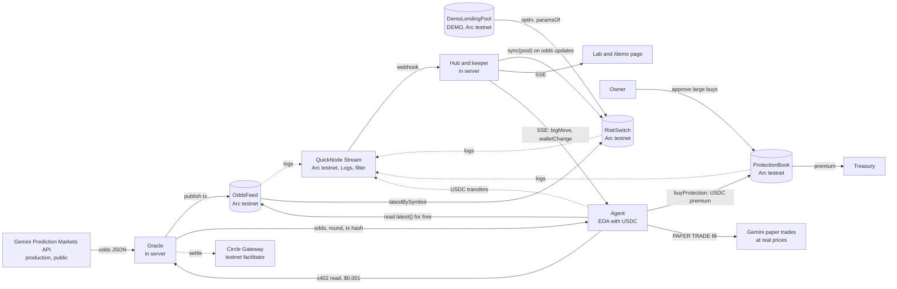

# Hedgehog — plan

> **A probability oracle that lets AI agents insure themselves.**
> UBC 2026 (University Blockchain Conference). "Hedgehog" is a working name; rename any time.
>
> Status: Phases 1 to 4 are built (Nov 16). Replanned in unit 0.5 (Nov 16): Phase 5 live wiring, Phase 6 DeFi risk switch, Phase 7 demo website, Phase 8 guardrails, Phase 9 submission.
> Deadline: **Fri Nov 20, 12:00 pm CST = 10:00 am Pacific.** Target: submitted by 9:00 am CST (7:00 am Pacific).

---

## 0. Research findings (checked Nov 15, 2026)

Items marked ⚠ could block us. Items marked *unverified* get proven in a Day 1 unit.

### 0.1 Gemini Prediction Markets API

- **Market data is public, no key.** `GET https://api.gemini.com/v1/prediction-markets/events?status=active&category=…&limit=…` lists events. `GET /v1/prediction-markets/events/{eventTicker}` returns one event. There are also endpoints for strike price, categories, newly listed, recently settled and upcoming events. Volume: `GET /v1/prediction-markets/volume/{date}` and `/hourly`.
- Each contract has an `instrumentSymbol` (example `GEMI-FEDJAN26-DN25`). Always take it from the API. Never build it from the title.
- Contracts carry a `priceHistory` array, which gives us history without a separate candles call. Order book: the existing book API with the `instrumentSymbol`. Live prices and depth come over `wss://ws.gemini.com`.
- **Prices** run from $0.01 to $0.99 per contract and approximate the probability. A winning contract pays $1 and a losing one pays $0.
- **Trading.** REST `POST /v1/prediction-markets/order` takes symbol, `orderType: limit`, side, quantity, price and outcome. Related endpoints: `/order/batch`, `/orders/active`, `/orders/history`, `/positions`. WebSocket `order.place` also works.
  - The Prediction Markets terms must be accepted first (`GET /v1/prediction-markets/terms/status`, `POST /v1/prediction-markets/terms/accept`). Otherwise orders fail with `TERMS_NOT_ACCEPTED`.
  - Auth is HMAC-SHA384, with the payload in `X-GEMINI-PAYLOAD` and an empty body.
  - The API key must be scoped to the trading account, have the Trading permission and use a time-based nonce.
  - The official TypeScript SDK `@gemini-markets/sdk` handles signing and supports `env: "sandbox"`.
  - **Confirmed in unit 3.3 (Nov 16), and what differs:** we use signed REST, not the SDK (a master key needs `account` on every prediction-market call, which the SDK can't send). Terms status is a signed `GET`; orders, positions and order lists are signed `POST`s. The nonce is the time in seconds. Order IDs are 18-digit integers and must be kept as strings. `clientOrderId` is accepted and echoed although the reference omits it from the request. There is no get-one-order endpoint. The sandbox lists 97 events (crypto and commodities, no Economics), with strikes that differ from production.
- **Sandbox** (Gemini also calls it the demo environment): `exchange.sandbox.gemini.com`, `api.sandbox.gemini.com`, `wss://ws.sandbox.gemini.com`.
  - It needs a separate account and runs on test funds, with bots simulating order books. For 2FA, set the cookie `GEMINI-SANDBOX-2FA=true` and enter `9999999`.
  - The Prediction Markets docs say auth, endpoints and messages are identical to production. Gemini also says to confirm each product is supported there.
  - *Unverified:* which prediction markets exist in sandbox. Unit 3.3 proves this on Day 1.
- ⚠ **Eligibility (production).** US users only, 18+, KYC. Third-party reviews disagree on state coverage (all 50 vs 42–44 states). We trade in production only if you already have a verified US account.
- **Rate limits.** Public endpoints allow 120 requests/min (1 per second recommended). Private endpoints allow 600/min (5 per second recommended). We stay far below both.
- **Categories** seen in the docs: politics, crypto (including BTC 5-minute up/down), sports, economics (Fed decisions), commodities, weather.
- ⚠ **Republishing terms.** The Market Data Agreement allows personal, internal and informational use. It prohibits using the data to create or price financial products, to build benchmarks or indexes, or to sell or license it. Redistribution needs a separate agreement (marketdata@gemini.com or bizdev@gemini.com), with attribution "Data provided by Gemini". An onchain feed sold per read is redistribution.
  - → Ask the Gemini bounty team to OK it for the hackathon (testnet only, attributed). This doesn't block Phase 1.
- **Demo market context.** The live story is the Dec 8–9 FOMC decision. Polymarket priced a 25 bp hike at about 85% on Nov 11, so "hike odds climbing" is real but mostly priced in already.
  - The scripted demo replays the real climb from `priceHistory` (Unit 7.3).
  - The live market is probably the Jan 2027 meeting or a BTC price threshold. Unit 2.1 confirms what Gemini actually lists.

### 0.2 Arc testnet

| Item | Value |
|---|---|
| Chain ID | `5042002` (mainnet `5042` has been live since Sep 16, 2026; we stay on testnet) |
| RPC | `https://rpc.testnet.arc.io`, wss same host. Older docs use `rpc.testnet.arc.network`. Alternatives: QuickNode `rpc.quicknode.testnet.arc.io`, Blockdaemon, dRPC |
| Explorer | `https://explorer.testnet.arc.io` (Blockscout). Older docs: `testnet.arcscan.app` |
| Faucet | `https://faucet.circle.com` → Arc Testnet → USDC. Guides report 10–20 USDC per request |
| USDC | ERC-20 interface at `0x3600000000000000000000000000000000000000` with **6 decimals**. Native gas is USDC with **18 decimals**. They are **one balance** |
| Blocks | About 0.5 s, deterministic finality, no reorgs. `block.timestamp` can repeat, so order by block number. `PREVRANDAO` is always 0 |
| Gas | Minimum base fee 20 gwei, about 0.00042 USDC for a plain transfer. An oracle publish is roughly 0.001–0.002 USDC |
| Tooling | viem ships `arcTestnet`. The standard Foundry deploy flow works (per Arc's tutorial). Arc docs recommend **Arc Foundry** (`arc-forge`, `arc-cast`, `arc-anvil`) because stock anvil can't mimic Arc. We test against the real testnet instead of a local fork |

**Circle tools on Arc testnet today:**

- **Agent Wallets**: Circle CLI, Arc testnet supported. ⚠ Spending policies are mainnet-only; testnet chains are rejected.
- **Nanopayments** through Gateway: a hosted testnet facilitator is available. The buyer must be an EOA, not a smart-contract account.
- **Facilitator Service**: a keyless trial runs on Arc testnet.
- **Contracts** and dev-controlled wallets are also available.
- **Paymaster** isn't needed, since gas is already USDC.

### 0.3 x402 on Arc

There are two working Circle options on Arc testnet:

- **A. Gateway Nanopayments (batched)**: our choice.
  - Seller: `createGatewayMiddleware({ sellerAddress, facilitatorUrl: "https://gateway-api-testnet.circle.com" })`, then `gateway.require("$0.001")` on a route.
  - Buyer: `new GatewayClient({ chain: "arcTestnet", privateKey }).pay(url)`.
  - Packages: `@circle-fin/x402-batching`, `@x402/core`, `@x402/evm`, `viem`.
  - The buyer needs a Gateway balance, which takes one deposit. Circle's reference app (`circlefin/arc-nanopayments`) lists no Circle API key.
  - Payments are signed offchain authorizations that Gateway settles onchain in batches.
- **B. Facilitator Service (exact scheme, EIP-3009)**: fallback.
  - One onchain transfer per payment. A keyless trial works on Arc testnet; production needs a Circle API key.
  - Every call needs a fresh `Facilitator-Seller-Proof` EIP-712 header, which means more code.
- **Why A:** it is the least code, and it is the exact "x402 + Nanopayments" pairing the main track recommends.
- **Tradeoff:** single reads don't show up as separate onchain transfers. The Stream sees Gateway deposits and settlements, and the payments ledger comes from settle responses. If A blocks us, B makes every read visible onchain at the cost of per-call signing.
- **Confirmed in unit 3.1 (Nov 16), and what differs from the notes above:**
  - Package versions: `@circle-fin/x402-batching` 4.0.0, `@x402/core` and `@x402/evm` 2.31.0. Imports come from `@circle-fin/x402-batching/server` and `/client`.
  - The middleware accepts every Gateway network unless `networks` is set; we set `"eip155:5042002"`.
  - The 402 response offers two options, `GatewayWalletBatched` versions 1 and 2, both against the Gateway Wallet contract `0x0077777d7eba4688bdef3e311b846f25870a19b9`. The price $0.001 is `amount: "1000"` (6 decimals).
  - The deposit is two transactions (approve, then deposit), and the balance shows up in Gateway within seconds.
  - "Settle" in the middleware means Gateway accepted the authorization. The onchain batch comes later; the per-payment status is readable with `GatewayClient.getTransferById(id)`.
  - Balances: `GatewayClient.getBalances()` for the wallet and Gateway balance, and `getBalance(address)` for anyone's Gateway balance, including the seller's.
- **Avoid:** the public `x402.org` facilitator and older x402 npm releases. One sample had to patch x402 v1.1.0 to add Arc.

### 0.4 QuickNode Streams

- **Arc Testnet is supported** for every EVM dataset (Block, Block with Receipts, Transactions, Logs, Receipts, traces). Validator Activity is the one exception.
- **Filter:** a JavaScript `function main(stream)`. Return data to deliver it, or `null` to skip the block.
- **Setup:** a Stream can be created in the dashboard or through the Streams REST API (`api.quicknode.com`, header `x-api-key`, filter sent as base64).
- **Destinations:** webhook and others; one stream can have several.
- ⚠ **Billing.** Credits are charged per block *processed*, and filters don't reduce them.
  - Arc makes about 2 blocks per second, roughly 173k blocks a day.
  - The free trial gives 10M credits for one month.
  - Ethereum blocks cost 20 credits each. At that rate, nonstop streaming uses about 3.5M credits a day, so the free trial lasts about 3 days. Arc's own rate isn't published; check the calculator.
  - Our answer: scripts create the stream at the latest block and delete it when idle. Also ask QuickNode for hackathon credits, or use the Build plan ($49, 80M credits).
- The webhook needs a public HTTPS URL. During development we use a cloudflared quick tunnel (no account needed).

### 0.5 The agent's decision

- **Rules decide. An LLM, if we use one, only proposes the threat map**: one call, cached, reviewed by you.
  - Rules are deterministic, testable, cheap and easy to document for the "decision loop" requirement.
- **Threat map:** each holding maps to (market, the outcome that hurts us, shock %). Illustrative example: ETH → "Fed hikes 25 bp in December", YES hurts, −12%.
- **Harm probability:** the feed carries YES only. `p` = YES when the market's `harmfulOutcome` is `"YES"`, and 1 − YES when it is `"NO"`.
- **Trigger:** buy when the probability `p` of the harmful outcome is at least `trigger` (default 0.50).
- **Sizing:**
  - `loss_if_event = exposure × shock`
  - `contracts = ceil(hedgeRatio × loss_if_event / $1) − already_held`
  - `premium ≈ contracts × the ask of the harmful side (YES ask, or NO ask)`
  - Example sized to faucet amounts: $60 exposure × 12% = $7.20 at risk → 8 contracts × $0.65 ≈ $5.20 premium.

### 0.6 The oracle contract

- `OddsFeed` keeps the latest `{probBps, observedAt, publishedAt, sourceHash, round}` for each market.
- `latest(marketId)` is a view function any contract can read for free.
- `marketId` = `keccak256(symbol)`, where the symbol is Gemini's `instrumentSymbol` (or a `test:` / `replay:` name). `latestBySymbol(symbol)` reads by name.
- Event: `OddsUpdated(marketId indexed, symbol, probBps, prevProbBps, observedAt, sourceHash, round, publisher indexed)`. Emitting `prevProbBps` lets the Stream filter spot big moves without keeping state.
- `sourceHash = keccak256` of the exact Gemini JSON snapshot used. Phase 8 stores the snapshots so anyone can recompute the hash.

### 0.7 Re-check (Mon Nov 16, 00:45 PST, from the build machine: WSL2 on the user's PC)

| Check | Result |
|---|---|
| `node --version` | `v22.23.1` (npm `10.9.8`) ✅ |
| `forge --version` | `1.8.3`; `cast` is installed too ✅ |
| `cloudflared` | installed ✅ (`jq` and `ngrok` are not; not needed) |
| Gemini `events?status=active&limit=3` | HTTP 200, no key ✅. 959 active events in total |
| `eth_chainId` on `rpc.testnet.arc.io` | `0x4cef52` = 5042002 ✅ |
| `eth_chainId` on `rpc.testnet.arc.network` | `0x4cef52` = 5042002 ✅ (the older host still answers) |

What the Gemini response showed, and what it changes:

- **The response is huge:** 1.3 MB for 3 events. Events nest sub-events (26 under one NFL game) and every contract carries a long rules text. → 2.1 filters by category, keeps `limit` small and prints only chosen fields.
- **Shape:** `{ data: [event], pagination: { limit, offset, total } }`. Prices sit at `contract.prices` as strings: `bestBid`, `bestAsk`, `lastTradePrice`, plus `buy.yes/no` and `sell.yes/no`.
- **`lastTradePrice` can be missing** (seen on player-prop contracts). The "mid, else last trade" rule in 2.3 needs a third case: no publish.
- ⚠ **No `priceHistory` in the list response.** §0.1 said contracts carry it. **Resolved in 2.1:** the single-event endpoint has none either, but `GET /v2/candles/<instrumentSymbol>/<1hr|1day>` returns real history, so 7.3 replays that.
- `quantityMinimum` varies by market (`0.01` or `1`). We size in whole contracts, so no change.
- The first page is all sports. Category values are capitalized (`"Sports"`); 2.1 confirms the filter values for economics and crypto.

---

### 0.8 Hackathon rules (from the organizers' guide, read Nov 16)

- **Submit on Devpost:** `ubc-hackathon-2026.devpost.com`. Deadline Friday Nov 20, 12:00 pm CST. Select one main track, one chain award (Solana, Arc or None) and every bounty, and opt in to the matching prizes.
- **Exactly one main track.** Bounties are optional and unlimited. One chain award at most: Best use of Solana **or** Best use of Arc, never both. All prizes stack except those two.

| Prize | Award | Who is eligible |
|---|---|---|
| Official UBC 2026 Hackathon Winner | 1st $2,500 plus 3 months of ElevenLabs Pro per member, 2nd $1,000, 3rd $500 | every submission, automatically |
| Track Winner | $2,000 per track (3 tracks) | every team, in the track it chose |
| Best use of Solana | $1,500 per track | Solana projects that select it |
| Best use of Arc | $1,000 per track | Arc projects that select it |
| Gemini Prediction Markets bounty | 1st $2,500, 2nd $1,000, 3rd $500 | teams that opt in |
| QuickNode Streams bounty | $500 | teams that opt in |
| ElevenLabs bounty | 3 months of ElevenLabs Scale per member | teams that opt in |
| Grok Bot bounty | mechanical keyboard per member plus swag | teams that opt in |
| Participation | 1 month ElevenLabs Creator, a $49/mo QuickNode plan, X Premium | complete, working submissions, at the judges' discretion |

- **Finalists:** up to 13 teams pitch in person on Saturday Nov 21: 3 from each main track (the top contender for Track Winner, Best use of Solana and Best use of Arc), the top 3 contenders for the overall winner, and the 1st place Gemini bounty team. Finalists are notified by Friday Nov 20, 11:59 pm CST. Each pitch is 5 minutes plus 2 minutes of Q&A.
- **In person on Nov 21:** teams must be present at the closing ceremony to qualify for any prize, including track and bounty prizes.
- **Our track, Agentic Payments and AI, requires:** agents that execute onchain transactions or read the blockchain (testnet is fine), and documentation of the agent's decision loop and the safety limits. It recommends x402 and Circle Nanopayments, per-request payments, budgets, allowlists and human approval for large transactions.
- **Best use of Arc requires:** core onchain functionality on Arc (testnet is fine), the contract addresses in the README, and a README explanation of how the project uses Arc.
- **Gemini bounty requires:** use of the Gemini Prediction Markets API (market data and/or trading endpoints).
- **QuickNode bounty requires:** Streams as a core data source, at least one Stream with a filter and a destination, and a README explanation of the Stream's network, dataset, filter logic and destination, and why.
- **What to submit:** project name, description and team; track, chain award and bounties; written answers (what did you build, what problem, how it works, what makes it unique, what next); technologies used; a public GitHub repo with source and setup instructions; a working demo or deployed app; a 2 to 3 minute demo video on Google Drive or YouTube; a README with technical documentation and an architecture overview.
- **Other rules:** projects must be substantially built during the hackathon. AI tools are allowed. Judging looks at technical execution, product and UX, innovation, impact and the demo.

## 1. Decisions

| Topic | Decision | Why |
|---|---|---|
| Chain | Arc testnet. RPC: your QuickNode Arc endpoint first, Circle's public RPC as fallback | Track requirement, USDC gas |
| Stay on Arc | We stay on Arc testnet and do not move to Solana (user's decision, Nov 16, after unit 0.4) | `docs/solana-option.md`: a switch costs 14 to 20 extra hours for $500 more upside, and Circle Nanopayments does not run on Solana |
| Languages | TypeScript on Node 22 (`tsx`, `viem`) for services. Solidity with Foundry for contracts | As requested |
| Paid reads | Circle Gateway Nanopayments over x402 (fallback: Circle Facilitator Service) | §0.3 |
| Agent wallet | Plain EOA key in `.env`, not a Circle Agent Wallet | Agent Wallets need CLI login with an email code; their policies are mainnet-only; the Gateway buyer must be an EOA. The guardrails live in our own contract |
| Odds | Gemini **production** public API (real data) | Real data needs no account |
| Trading | `PAPER TRADE` at the real production price; the agent doesn't use the sandbox. The sandbox order API was proven in unit 3.3 and stays available through `npm run gemini:order` | User's decision, Nov 16: real Gemini odds always. §0.1 |
| Holdings | A `DECLARED HOLDING` portfolio valued at live Gemini spot prices. The agent's USDC, payments and premiums are real testnet USDC | Testnet has no real ETH or BTC exposure |
| Harmful outcome | Each market in `config/markets.json` says which outcome hurts: `"YES"` or `"NO"`. BTC threshold contracts are "$X or above", so the harm for a BTC holder is **NO**; for the Fed hike contract it is YES. The oracle stays neutral and publishes YES only. The agent (units 4.1 and 4.2) computes harm = YES, or 1 − YES, and buys that side on Gemini | Gemini lists no "BTC below X" contracts, and one neutral feed serves any reader |
| Premium flow | The agent pays the USDC premium onchain through `ProtectionBook` to a treasury address that stands in for funding the Gemini account. The Gemini order is the hedge itself | Keeps the money onchain and the guardrail enforceable |
| Oracle mode | Push and pull. A timer publishes every 5 min, which saves faucet USDC. A paid read also refreshes and publishes | The feed stays free to read onchain; the fee pays for freshness (fetch plus publish gas) |
| Demo | Everything real except the odds path in the 3-minute scenario, which replays real Gemini hourly candles (the `replay` entry in `config/markets.json`) under a separate `replay:` market ID, labeled `REPLAY` on screen | Real markets won't move on cue |
| Processes | 2 Node processes, no dev server. **server** runs the Lab page and its `/api` routes, the publisher, the x402 endpoint and SSE on port 8787, and the Stream webhook alone on port 8788. **agent** is the second | Few moving parts. Only 8788 is ever tunneled |
| Dashboard | Two plain pages served by the server, no framework, no build step, Chart.js from one CDN script tag. The Lab (`lab/index.html`) grows a panel per unit and stays as the behind-the-scenes view. The demo website (`demo/index.html`, at `/demo`, Phase 7) is the clean page for judges | You see and click each piece as it's built; judges see one story |
| Access control | `publish()` is open to any sender in Phase 2 (no allowlists yet, per the rules). Phase 8 limits it to the oracle address | Working rule 4 |
| Wallets | **Two keys only**, both generated in 1.1 and funded in one faucet visit. `DEPLOYER_KEY` is the deployer, oracle publisher, x402 seller, book owner and treasury. `AGENT_KEY` is the agent | 3.1 needs the agent key on Day 1, before 4.2. Fewer keys means fewer faucet trips |
| Deploys | One TypeScript script, `npm run deploy -- <Contract>` (runs `forge build --root contracts` first). It loads the artifact, deploys with viem and merges `{address, txHash, block, deployedAt}` into `deployments/arc-testnet.json`. Then verify on the explorer with the command in unit 1.2 | The key comes from `.env` like everywhere else, the address is recorded automatically, and there is no `.s.sol` file per contract |
| ABIs | Read at run time from Foundry's build output by `loadArtifact(name)` in `src/shared/artifacts.ts`. No hand-written ABIs anywhere. `addressOf(name)` in the same file reads `deployments/arc-testnet.json` | One source of truth, so an ABI can't drift from the contract. `npm run deploy` runs `forge build` first; a clean clone still typechecks without it |
| Logs | `logs/*.jsonl`, gitignored, appended with `fs.appendFileSync`. Each file is created by the first unit that writes it: `oracle` (2.3), `payments` (3.1), `stream` (3.2), `agent` and `paper` (4.2) | No logging library |
| BTC market | The agent watches and trades one contract: `GEMI-BTC2611302200-HI67500` (BTC $67,500 or above on Nov 30), harmful outcome NO. It replaced `-HI65000` in `config/markets.json` in unit 4.1 | It is a real production market and our replay source |
| Fed market | `GEMI-FED261211-HIKE25` (harmful outcome YES) is a threat like BTC: the oracle publishes it and the agent buys protection as a `PAPER TRADE` | With paper trades there is no need for a sandbox market |
| Track and prizes | Main track Agentic Payments and AI; chain award Best use of Arc; bounties Gemini Prediction Markets and QuickNode Streams | User's decision, Nov 16. See §0.8 |
| Hackathon guide | The organizers' PDF stays out of the repo (`docs/*.pdf` is gitignored). §0.8 carries no Telegram or Discord invite links | The repo is public |
| Two consumers | Keep the agent-insurance product, and add a second consumer of the oracle: a "risk switch" that DeFi protocols opt into, which changes their risk parameters automatically when prediction-market odds cross levels they set (Phase 6) | User's decision, Nov 16 (unit 0.5). One oracle, two uses |
| Demo pool | The lending pool is our own contract on Arc, labeled `DEMO`, with no real deposits | Existing Arc protocols can't read our oracle |
| Build order | The demo website (Phase 7) is built before the guardrails (Phase 8) | User's decision, Nov 16: the demo is playtested Wednesday evening |
| LLM threat map | Cut from the units (was 4.3) to "Later ideas" in §5, next to the Solana port | A static `threats.json` works |
| Markets | BTC (`GEMI-BTC2611302200-HI67500`, harmful NO) and Fed (`GEMI-FED261211-HIKE25`, harmful YES) stay | Confirmed in unit 0.5 |
| Max price | The agent refuses protection priced above $0.85 per $1 payout (built in 8.1 with the budget) | Paying more than $0.85 to insure $1 is not worth it |
| Tests | `forge test` for contracts. `npm test` = `tsx --test` (Node's built-in runner), added in 2.1 | No test dependency |

---

## 2. Design

### 2.1 Components

- **Oracle** (in `server`): fetches Gemini odds and publishes them to `OddsFeed`. It serves `GET /odds/:symbol` behind x402.
- **OddsFeed** (Arc): the latest odds for each market, readable by any contract.
- **Agent**: holds testnet USDC. It values its declared holdings, pays per read for odds, decides, and buys protection: USDC premium onchain plus a Gemini order. It re-checks on a slow timer and whenever the Stream signals.
- **ProtectionBook** (Arc): the agent's checkbook for premiums. Phase 8 adds the daily budget, the max price and owner approval.
- **QuickNode Stream**: Arc testnet, Logs dataset, filter for our contracts and the agent's USDC transfers. It sends to the `server` webhook.
- **Server hub**: receives Stream webhooks and fans them out over SSE to the dashboard and the agent.
- **RiskSwitch** (Arc, Phase 6): the oracle's second consumer. A DeFi protocol opts in with its own levels; `sync` turns the latest odds into that protocol's current risk level and limits.
- **DemoLendingPool** (Arc, Phase 6, `DEMO`): our own pool, with no real deposits, that opts into the RiskSwitch. Its borrowing limit steps down as the harm probability rises. Existing Arc protocols can't read our oracle, so we show the pattern with our own.
- **Keeper** (in `server`): when the Stream delivers an odds update for the pool's market, it calls `RiskSwitch.sync(pool)`.
- **Lab and demo website**: the Lab is the behind-the-scenes view, a panel per unit. The `/demo` page tells the story for judges: odds, the agent's insurance, the pool's limit, a timeline and the payments ledger, all live.

### 2.2 Diagram



### 2.3 How data and money flow

1. **Data:** Gemini → oracle → `OddsFeed` on Arc. From there three paths read it:
   - any contract, through `latest()`, for free;
   - the agent, through a paid x402 read, which also refreshes the feed;
   - the Stream, which forwards the logs to the hub, then the pages and the agent;
   - the RiskSwitch, which reads `latestBySymbol` inside `sync` and sets the demo pool's limits.
2. **Money:**
   - **Reads:** the agent deposits USDC into Gateway once. Each read is a $0.001 nanopayment to the oracle's seller address, settled on Arc in batches.
   - **Protection:** the agent calls `ProtectionBook.buyProtection`, which moves the USDC premium to the treasury. The agent then places the Gemini YES order. Each contract pays $1 if the harmful event happens.
   - **Gas:** the oracle pays publish gas in USDC on Arc, funded in spirit by read fees.
3. **Signals:** a big odds move (≥ 5 points) or a USDC transfer touching the agent's wallet arrives through the Stream and triggers a fresh agent check. Any odds update for the pool's market triggers `RiskSwitch.sync(pool)`.

### 2.4 Repo layout (target; each unit creates only its own files)

```
hedgehog/
  PLAN.md  CLAUDE.md  README.md  LOG.md  LESSONS.md
  .env.example  .gitignore  package.json  tsconfig.json
  contracts/                   Foundry project (foundry.toml; no deploy scripts)
    src/  Hello.sol  OddsFeed.sol  ProtectionBook.sol  RiskSwitch.sol  DemoLendingPool.sol
    test/ OddsFeed.t.sol  ProtectionBook.t.sol  RiskSwitch.t.sol  DemoLendingPool.t.sol
  deployments/arc-testnet.json  contract addresses (committed)
  config/markets.json           markets the oracle publishes
  src/
    shared/  chain.ts  artifacts.ts
    oracle/  gemini.ts  odds.ts  publisher.ts
    server/  index.ts           8787: Lab page, /demo page, /api routes, x402 /odds, /events SSE · 8788: /stream webhook (also calls RiskSwitch.sync)
    agent/   portfolio.json  threats.json  policy.ts  policy.test.ts  inputs.ts  paper.ts  trade.ts  agent.ts
    stream/  filter.js
  scripts/   new-keys, check-arc, deploy, hello, markets, oracle, feed, gemini-order, agent-dry, agent,
             gateway-deposit, pay-read, stream-up, stream-down, approve, demo
  lab/       index.html         the Lab: the behind-the-scenes view, a panel per unit
  demo/      index.html         the demo website at /demo (Phase 7)
  logs/      *.jsonl (gitignored)
```

---

## 3. Phases and units

Every unit ends the same way: it runs end to end, `npm run typecheck` passes, `LOG.md` is up to date, you get a short report plus the git commands (you commit and push), and I wait for your go. Time estimates are my build time; they leave out your account setup and review time.

**See it.** Every unit has a "See it" line after "Done when": what you open or run, what you click, and what you should see.

**The Lab.** Unit 1.3 starts a small local page at `http://localhost:8787/lab` (at `/` until unit 7.4), served by `src/server/index.ts`. It is a dev tool for seeing and playing with each piece, not the final product. Rules:

- Every unit after 1.3 that produces something new adds one small panel to `lab/index.html` and the matching `/api` route to the server.
- Panels stay plain: a table or a list, plus at most one button or slider.
- The first chart arrives in 2.3, through one CDN script tag for Chart.js. Never add npm frontend dependencies.
- The Lab stays the behind-the-scenes view. Phase 7 adds one more plain page, `/demo`, for judges. No framework and no build step for either.

### Phase 1: Skeleton (detailed plan)

- [x] **1.1 Repo and environment** (45 min) — done Nov 16

- **Goal:** a fresh repo that typechecks, holds two funded keys and talks to Arc testnet.
- **Files (7, plus the generated `package-lock.json`):**

  | File | Contents |
  |---|---|
  | `.gitignore` | `.env`, `node_modules/`, `logs/`, `contracts/out/`, `contracts/cache/`, `contracts/broadcast/`, `*:Zone.Identifier` |
  | `package.json` | `"type": "module"`, `"private": true`. Scripts: `typecheck` = `tsc --noEmit`, `new-keys` = `tsx scripts/new-keys.ts`, `check:arc` = `tsx scripts/check-arc.ts` |
  | `tsconfig.json` | `strict`, `noEmit`, `target` `ES2022`, `module` and `moduleResolution` `NodeNext`, `types: ["node"]` (TypeScript 7 needs it), `include` `["src", "scripts"]` |
  | `.env.example` | `ARC_RPC_URL=https://rpc.testnet.arc.io`, `DEPLOYER_KEY=`, `AGENT_KEY=`. Placeholders only; later units add their own variables |
  | `src/shared/chain.ts` | Loads `.env` (`import "dotenv/config"`). Exports `publicClient` (viem `arcTestnet`, `http(ARC_RPC_URL)`), `account("DEPLOYER_KEY" \| "AGENT_KEY")` (throws a one-line error if the key is empty), `USDC` and `EXPLORER`. The only shared file for now |
  | `scripts/new-keys.ts` | Copies `.env.example` to `.env` if `.env` is missing. For `DEPLOYER_KEY` and `AGENT_KEY`: only if the value is empty, generates a key and writes it into `.env`. Prints the two labeled addresses with explorer links, never a key. Never replaces an existing key, because that would strand its funds |
  | `scripts/check-arc.ts` | Prints the chain ID and the latest block number, then a table with each address's label, USDC balance (ERC-20 `balanceOf`, 6 decimals), native balance (`getBalance`, 18 decimals) and explorer link. The two balances should match |

- **Steps, in this order:**
  1. Write `.gitignore`. Run `git check-ignore .env` and see `.env` printed **before anything else exists**.
  2. Write `package.json` and `tsconfig.json`. Run `npm install viem dotenv` and `npm install -D typescript tsx @types/node`. No other dependencies.
  3. Write `.env.example`, `chain.ts`, `new-keys.ts` and `check-arc.ts`.
  4. `npm run new-keys` → two addresses.
  5. `BLOCKED:` you fund both addresses at the faucet (see below).
  6. `npm run check:arc`, the checks below, then the report and the git commands.
- **Done when** (each line is a command I run and paste the output of):
  - `git check-ignore .env` prints `.env`.
  - `npm run typecheck` exits 0.
  - `npm run new-keys` prints two addresses and no key. A second run prints the same two addresses.
  - `npm run check:arc` prints chain `5042002`, a block number that is higher on a second run, and two balances > 0, with USDC and native matching.
  - `git status --short` lists no `.env`, and `git grep -nE "0x[0-9a-fA-F]{64}"` finds nothing.
- **See it:** in the terminal, `npm run check:arc` shows chain 5042002, the latest block and both balances. In the browser, open both addresses at `https://explorer.testnet.arc.io/address/<address>` and see the faucet transfer.
- **Needs from you:**
  - **Faucet:** `https://faucet.circle.com` → Arc Testnet → USDC, one request for each of the two printed addresses. This covers gas, the Gateway deposit (3.1) and the premiums (4.2).
  - **Optional:** put your QuickNode Arc testnet endpoint URL in `.env` as `ARC_RPC_URL`. The public RPC works until you do; the QuickNode account is needed by 3.2 anyway.

- [x] **1.2 Hello contract on Arc** (45 min) — done Nov 16

- **Goal:** prove the build, deploy, write and read path on Arc, and set the deploy and ABI pattern every later contract reuses.
- **New files (6):**

  | File | Contents |
  |---|---|
  | `contracts/foundry.toml` | `src = "src"`, `out = "out"`, `solc_version = "0.8.28"`, default EVM version. Written by hand: no `forge init`, so no sample files and no `forge-std` until 2.2 needs it for tests |
  | `contracts/src/Hello.sol` | `string public message`, `event Ping(address indexed from, string message)`, `function ping(string calldata m)` that stores and emits. No owner, no access control |
  | `scripts/deploy.ts` | `npm run deploy -- <Name>`. Loads the artifact, deploys with `walletClient("DEPLOYER_KEY").deployContract` (no constructor arguments yet), waits for the receipt, merges `{address, txHash, block, deployedAt}` under `<Name>` into `deployments/arc-testnet.json`, and prints the address with its address and tx explorer links |
  | `src/shared/artifacts.ts` | `loadArtifact(name)` returns `{ abi, bytecode }` from `contracts/out/<name>.sol/<name>.json`. `addressOf(name)` returns the address from `deployments/arc-testnet.json`, or throws `deploy <name> first: npm run deploy -- <name>` |
  | `deployments/arc-testnet.json` | Written by `deploy.ts`, committed |
  | `scripts/hello.ts` | `npm run hello -- <text>`. Sends `ping(text)` to `addressOf("Hello")` as the deployer, waits for the receipt, reads `message()`, prints the tx link and `message = <value>` |

- **Edited files:** `src/shared/chain.ts` (adds `walletClient(name)`), `package.json` (scripts `deploy` = `forge build --root contracts && tsx scripts/deploy.ts` and `hello` = `tsx scripts/hello.ts`), `CLAUDE.md` (Commands list).
- **Steps:**
  1. Write `foundry.toml` and `Hello.sol`. Run `forge build --root contracts`.
  2. Write `artifacts.ts`, `deploy.ts`, `hello.ts`. Run `npm run deploy -- Hello`.
  3. Run `npm run hello -- gm`.
  4. Verify the contract on the explorer (command below).
- **Verify command (worked Nov 16; reuse it for every later contract):**

  ```
  forge verify-contract --root contracts <address> src/<Name>.sol:<Name> --chain-id 5042002 --verifier blockscout --verifier-url https://explorer.testnet.arc.io/api/ --watch
  ```

  It is Arc's documented command with stock `forge` in place of `arc-forge`. A contract with constructor arguments also needs `--constructor-args $(cast abi-encode "constructor(...)" ...)`.
- **Done when:**
  - `forge build --root contracts` compiles with no errors.
  - `npm run deploy -- Hello` prints an address, and `deployments/arc-testnet.json` contains it.
  - The explorer reports the contract as verified.
  - `npm run hello -- gm` prints a tx hash and `message = gm`. A second run with another word reads that word back.
  - `npm run typecheck` exits 0.
  - You open the printed explorer link and see the `ping` transaction (a glance, not a blocker).
- **See it:** the explorer shows the Hello contract, the `ping` tx, and its `Ping` event in the Logs tab.
- **Needs from you:** nothing new. The deployer was funded in 1.1.
- **Settled here:** Foundry's default EVM version (the explorer reports `prague`) deploys and runs on Arc with no `evm_version` setting. Deploy plus one ping cost about 0.011 USDC of gas.
- **Deployed:** Hello at `0xc06b4ee36f838bb1f6ca95caa25ed9d6f2d45e67`, verified.

- [x] **1.3 Lab v1** (1 h) — done Nov 16

- **Goal:** a local page where you see the chain state and send a transaction with a click. Every later unit adds its panel here.
- **Files:** `src/server/index.ts`, `lab/index.html`.
- **Edited files:** `package.json` (script `"lab": "tsx src/server/index.ts"`; dependencies `express` and `@types/express`), `.env.example` (`PORT=8787`), `CLAUDE.md` (Commands list). `chain.ts` and `scripts/hello.ts` are untouched.
- **Server:** one Express app on `PORT` from `.env` (default 8787), bound to `127.0.0.1` only, so it is reachable from this machine and nothing else. It prints `Lab running at http://localhost:8787`. This is the same server that later gets `/odds` (3.1) and the Stream webhook (3.2). Exactly three routes:
  - `GET /` serves `lab/index.html`.
  - `GET /api/status` returns `{ chainId, block, wallets: [{ label, address, usdc, explorerUrl }], contracts: [{ name, address, block, explorerUrl, txUrl }], hello: { message }, explorer }`. `usdc` is a 6-decimal string from ERC-20 `balanceOf`; `contracts` has one row per entry in `deployments/arc-testnet.json`; `hello.message` is read live from the contract.
  - `POST /api/ping` with `{ text }` sends `Hello.ping(text)` as the deployer, waits for the receipt, reads `message()` back, and returns `{ txHash, txUrl, message, block }`. On error it returns status 500 with `{ error }`.
- **Page:** one file with inline CSS and JS; no framework, no build step, no CDN scripts in this unit. A header (chain ID, latest block, "updated <time>"), a Wallets table, a Contracts table and a Hello panel (current message, a text input and a Ping button that shows "sending…", then the tx link and new message, or the error in red). It polls `/api/status` every 3 seconds, shows "server unreachable" in the header when a poll fails, and keeps polling. Monospace for numbers, addresses and hashes.
- **Done when:** with `npm run lab` running, `curl localhost:8787/api/status` returns the JSON above; a `curl -X POST localhost:8787/api/ping` with `{"text":"hello lab"}` returns a tx hash; a second status call shows `hello.message` = `hello lab` and a slightly lower deployer balance; and `npm run typecheck` exits 0.
- **See it:** run `npm run lab` and open `http://localhost:8787/lab`. The block number ticks, the balances match the explorer, and typing text then clicking Ping shows a tx link and the message read back from the chain.

### Phase 2: Oracle, first version (no checks)

**2.1 Gemini reader and market pick** (45 min) — ✅ done Nov 16

- **Goal:** real Gemini probabilities in our code, with every step visible in the Lab (the API URL, the fields, the calculation), and the demo markets chosen.
- **Files:** `src/oracle/gemini.ts`, `src/oracle/odds.ts`, `src/oracle/odds.test.ts`, `config/markets.json` (after the pick), and edits to `src/server/index.ts`, `lab/index.html`, `package.json` (`"test": "tsx --test"`).
- **Reader (`gemini.ts`):** `getCategories()`, `getEvents({ status, category, limit, offset })`, `getEvent(ticker)` and `getCandles(symbol, "1hr" | "1day")`. Types for only the fields we use. Plain fetch, no retries, no caching, calls spaced 1 second apart. Each returns the exact URL it called.
- **Odds math (`odds.ts`), moved here from 2.3:** `probability(contract)` returns `{ prob, method, inputs }`. Bid and ask both present → their middle (`"mid"`). Otherwise a last trade → that (`"last"`). Otherwise `prob = null` (`"none"`), and nothing gets published. Three tests in `odds.test.ts`.
- **Routes:**
  - `GET /api/markets/categories` → `{ categories, apiUrl }`.
  - `GET /api/markets?category=&offset=` → `{ apiUrl, fetchedAt, total, offset, chosen, events: [{ ticker, title, expiry, volume, contracts: [{ symbol, label, yesBid, yesAsk, last, volume, prob, method }] }] }`. 50 events per call, compact rows only. `volume` is the event's; Gemini has none per contract.
  - `GET /api/markets/inspect?event=&symbol=` → `{ apiUrl, rawContract, used, result, history }`, where `history` summarizes the contract's daily candles.
- **Lab:** the visual base (CSS variables, IBM Plex Sans and Mono from one Google Fonts link) and the "Markets" panel: category dropdown, Refresh, the Source URL as a link, one group of rows per event, an Inspect box per contract, "Load more" for categories with over 50 events, and highlighted rows for the symbols in `config/markets.json`. Gemini is called only on a change or a click.
- **Findings (details in `LESSONS.md`):**
  - The events API has **no `priceHistory`** anywhere. History exists at `GET https://api.gemini.com/v2/candles/<instrumentSymbol>/<1hr|1day>`, back to the contract's first trade (Fed December: 38 daily and 911 hourly candles, from Oct 9). `GET /v1/trades/<instrumentSymbol>` also works. So 8.1 can replay real history.
  - Gemini lists **no January 2027 Fed event**. The December one (`FED261211`) has "Hike 25bps" at about 88%.
  - BTC and ETH thresholds are "$X or above" contracts, so for a holder the harmful outcome is **NO**, not YES.
- **Picked (in `config/markets.json`):**
  - Live: `GEMI-BTC2611302200-HI65000` ("BTC price on November 30: $65,000 or above", harmful outcome NO) and `GEMI-FED261211-HIKE25` ("Fed decision in December?: Hike 25bps", harmful outcome YES).
  - Replay: `GEMI-BTC2611302200-HI67500` (harmful outcome NO), hourly candles from Nov 12 to Nov 15, when YES fell from 0.88 to 0.39.
- **Done when:** with the Lab running, the three routes return live data; `npm test` passes 3 tests; `npm run typecheck` exits 0; the history finding is in `LESSONS.md` and here; `config/markets.json` is written after the pick.
- **See it:** Lab "Markets" panel: a category dropdown, live Gemini markets with YES bid/ask/last and volume, and our chosen markets highlighted. One price matches Gemini's website.

**2.2 OddsFeed contract** (1 h) — ✅ done Nov 16

- **Goal:** the onchain feed from §0.6. Anyone can read the latest probability for a market, and every update leaves an event with the previous value. No publisher loop; we publish manually to prove it.
- **Files:** `contracts/src/OddsFeed.sol`, `contracts/test/OddsFeed.t.sol`, `scripts/feed.ts`, `contracts/lib/forge-std/` (vendored), and the `feed` script in `package.json`.
- **forge-std:** installed with `forge install foundry-rs/forge-std --no-git` from `contracts/`. It lands as plain files (1.4 MB, no submodule) and is committed, so a clean clone builds with no extra step. No remapping was needed.
- **Contract:**
  - `struct Odds { uint16 probBps; uint64 observedAt; uint64 publishedAt; bytes32 sourceHash; uint32 round; }`. `probBps` is the YES probability in basis points (5150 = 51.5%).
  - `mapping(bytes32 => Odds) public odds`, keyed by `idOf(symbol)` = `keccak256(bytes(symbol))`.
  - `publish(symbol, probBps, observedAt, sourceHash)`: stores the values with `publishedAt = block.timestamp` and `round + 1`, and emits `OddsUpdated(marketId indexed, symbol, probBps, prevProbBps, observedAt, sourceHash, round, publisher indexed)`. Open to anyone in Phase 2; Phase 7 restricts it.
  - `latest(marketId)` and `latestBySymbol(symbol)` return the `Odds`. An unknown market reads as all zeros (round 0).
- **`scripts/feed.ts`:**
  - `npm run feed [symbols…]` prints a table for every symbol in `config/markets.json` plus any given: YES %, round, observedAt, publishedAt, sourceHash, or "never published".
  - `npm run feed -- publish <test:symbol> <percent>` publishes a manual value as the deployer with `sourceHash` = zero. It refuses symbols that don't start with `test:`, so a manual value can never look like real Gemini data.
- **Done when:** `forge test --root contracts` passes 4 tests. `npm run deploy -- OddsFeed` records the address and the verify command from 1.2 reports it verified. Two manual publishes (42, then 57) read back as round 2 at 57%, and the second event carries `prevProbBps` 4200. `npm run typecheck` and `npm test` pass.
- **Deployed:** OddsFeed at `0xe83a5a53dd68bf395337343cd25a0432a1acc50d`, verified.
- **See it:** the `forge test` output; the explorer shows the OddsFeed contract.

**2.3 Publisher and Oracle panel** (1 h) — ✅ done Nov 16

- **Goal:** real Gemini probabilities flow onto Arc automatically, and the Lab shows the whole connection for each market. The plain path: no checks, no smoothing, no change detection (Phase 8).
- **The oracle is neutral:** it always publishes Gemini's YES probability exactly as `probability()` in `odds.ts` computes it, for every entry under `markets` in `config/markets.json` (not `replay`). It never flips to NO and never reads `harmfulOutcome`.
- **Files:** `src/oracle/publisher.ts`, `scripts/oracle.ts`, and edits to `src/oracle/odds.ts` (`toBps`), `src/oracle/odds.test.ts` (two more cases), `src/server/index.ts`, `lab/index.html`, `.env.example` (`ORACLE_INTERVAL_S=300`), `package.json` (`oracle` script).
- **`publishOnce()`**, per market, one at a time: `getEvent` → find the contract → `probability()` → skip with "no price" if null → `toBps` → `sourceHash` = keccak256 of `JSON.stringify(rawContract)` → read the onchain value for `prev` → `OddsFeed.publish` as the deployer → wait for the receipt → append `{ ts, symbol, probBps, prevProbBps, method, bid, ask, last, sourceHash, txHash, block }` to `logs/oracle.jsonl`. It always publishes, even an unchanged value, as a heartbeat. No retries; a failed market is logged and the next one runs.
- **`scripts/oracle.ts`:** `npm run oracle -- --once` runs it once; `npm run oracle` loops every `ORACLE_INTERVAL_S` seconds (default 300). One line per market: `<symbol>  88.5%  (prev 0% → +88.5 pts)  tx <link>`.
- **Routes:**
  - `GET /api/oracle` → per market `{ symbol, label, harmfulOutcome, gemini: { prob, method, bid, ask, last, fetchedAt, apiUrl }, onchain: { probBps, round, observedAt, publishedAt, sourceHash, prevProbBps, txUrl }, gapPts, last }`.
  - `GET /api/oracle/history?symbol=` → `{ onchain: [{ time, block, probBps, prevProbBps, round, txHash, txUrl }], gemini: [{ time, prob }] }`. `onchain` is the `OddsUpdated` events read with getLogs from the feed's deploy block; `gemini` is the last 7 days of hourly candle closes.
  - `POST /api/oracle/publish` runs `publishOnce()` and returns the results with tx links.
- **getLogs limit:** the public RPC allows at most 10,000 blocks per call (about 83 minutes of Arc). The server reads in 10,000-block chunks and remembers where it stopped, so only the first history request after a start scans from the deploy block (about 17 calls per day elapsed).
- **Lab "Oracle" panel:** a "Publish now" button and a Refresh button; one card per market with Gemini now, the onchain value (round, age, tx link), the gap in points, the change on the last publish and the harmful outcome (for a NO market, "harm (NO) = 100 − YES", display only); a Chart.js chart (one CDN script tag) with Gemini's hourly closes as a line and our publishes as dots; and the publishes as a table. It refreshes every 30 seconds on its own timer, never the 3-second status timer.
- **Gas:** measured about 0.0011 USDC per publish once a market has a value (about 0.0024 for its first). Two markets every 5 minutes is about 0.6 USDC a day from the deployer's balance, so 20 USDC lasts the week. (The estimate before measuring was 0.9.)
- **Known limit of the plain path:** the oracle loop and the Lab's "Publish now" both send from the deployer key. If both fire in the same second, one transaction can fail on its nonce; it is logged and the next cycle publishes.
- **Done when:** `npm run oracle -- --once` prints a tx link for each market, `npm run feed` (built in 2.2) prints the same probabilities from the chain, `logs/oracle.jsonl` has one line per publish, the three routes return live data, and `npm test` and `npm run typecheck` pass.
- **See it:** Lab "Oracle" panel: for each market, Gemini's price next to the onchain value, the last publish time with a tx link, and a "Publish now" button. The explorer shows the `OddsUpdated` events.

### Phase 3: Prove the integrations

**3.1 Paid read over x402 on Arc** (1.25 h) — ✅ done Nov 16

- **Goal:** one real paid read on Arc testnet, using x402 with Circle Gateway Nanopayments. The agent's wallet pays $0.001 to read live odds, and the Lab shows the payment. The agent logic doesn't exist yet (Phase 4), so the Lab button pays as the agent.
- **Files:** `scripts/gateway-deposit.ts`, `scripts/pay-read.ts`, and edits to `src/server/index.ts`, `lab/index.html`, `package.json` (scripts `gateway:deposit` and `pay-read`; dependencies `@circle-fin/x402-batching`, `@x402/core`, `@x402/evm`).
- **Paid endpoint:** `GET /odds/:symbol`, outside `/api` because it is the product endpoint. An unknown symbol returns 404 before any payment is asked for. Otherwise `createGatewayMiddleware({ sellerAddress: <deployer>, facilitatorUrl: "https://gateway-api-testnet.circle.com", networks: "eip155:5042002" }).require("$0.001")` guards it. The handler fetches the market live from Gemini and returns `{ symbol, prob, probBps, method, bid, ask, observedAt, source: "Gemini (live)" }`. It does not publish onchain (that is 5.1).
- **Payments log:** each paid request appends `{ ts, symbol, amount, payer, network, transaction, probBps }` to `logs/payments.jsonl`. `transaction` is Gateway's transfer id (a UUID), not an onchain tx hash.
- **Scripts:**
  - `npm run gateway:deposit -- <usdc>` deposits from `AGENT_KEY` into Gateway with `GatewayClient.deposit()` (an approve tx and a deposit tx), and prints the wallet and Gateway balances before and after.
  - `npm run pay-read -- <symbol>` pays for one read with `GatewayClient.pay()` against `http://127.0.0.1:$PORT/odds/<symbol>` and prints the status, the body, the amount, the transfer id and the Gateway balance before and after.
- **Lab routes:** `GET /api/payments` (agent wallet and Gateway balances, the seller's Gateway balance, the price, the symbols, the 50 newest paid reads, and Gateway's settlement status for the 5 newest) and `POST /api/pay-read { symbol }` (the same buyer flow, run on the server with `AGENT_KEY`).
- **Lab "Payments" panel:** the balances, a market dropdown, "Pay for a read (as agent)", a line on when payments settle, and the table of paid reads with a Settlement column. It refreshes every 10 seconds and after a click, with no Gemini call on the timer.
- **Settlement:** Gateway accepts a payment at once, off chain, and returns the resource. It settles onchain later in batches (Circle's docs: "often several minutes"). A transfer moves through `received → batched → confirmed → completed`; its `txHash` is empty until its batch lands. The seller's Gateway balance rises only after that.
- **No Circle API key** is needed for this path (self-managed EOA buyer, Gateway middleware seller).
- **Done when:**
  - `curl -i 127.0.0.1:8787/odds/<symbol>` returns 402 with a `PAYMENT-REQUIRED` header.
  - `npm run pay-read -- <symbol>` returns 200 with live odds, and the agent's Gateway balance drops by 0.001.
  - `curl -X POST 127.0.0.1:8787/api/pay-read` does the same through the Lab route.
  - `logs/payments.jsonl` has one line per paid read.
  - `npm run typecheck` and `npm test` pass.
- **See it:** in the terminal, the curl shows 402. Lab "Payments" panel: the Gateway balance, a "Pay for a read" button, and the list of paid reads.
- **If blocked:** `BLOCKED:` report, then propose Circle Facilitator Service (§0.3 option B) and wait.

**3.2 QuickNode Stream to webhook** (1 h) — ✅ done Nov 16

- **Goal:** prove that a QuickNode Stream on Arc testnet delivers our contracts' logs to our webhook within seconds, show the deliveries in the Lab, then delete the stream so it stops using credits. No decoding, no big-move logic (5.2), no agent (5.3).
- **Files:** `src/stream/filter.js`, `scripts/stream-up.ts`, `scripts/stream-down.ts`, and edits to `src/server/index.ts`, `lab/index.html`, `.env.example` (`QUICKNODE_API_KEY`, `STREAM_WEBHOOK_URL`, `STREAM_PORT=8788`) and `package.json` (scripts `stream:up`, `stream:down`).
- **Ports:** the Lab and its buttons stay on 8787, which is never tunneled. The webhook is a second Express app in the same process on 8788 with one route, `POST /stream`, and cloudflared tunnels only 8788. The Lab's buttons are therefore never reachable from the internet. Webhook signatures are not verified yet.
- **Webhook:** reads the body as text whatever the Content-Type (QuickNode sends none), parses it, appends `{ receivedAt, contentType, body }` to `logs/stream.jsonl`, answers 200 at once and prints a one-line summary.
- **Filter:** `function main(stream)` keeps logs whose address is OddsFeed or Hello (hardcoded, lowercase) and returns them as a flat array, or `null`. The webhook body is exactly that array.
- **`npm run stream:up`:** tests the filter with `POST /streams/test_filter` on the block of the latest publish in `logs/oracle.jsonl`, then creates the stream "ubc-oracle-test": network `arc-testnet`, dataset `logs`, region `usa_east`, `start_range` = current block, no `end_range`, `dataset_batch_size` 5 with `elastic_batch_enabled`, base64 filter, webhook `STREAM_WEBHOOK_URL + "/stream"`, compression `none`. Saves the id to `logs/stream-id.txt`.
- **`npm run stream:down`:** deletes the saved stream, removes `logs/stream-id.txt`, and lists the account's streams.
- **Lab:** `GET /api/stream` returns `{ streamId, deliveries (last 20, newest first), contracts }`. The "Stream" panel shows up or down, and a table of received time, block, number of logs, contract, tx links and delay (received minus `blockTimestamp`). It refreshes every 3 seconds from the local file.
- **Steps:**
  1. With `npm run lab` running, open the tunnel: `cloudflared tunnel --url http://localhost:8788`. Put the printed `https://….trycloudflare.com` URL in `.env` as `STREAM_WEBHOOK_URL`.
  2. `npm run stream:up`.
  3. `npm run oracle -- --once` and `npm run hello -- <text>`.
  4. `npm run stream:down`.
- **Done when:** the deliveries arrive with our tx hashes, the Lab route returns them, the stream is confirmed deleted, and typecheck and tests pass.
- **Result (Nov 16):** two `OddsUpdated` logs and one `Ping` arrived 0.5 to 5.5 seconds after their blocks. The stream was up for under a minute and is deleted.
- **See it:** Lab "Stream" panel: a live list of webhook deliveries. The QuickNode dashboard shows the stream and its deliveries.

**3.3 Gemini sandbox order** (1 h) — ✅ done Nov 16

- **Goal:** prove we can place real Gemini prediction-market orders through the API in the sandbox (test funds), on both sides: one YES and one NO. Production is impossible in this unit.
- **Files:** `src/agent/trade.ts`, `scripts/gemini-order.ts`, and edits to `package.json` (script `gemini:order`) and `.env.example` (`GEMINI_SANDBOX_API_KEY`, `GEMINI_SANDBOX_API_SECRET`). No new dependency.
- **`src/agent/trade.ts`:** the host `https://api.sandbox.gemini.com` is hardcoded; there is no environment switch and no production client. Private calls are signed REST (HMAC-SHA384, payload in `X-GEMINI-PAYLOAD`, time-based nonce in seconds, `account: "primary"`). Functions: `termsStatus()`, `balances()`, `listEvents()`, `placeLimitBuy({ symbol, outcome, price, quantity, clientOrderId })`, `getOrder(orderId)`, `positions()`. It never calls the terms-accept endpoint.
- **Why REST and not the SDK:** the API key is a master key, so every prediction-market call needs an `account` field, and `@gemini-markets/sdk` 0.1.1 has no way to send one (`MissingAccounts`). The SDK was installed, tried and removed.
- **`npm run gemini:order -- <mode>`:**
  - `list`: terms status, USD balance, then every active sandbox event with each contract's symbol, `prices.buy.yes` and `prices.buy.no`.
  - `buy <symbol> <yes|no> <price>`: a 1-contract limit buy, price rounded to `priceIncrement`, with `clientOrderId` "test-<timestamp>". Prints the order ID, status and fill.
  - `status <orderId>`: looks in the open orders, then the history (there is no get-one-order endpoint).
  - `positions`.
- **Result (Nov 16):** terms accepted (v2), USD 100,000 test funds, 97 sandbox events.
  - Filled: order `145853902320002153`, 1 YES `GEMI-BTC2611162000-HI64500` at 0.16; order `145853902320002188`, 1 NO `GEMI-BTC2611162000-HI65000` at 0.97. Both showed as positions. Both contracts expired the same day at 3 pm ET.
  - Open: order `145853902320000856`, 1 YES `GEMI-BTC2611302200-HI67500` at 0.32 (the sandbox book has no asks).
  - Cancelled by Gemini: order `145853902320000887`, 1 NO on the same contract at 0.98, because it would have traded against our own open YES order.
- **Done when:** both orders have IDs and show filled or open, `positions` lists them, they are visible in the sandbox web UI, and typecheck and tests pass.
- **See it:** the orders and positions show in the Gemini sandbox web UI.

### Phase 4: Agent

**4.1 Rules and Agent panel** (1 h) — ✅ done Nov 16

- **Goal:** the agent's decision logic as a pure, tested function, plus a Lab panel that shows each decision and lets the user drag the odds to watch it change. No trading (that is 4.2).
- **Files:** `src/agent/portfolio.json`, `src/agent/threats.json`, `src/agent/policy.ts`, `src/agent/policy.test.ts`, `src/agent/inputs.ts`, `scripts/agent-dry.ts`, and edits to `config/markets.json`, `src/oracle/gemini.ts` (`getSpot`, and `prices.buy` on the contract type), `src/server/index.ts`, `lab/index.html`, `package.json` (script `agent:dry`).
- **Markets:** `config/markets.json` now lists `GEMI-BTC2611302200-HI67500` (harm = NO) in place of `-HI65000`, plus `GEMI-FED261211-HIKE25` (harm = YES).
- **Holding:** `src/agent/portfolio.json` is a `DECLARED HOLDING` of 0.001 BTC, valued at Gemini's public spot ticker (`GET /v1/pubticker/btcusd`, `last`). Sized so a full BTC hedge costs under 5 USDC: 0.001 BTC × about $65,000 = about $65; × 10% shock = $6.50 of expected loss → 7 contracts × $0.69 = $4.83.
- **Threats:** `src/agent/threats.json`, both against the BTC holding. BTC contract: shock 0.10, trigger 0.50, hedge ratio 1.0. Fed contract: shock 0.05, trigger 0.50, hedge ratio 1.0. Both have execution `paper`.
- **`decide(input)`** in `src/agent/policy.ts`, pure:
  - Inputs: `yesBps`, `harmfulOutcome`, `trigger`, `exposureUsd`, `shock`, `hedgeRatio`, `alreadyCovered`, `sidePrice`, `execution`.
  - `pHarm` = YES, or 1 − YES when the harmful outcome is NO. Below the trigger → `hold`.
  - Otherwise `contracts = ceil(hedgeRatio × exposureUsd × shock) − alreadyCovered` (the product is rounded to 6 places first, against float noise). Zero or less → `hold`. Else `buy`. `premiumEstimate = contracts × sidePrice`.
  - Output: `{ pHarm, action, contracts, side, premiumEstimate, execution, reason }`, with `execution: "paper"`, where `reason` is one sentence such as "harm 67% ≥ trigger 50% → buy 7 NO at $0.69 ≈ $4.83".
- **Inputs** (`src/agent/inputs.ts`): `yesBps` from `OddsFeed.latestBySymbol` onchain; BTC spot from Gemini; `sidePrice` from production `prices.buy.<side>`, labeled "real production price; paper trades fill here". `alreadyCovered` is 0 until 4.2 reads the paper fills.
- **Routes:** `GET /api/agent` (the holding and, per threat, the inputs and the decision; three Gemini calls: one ticker and one event per threat) and `POST /api/agent/whatif` (`decide()` on the body; no chain, no Gemini).
- **Lab "Agent" panel:** the holding line with a `DECLARED HOLDING` tag; one card per threat with a `PAPER TRADE` tag, the harmful side, harm against the trigger, the buy price, the sizing and the decision sentence; a what-if slider (0 to 100% harm) per card with "Reset to real". Refreshes every 30 seconds and on a button. When the slider moves, the assumed buy price is set equal to the harm probability (rounded to $0.01, labeled "assumed price ≈ harm probability"), so the premium estimate moves with it; Reset restores the real price.
- **`npm run agent:dry`:** prints the same view as a table.
- **Done when:** `npm test` passes (10 tests: below trigger → hold; above → buy with the rounded-up count; already covered → hold; the NO flip; paper → buy with `execution: "paper"`), typecheck passes, `agent:dry` shows both threats with real inputs, and both routes work.
- **See it:** Lab "Agent" panel: the holding, both threats and their decisions at current odds, and the slider flipping the BTC decision between hold and buy at 50%.

**4.2 ProtectionBook and first protection buy** (1.5 h) — ✅ done Nov 16

- **Goal:** the agent's first full cycle: it reads our onchain odds, decides with `decide()`, pays the USDC premium onchain through `ProtectionBook`, and records a `PAPER TRADE` fill at the real Gemini production price. No budget or approval yet (Phase 8).
- **Files:** `contracts/src/ProtectionBook.sol`, `contracts/test/ProtectionBook.t.sol`, `src/agent/paper.ts`, `src/agent/agent.ts`, `scripts/agent.ts`, and edits to `src/agent/inputs.ts`, `src/agent/policy.ts` (output gains `needed`), `scripts/agent-dry.ts`, `src/server/index.ts`, `lab/index.html`, `package.json` (script `agent`), `.env.example` (`AGENT_INTERVAL_S`). Logs: `logs/agent.jsonl`, `logs/paper.jsonl`.
- **`ProtectionBook`** at `0x31f88462ddb390cfe8484674509fe83514110692`, verified:
  - No constructor arguments. `USDC` is a constant (Arc's `0x3600…0000`); `treasury` is the deployer; `purchases` counts buys.
  - `buyProtection(symbol, side, contracts, premium, orderRef)`: `require(USDC.transferFrom(msg.sender, treasury, premium))`, then `purchases++` and the event.
  - `event ProtectionBought(id, marketId, symbol, buyer, side, contracts, premium, orderRef)`. `side`: 0 = YES, 1 = NO. `premium` is in USDC base units (6 decimals). `marketId = keccak256(bytes(symbol))`, the same as OddsFeed.
  - Tests: a mock ERC-20 placed at the USDC address with `vm.etch`; a buy moves the premium and emits id 1; a buy without allowance reverts.
- **`src/agent/paper.ts`:** `recordPaperFill()` appends a `PAPER TRADE` line to `logs/paper.jsonl`; `paperPositions()` sums contracts per symbol and side. The fill price is production `prices.buy.<side>` at decision time.
- **`runOnce()` in `src/agent/agent.ts`**, for each threat: inputs → decision → (if buy) USDC `approve` for the exact premium → `buyProtection` → paper fill → done; or hold. `premium = ceil(contracts × price × 1e6)` base units. `orderRef = keccak256(symbol + ":" + timestamp)`. Each step is returned and appended to `logs/agent.jsonl` as `{ ts, threat, step, detail, txHash? }`. No retries: a failed step is recorded as `error` and the next threat runs.
- **Scripts:** `npm run agent -- --once` runs one cycle; `npm run agent` loops every `AGENT_INTERVAL_S` seconds (default 300).
- **Routes:** `POST /api/agent/run` (one cycle, returns the steps); `GET /api/agent` now also returns the agent's wallet balance, coverage per threat and the paper fills.
- **Lab Agent panel:** "Run agent once" button with the steps listed per threat (tx links, `PAPER TRADE` tag on the fill); coverage on each card; a "Protection bought" table; the agent's wallet USDC in the panel header.
- **Markets (decided by the user, Nov 16):** BTC `GEMI-BTC2611302200-HI67500` and Fed `GEMI-FED261211-HIKE25`, both bought as `PAPER TRADE`s. No sandbox orders and no order cancel; the agent does not use `src/agent/trade.ts`. Odds and fill prices both come from production.
- **Result (Nov 16):** the first run bought 7 NO on BTC (4.83 USDC, tx `0x02ee3174…13ee`) and 4 YES on the Fed (3.72 USDC, tx `0xb62b848b…4ead`). The agent's USDC went from 17.996425 to 9.439819: 8.55 in premiums plus about 0.0066 in gas for four transactions. The treasury rose by exactly 8.55. A second run and `POST /api/agent/run` both hold as already covered. The explorer shows `ProtectionBought` ids 1 and 2.
- **Not here:** settlement or payouts of paper trades; budget, owner approval and a max price (Phase 8).
- **Done when:** forge tests pass (6), the first `npm run agent -- --once` makes both buys, the second holds, the explorer shows both events, the agent's USDC dropped by the premiums plus gas, and typecheck and `npm test` pass.
- **See it:** Lab Agent panel: coverage on both cards and the "Protection bought" table; a `buyProtection` tx link opens the explorer with the `ProtectionBought` event in its Logs tab. Move `logs/paper.jsonl` aside and click "Run agent once" to watch a buy from scratch.

### Phase 5: Live wiring

**5.1 Agent pays per read; the read refreshes the feed** (1 h) — ✅ done Nov 16

- **Goal:** wire paid reads into the agent.
- **Files:** edits to `src/oracle/publisher.ts`, `src/server/index.ts`, `src/agent/inputs.ts`, `src/agent/agent.ts`, `scripts/agent.ts`, `lab/index.html`. Logs: `logs/payments.jsonl`, `logs/agent.jsonl`.
- **`refreshMarket(market, onlyIfChanged)`** in `publisher.ts`: one market's fetch from Gemini and publish. The oracle loop and "Publish now" call it for every market and always publish (the heartbeat). The paid read calls it with `onlyIfChanged`, so an unchanged value costs no gas.
- **`GET /odds/:symbol`** (still $0.001 behind x402) now refreshes the feed and returns `{ symbol, probBps, prevProbBps, method, observedAt, sourceHash, round, txHash }`. `txHash` is the publish the read caused, or `null` when the feed already held the value; `round` is the onchain round either way. An optional `?run=` is saved on the payment's row.
- **The agent's cycle**, per threat: `paidRead()` (the Gateway buyer client, as the agent) → step `paid read` (amount, payer, Gateway transfer id, the value, the round, whether the read refreshed the feed) → `OddsFeed.latestBySymbol` → step `onchain check` (the same round and value, or the threat stops with an error) → inputs → decision → as before. The Lab's `GET /api/agent` view still reads the feed for free; only a run pays.
- **Runs:** every step in `logs/agent.jsonl` carries `run` (the run's start time). Each row in `logs/payments.jsonl` carries `run`, `round` and `txHash`.
- **The agent now needs the Lab server running**, because the paid endpoint lives there. `npm run agent` without it records an error per threat.
- **Lab:** the Agent panel shows the newest check from the log (whoever started it), one line per risk ending "odds via paid read ($0.001) · round N onchain", with the steps behind a toggle. The Payments table has a "Paid for" column ("agent check at 4:32 pm" or "a single read").
- **Result (Nov 16):** one run with the feed unchanged (BTC round 7, Fed round 14, no publish), and one where Gemini had moved: the BTC read published 28% → 27.5% as round 9 (tx `0x4cc0b39d…b973`) and the onchain check matched. Cost: $0.001 per read from the agent's Gateway balance.
- **Known limit of the plain path:** if the oracle loop publishes between the paid read and the onchain check, the rounds differ and that threat ends in an error until the next run.
- **Done when:** the agent's cycle log shows the paid read (amount, payer, settle ID) and the matching onchain round.
- **See it:** click "Run agent once" in the Lab: each risk's line ends with the paid read and the round; "Show steps" lists `paid read` and `onchain check`; the Payments table shows two new rows for that check.

**5.2 Real Stream filter** (1 h) — ✅ done Nov 16

- **Goal:** the filter for the real contracts and wallet.
- **Files:** `src/stream/filter.js`, `scripts/stream-up.ts` (prints typed events), `src/server/index.ts` (`POST /api/test-move`, `GET /api/stream`), `lab/index.html` (Stream panel).
- **Filter:** plain JavaScript that decodes the ABI data by hand, with the addresses and event hashes hardcoded. It returns an array of small typed events, or `null`:
  - `OddsFeed.OddsUpdated` → `{ type: "oddsUpdated" | "bigMove", symbol, probBps, prevProbBps, round }`; `bigMove` when |prob − prev| ≥ 500 bps.
  - `ProtectionBook.ProtectionBought` → `{ type: "protectionBought", id, symbol, buyer, side, contracts, premium }`.
  - USDC `Transfer` (at `0x3600…0000` only) where the agent is sender or receiver → `{ type: "walletChange", direction, from, to, amount }`.
  - Every event also has `block`, `time` (the block timestamp) and `tx`. Hello is no longer forwarded.
- **`POST /api/test-move`:** publishes `test:demo` 7 points above its last value (below, once it is over 50%), as the deployer, with a zero `sourceHash`.
- **Lab Stream panel:** a "Send test move" button and a table of typed events in plain language (odds update, big move, protection bought, wallet change), with the delay from block to delivery.
- **Checked on QuickNode's test-filter endpoint (Nov 16):** block 72594786 → `walletChange` and `protectionBought`; block 72617272 → `oddsUpdated`; block 72593684 → `bigMove`; a block with none of ours → `null`.
- **Result (Nov 16, live through the Stream):** two `test:demo` moves arrived as `bigMove` 2.8 s and 1.4 s after their blocks; 0.1 USDC from the deployer to the agent arrived as `walletChange` (direction `in`, amount 100000) after 3.3 s; a publish caused by a paid read arrived as `oddsUpdated` after 1.3 s. `protectionBought` was checked on the test-filter endpoint only, because a live one costs a real premium.
- **Done when:** a `test:` market publish with a ≥ 5-point move arrives as `{type:"bigMove"}`, and sending USDC to the agent arrives as `{type:"walletChange"}`.
- **See it:** the Lab's "Send test move" button publishes a ≥ 5-point move on a `test:` market, and a `bigMove` appears in the Stream panel.

**5.3 Agent re-checks on Stream events** (45 min) — ✅ done Nov 16

- **Goal:** the agent reacts to the Stream instead of only polling.
- **Files:** `src/server/index.ts` (the webhook), `src/agent/agent.ts` (trigger and the one-run-at-a-time rule), `scripts/agent.ts`, `lab/index.html`.
- **How:** the webhook runs inside the Lab server, so it calls `runOnce(trigger)` directly and does not wait for it. It does so for a `bigMove` on a symbol in `threats.json`, or for any `walletChange`; one run per delivery. No SSE yet (7.1).
- **One run at a time:** if a run is in progress in this process, the new one logs `skipped, run in progress` and ends. This prevents nonce collisions on the agent's key.
- **Triggers:** every run starts with a `start` step that records its trigger: `timer` (the `npm run agent` loop), `manual` (`npm run agent -- --once`), `button`, `stream: bigMove <symbol> <prev>% → <now>% YES`, or `stream: walletChange ±<amount> USDC`.
- **Lab:** the Agent panel's newest check starts with, for example, "Last check: triggered by the Stream (wallet change) at 5:42 pm", and lists the other recent checks with their triggers. In the Stream panel, the event that started a check is marked "→ the agent was told to check again". The Agent panel refreshes every 30 seconds until 7.1; click Refresh to see a Stream-triggered check sooner.
- **The agent's own buy is a wallet change**, so a buy leads to one more check. It arrives while the buying run is still going and is skipped, or runs after it and holds.
- **Result (Nov 16, live):** with `test:demo` added to `threats.json` for one test, its big move was delivered at 00:39:51.443 UTC and the run's `start` step has the same timestamp, 1.4 s after the block. The 0.1 USDC wallet change (block time 00:40:38) was delivered and the run started at 00:40:41.343. Both runs held (already covered); the temporary threat was removed. The Stream was up for under 2 minutes in total and is deleted.
- **Done when:** after a test big move, the agent's cycle starts within about 2 s (timestamps in the logs).
- **See it:** after a wallet change, the Agent panel shows a new check that the Stream triggered.

### Phase 6: DeFi risk switch

A second consumer of the oracle. A DeFi protocol opts in once with its own levels; after that, its risk parameters follow the prediction-market odds without anyone at the protocol acting. The demo protocol is our own lending pool, labeled `DEMO`: it holds no deposits and lends nothing.

**6.1 RiskSwitch contract and tests** (1.25 h) — ✅ done Nov 16

- **Goal:** a contract any protocol can opt into, which turns our onchain odds into that protocol's current risk level.
- **Files:** `contracts/src/RiskSwitch.sol`, `contracts/test/RiskSwitch.t.sol`, and an edit to `scripts/deploy.ts`.
- **Contract** (`constructor(address oddsFeed)`, kept as an immutable):
  - `struct Tier { uint16 thresholdBps; uint16 maxLtvBps; bool paused; }`.
  - `optIn(string symbol, uint8 harmfulSide, Tier[] tiers)`: stored per `msg.sender`. `harmfulSide`: 0 = YES, 1 = NO, the same as `ProtectionBook`. Tier 0 must start at 0 (the normal state) and thresholds must rise; both are checked because a wrong order would give wrong levels. Emits `OptedIn`.
  - `sync(address protocol)`: anyone can call it. It reads `OddsFeed.latestBySymbol(symbol)` and reverts if the market was never published (round 0), so an empty feed can't read as 100% harm for a NO market. Harm = YES, or 10000 − YES when the harmful side is NO. The level is the highest tier whose threshold is at or below the harm. It stores the level, the harm and `syncedAt`, and emits `RiskLevelChanged(protocol indexed, symbol, oldLevel, newLevel, harmBps)` only when the level changes.
  - `paramsOf(protocol)` returns `(level, maxLtvBps, paused, harmBps, syncedAt)` as of the last sync, not the live feed. `tiersOf(protocol)` returns the tiers (the Lab's tier table reads it).
  - No access control yet (Phase 8).
- **Tests (7):** opt-in stores the tiers; bad tiers are rejected; the right tier on each side of every threshold (4999 → 0, 5000 → 1, 6999 → 1, 7000 → 2, 8499 → 2, 8500 → 3); the NO flip (YES 3300 → harm 6700 → level 1); the event fires on a change and not on a repeat, while harm and `syncedAt` still update; `sync` reverts on an unpublished market and on a protocol that never opted in.
- **`scripts/deploy.ts`:** `npm run deploy -- <Name> [constructor args…] [--as <Key>]`. An argument written `@Other` becomes that contract's address from `deployments/arc-testnet.json`. `--as` records a second copy of a contract under another key.
- **Deployed:** `npm run deploy -- RiskSwitch @OddsFeed` → `0x6a961276b85bc64214b4a7810a01256363552525`, verified.
- **Verify command with constructor arguments (worked Nov 16):**

  ```
  forge verify-contract --root contracts 0x6a961276b85bc64214b4a7810a01256363552525 src/RiskSwitch.sol:RiskSwitch --chain-id 5042002 --verifier blockscout --verifier-url https://explorer.testnet.arc.io/api/ --constructor-args $(cast abi-encode "constructor(address)" 0xe83a5a53dd68bf395337343cd25a0432a1acc50d) --watch
  ```

- **Done when:** `forge test --root contracts` passes with the new tests, the contract is deployed and verified, and typecheck passes.
- **See it:** the `forge test` output lists the RiskSwitch tests as passed; the explorer shows the verified contract.

**6.2 Demo lending pool** (1 h) — ✅ done Nov 16

- **Goal:** a protocol that uses the switch, deployed on Arc next to it.
- **Files:** `contracts/src/DemoLendingPool.sol`, `contracts/test/DemoLendingPool.t.sol`, `deployments/arc-testnet.json`.
- **Contract** (`DEMO: no real deposits`; no tokens move):
  - `constructor(address riskSwitch, string symbol, uint8 harmfulSide)` opts in with four tiers: 0 → LTV 75%; harm ≥ 50% → 60%; harm ≥ 70% → 40%; harm ≥ 85% → paused.
  - `canBorrow(uint256 collateralUsd, uint256 loanUsd)`: a view returning `(bool ok, uint256 maxLoanUsd, string reason)`, from `RiskSwitch.paramsOf(address(this))`. The reasons are "within the limit", "the loan is above the limit" and "borrowing is paused".
  - `borrow(collateralUsd, loanUsd)` reverts with that reason if not allowed; otherwise it counts a simulated loan and emits `LoanRecorded(borrower indexed, collateralUsd, loanUsd, level)`.
- **Tests (5):** the constructor opts in; level 0 allows 75% and refuses 76%; the limit follows the odds after a sync (60%, then 40%); paused allows nothing; `borrow` records a loan and reverts above the limit.
- **Deployed:** `npm run deploy -- DemoLendingPool @RiskSwitch GEMI-BTC2611302200-HI67500 1` → `0x461994160526949cae165850a45c7a36e8e2149f`, verified with `--constructor-args $(cast abi-encode "constructor(address,string,uint8)" <RiskSwitch> GEMI-BTC2611302200-HI67500 1)`.
- **Result (Nov 16):** the first `sync(pool)` (tx `0x8a8f0a36…b264`) moved it from level 0 to level 2: LTV 40% at 72% harm. `canBorrow(100, 40)` is true and `canBorrow(100, 41)` is false.
- **Test pool:** a second copy on `test:demo`, side YES, recorded as `TestLendingPool` (`0x9ff1c68b935264add1a7251e107b9b85d860158f`, not verified), labeled `TEST`. It shows level changes on demand: `npm run feed -- publish test:demo <percent>`.
- **Done when:** both contracts are verified on the explorer, the Lab's Contracts table lists them, and `paramsOf(pool)` returns the level that matches the current BTC odds.
- **See it:** both contracts on the explorer; in the pool's Read tab, `canBorrow(100, 40)` is true and `canBorrow(100, 41)` is false while the level is 2.

**6.3 Automatic updates and a DeFi panel** (1.25 h) — ✅ done Nov 16

- **Goal:** the pool's limits follow the odds on their own, and the Lab shows it.
- **Files:** `src/server/index.ts`, `src/stream/filter.js`, `lab/index.html`, `package.json` (`lab:dev`). Log: `logs/defi.jsonl`.
- **The keeper** (in the Lab server): when the Stream webhook delivers an `oddsUpdated` or `bigMove` for a pool's market, the server calls `RiskSwitch.sync(pool)` as the deployer. One sync at a time; a second one logs "skipped, sync in progress". Each line in `logs/defi.jsonl` has the pool, the trigger (`button`, or `stream: oddsUpdated <symbol> <prev>% → <now>% YES`), the tx hash, and the level before and after. Pools are the deployment keys `DemoLendingPool` and `TestLendingPool`.
- **Filter:** also keeps the RiskSwitch address and decodes `RiskLevelChanged` → `{ type: "riskLevelChanged", protocol, symbol, oldLevel, newLevel, harmBps }`.
- **Routes:** `GET /api/defi` (the demo pool's params and tiers, the feed's current harm, the last syncs, and the `RiskLevelChanged` history read with getLogs in 10,000-block chunks, each joined to its trigger); `POST /api/defi/sync` (the "Sync now" button); `POST /api/defi/check { collateralUsd, loanUsd }` (a free view call to `canBorrow`).
- **Lab "DeFi" panel**, with a `DEMO` tag: the top line; the current limit in large type ("Loans up to 40% of collateral", or "Borrowing paused"); the tier table with the current row marked; "Sync now"; the checker "Can I borrow $X against $Y of collateral?" with a plain answer; the level changes with what triggered each (the test pool's rows carry a `TEST` tag); addresses and recent syncs behind "Show details". It refreshes every 10 seconds with chain reads only.
- **`npm run lab:dev`:** the Lab under `tsx watch`, so it restarts itself when server code changes.
- **Known limit of the plain path:** the keeper, the oracle loop, "Publish now" and a paid read's refresh all send from the deployer key. Two in the same instant can collide on the nonce; the failed one is logged and the next update syncs.
- **Result (Nov 16, live through the Stream):** a publish of the BTC market (29% YES, unchanged) arrived as `oddsUpdated` 1.9 s after its block and the keeper synced the demo pool 2.4 s later with no click (tx `0x55bcbd0a…38d9`): the level stayed at 2 and the stored harm moved from 72% to 71%. Publishing `test:demo` at 55, 75, 90 and 40 moved the test pool through levels 1, 2, 3 and 0; each `RiskLevelChanged` arrived through the Stream as `riskLevelChanged` about 1 s after its block. The Stream was up for under 2 minutes and is deleted.
- **Done when:** with the Stream up, an odds update for the pool's market leads to a `sync` tx with no click, and a publish that crosses a threshold leads to a `RiskLevelChanged` that arrives through the Stream; "Sync now" and the borrow checker work with the Stream down. Typecheck passes. Run `npm run stream:down` afterwards.
- **See it:** the DeFi panel shows the level and limit; after an odds move across a threshold the level changes by itself and a new history row appears with its tx link.

**6.4 Live advisor (read-only)** (1.5 h) — ✅ done Nov 16

- **Goal:** show the risk switch applies to a real, live lending protocol, without changing anything there.
- **Label, everywhere it appears:** "LIVE ADVISOR: read-only. Changes to this protocol require its governance or approved risk stewards."
- **Files:** `src/server/index.ts` (`GET /api/advisor`), `lab/index.html` (a card in the DeFi panel), `LESSONS.md` (the source). Later also `demo/index.html` (7.2).
- **Source (the first choice worked):** Aave V4 on Arc **mainnet** (chain 5042), Main Spoke `0xB843bdC3a87A05E77E07Df9FE48928b3A34b134d`, cirBTC reserve (`0x171A4217b86A807A64eB94757Db6849fb4bDbAA0`), read through Arc's public RPC `https://rpc.mainnet.arc.io`. The addresses come from Aave's official address book (`aave-dao/aave-address-book`, `src/AaveV4Arc.sol`) and the function names from `aave/aave-v4` (`ISpoke.sol`, `IHub.sol`). No value is hardcoded: every request reads the chain.
- **What V4 has instead of LTV and liquidation threshold:** one **collateral factor** per reserve (`getDynamicReserveConfig`). The caps are the Hub's `addCap` (supply) and `drawCap` (borrow) for that Spoke, in whole tokens. The route finds the reserve by its token address, then reads `getReserveConfig` (paused, frozen, borrowable), the dynamic config, the caps, and the supplied and borrowed amounts.
- **Recommendation:** today's BTC harm from OddsFeed, placed on the demo pool's tiers. Level 0 = no change; level 1 (≥ 50%) = collateral factor −10 points; level 2 (≥ 70%) = −25 points; level 3 (≥ 85%) = freeze new borrows.
- **Lab "Live advisor" card:** protocol, market, chain and source links; a table of each setting now and recommended; one sentence of reason; a "proposed update" block in risk-steward style with a copy button. It reads on page load, on "Read again", and every 5 minutes.
- **Result (Nov 16):** collateral factor 78.00%, largest liquidation bonus 7.22%, supply cap 1,600 cirBTC, borrow cap 220 cirBTC, open and not frozen; 1,271.7 cirBTC supplied. At 72% harm (level 2) the recommendation is 53.00%.
- **README note for 9.1:** Aave already automates parameter updates through risk oracles within governance bounds (Chaos Labs Edge). Our input is prediction-market odds. Say that V4 has one collateral factor.
- **Done when:** the DeFi panel shows the live parameters with their source link and the recommendation for the current harm probability, under the label above; nothing is written to the protocol; typecheck passes.
- **See it:** the DeFi panel's "Live advisor" card: the market's current collateral factor and caps, the recommended change, the reason, the proposal text, and a link to the source.

### Phase 7: Demo website

The Lab stays as the behind-the-scenes view (at `/lab` since 7.4). Judges get a home page and two guided demos, served by the same server. Still no framework and no build step.

**7.1 Live updates over SSE** (45 min) — ✅ done Nov 16

- **Goal:** the pages update when something happens, with no short polling timers.
- **Files:** `src/server/index.ts`, `lab/index.html`.
- **How:** every record this project writes is a line in a `logs/*.jsonl` file. The server watches the `logs/` folder and pushes each new line on `GET /events` (SSE) as one typed event: `oracle` (a publish), `agent` (an agent step), `payment` (a paid read), `defi` (a sync), `stream` (one per decoded event of a Stream delivery, with `via`), `demo` (a demo-run step). This also covers lines written by other processes (`npm run oracle`, `npm run agent`). A `status` event with the block and whether a Stream is up goes out every 5 s while a page is connected.
- **Lab:** each panel loads once, then reloads when an event concerns it. The 3 s and 10 s timers are gone. The only timers left are the slow reads of outside services: Gemini (Oracle and Agent panels, 30 s), Circle's settlement status (Payments, 60 s), Aave (Live advisor, 5 min). `EventSource` reconnects by itself; there is no other fallback.
- **Result (Nov 16):** with the Stream up, a test move reached the webhook at 01:52:40.754 UTC and the Lab's Stream panel showed it at 01:52:40.813, 59 ms later, with no refresh. In 12 s the page made one request per `/api` route and none repeated.
- **Done when:** the page's network tab shows one open `/events` connection and no fast-repeating `/api` requests, and a test move appears in the Stream panel within 1 s of the webhook.
- **See it:** Lab events appear at once, without polling.

**7.2 The /demo page** (2.5 h) — ✅ done Nov 16

- **Goal:** the page judges watch: the whole story on one screen, in plain language, in about 3 minutes.
- **Files:** `demo/index.html` (new), `src/server/index.ts` (`GET /demo`, `GET /api/demo`), `docs/screenshots/demo-*.png`.
- **Design (frontend-design skill; the bold pass):** cool fog page, navy ink, risk red, insured teal, yellow slips for the stand-in labels; Archivo only, condensed and heavy for the big numbers. One idea carries the page: a 0 to 100% ruler with the lines that matter on it (the agent's 50%; the pool's 50, 70 and 85%). A replay turns the whole page navy under a yellow banner, so nobody mistakes it for live.
- **Layout:** on a wide screen, two columns: the story on the left (odds, then agent and pool side by side, then the live advisor) and the timeline and money on the right, so a 1080p recording shows odds, agent, pool and timeline without scrolling. On a narrow screen the sections stack in order: odds, agent, pool, advisor, timeline, money.
- **Top:** the pitch, three status pills (Arc testnet block, oracle last update, Stream up or down) and the "Start demo" button.
- **Sections:**
  1. The odds: the chance that BTC ends below $67,500 as the big number, the ruler with the agent's 50% line, the chart (Gemini's hourly history as a line; the changes we published onchain as dots; a dashed rule at 50%), and the Fed chance smaller.
  2. The agent: what it holds (`DECLARED HOLDING`), "Insured: 7 of 7" per risk with one pip per contract, and its last decision as sentences with what set it off.
  3. The lending pool (`DEMO`): the loan limit as a big number and the tier bar with the current chance marked.
  4. Live advisor (`LIVE ADVISOR`): "Aave V4 on Arc, cirBTC: collateral factor 78% → we'd recommend 53%", the reason, the read-only line and the source link.
  5. What just happened: every event from `/events` as one sentence with a time and a short tx link, newest first. Rows are keyed by transaction, so our own log line and the Stream's delivery of the same thing are one sentence; rows within 3 s share one time. Unchanged heartbeats and no-change syncs are left out.
  6. Money: total paid for x402 reads, total premiums, and the last six payments.
- **Footer:** every contract with its explorer link, and one line per label (`PAPER TRADE`, `DECLARED HOLDING`, `DEMO`, `TEST`, `REPLAY`, `LIVE ADVISOR`). "Data provided by Gemini."
- **`GET /api/demo`:** the first load, from chain reads and local logs only (no Gemini call): status, both markets' onchain odds, money totals, contracts, the replay run's state, and the newest 80 events for the timeline. The page also uses `/api/agent`, `/api/defi?pool=`, `/api/advisor` and `/api/oracle/history`. Gemini-backed reads refresh every 60 s, Aave every 5 min; everything else arrives over `/events`.
- **Screenshots (headless Chromium, 1920 wide):** `docs/screenshots/demo-top.png`, `demo-full.png`, `demo-replay.png` (mid-run, Stream down), `demo-replay-end.png`.
- **Done when:** `/demo` shows all six parts and updates without a refresh; the Lab still works.
- **See it:** `http://localhost:8787/demo` (until 7.4; it now redirects to the home page).

**7.3 The Start demo replay** (2 h) — ✅ done Nov 16

- **Goal:** the full story on a short clock, started with one click.
- **Files:** `src/server/index.ts` (`POST /api/demo/start`, `handleEvents`, the demo state), `scripts/demo.ts` (`npm run demo`), `demo/index.html` (the button, the `REPLAY` banner, captions, summary), `src/agent/demo.json` (the demo holding and threat), `src/agent/agent.ts`, `inputs.ts`, `paper.ts` (the agent's demo mode), `src/oracle/publisher.ts` (`publishValue`), `src/shared/chain.ts` (`asDeployer`), `deployments/arc-testnet.json` (`ReplayLendingPool`).
- **The replay:** the real Gemini hourly candles of `GEMI-BTC2611302200-HI67500` from Nov 12 00:00 to Nov 15 23:00 UTC (96 candles; YES 81% → 88% → 39%, so the harm goes 19% → 12% → 61%). 26 of them, evenly spaced, are published one every 7 s (about 3 min 10 s, about 1,900× real time) through the real publisher under `replay:GEMI-BTC2611302200-HI67500`. The real symbol is never written. Each publish's `observedAt` is the candle's time and its `sourceHash` is the keccak hash of that candle's JSON.
- **The demo agent:** `runOnce(trigger, demo)` checks only the threat in `src/agent/demo.json`, with a `DECLARED HOLDING` of 0.0005 BTC valued once at the start (4 contracts needed). It pays $0.001 per read like any run; for the replay symbol the paid read returns the value the feed holds. Its fill is priced at the replayed chance, labeled `REPLAY`, and kept in `logs/paper-demo-<runId>.jsonl`, so every run starts uninsured. The premium (4 × $0.50 = 2 USDC) is real USDC through `ProtectionBook`.
- **The demo pool:** `ReplayLendingPool`, a second `DemoLendingPool` on the replay symbol, side NO. `npm run deploy -- DemoLendingPool @RiskSwitch replay:GEMI-BTC2611302200-HI67500 1 --as ReplayLendingPool` → `0x3a211c22595425615754823e67928d4af9881ee6`, verified. The keeper syncs it like the others.
- **The path is the real one:** publish → the Stream delivers `bigMove` or `oddsUpdated` → the agent checks, paying for its read → it buys when the harm reaches 50% → the keeper's `sync` changes the pool's level → all of it reaches `/demo` over `/events`. While a demo runs, any changed replay value starts an agent run (not only moves of 5 points), and other triggers are ignored.
- **Fallback when the Stream is down:** the webhook's body is the function `handleEvents(events, via)`. With no Stream up at the start, the demo calls it itself after each publish with the same event shape and `via: "direct"`. The page shows "Stream is down: triggers run directly" and those rows say "direct trigger".
- **On the page:** the page turns navy, switches to the replay market and the replay pool, and shows the banner "Replaying real Gemini odds from Nov 12 to Nov 15 at about 1,900× speed" with four steps: "Crash odds are rising", "The odds passed 50%: the agent insures itself", "The pool tightened its loan limit", "Fully insured; the pool's loan limit is down to 60%". At the end a summary gives the odds from start to end, what the agent bought and paid, the pool's limit before and after, and the run's exact cost. "Back to live" returns to the real markets. `npm run demo` starts the same run from the command line and prints it.
- **No reset step:** the first publish of a run puts the replay symbol back to the starting value, which syncs the pool back to level 0, and the fills are per run.
- **Changed from the first plan:** the harm tops out at 61%, so the pool reaches the 60% tier, not its safest; the last caption says so. The speed is about 1,900×, not 1,000×. `POST /api/demo/reset` and the `SCENARIO` fallback were not needed.
- **Result (Nov 16):** two full runs in a row, no cleanup between. Run 1 through the Stream, run 2 from `npm run demo` with the Stream down (direct triggers). Each: 26 publishes, 8 agent checks, one buy of 4 contracts for 2 USDC at the 50% crossing, pool 75% → 60%.
- **Cost per run (measured from balances):** 2.081 USDC: premium 2.00 (agent → treasury, which is the deployer), reads 0.008, agent gas 0.003, deployer gas 0.070. The deployer-gas figure includes any publishes by a running `npm run oracle`.
- **Known limit:** `npm run oracle` in another terminal shares the deployer key and can still collide with a replay publish on the nonce; that publish is logged as failed and the replay goes on. Stop the oracle loop while recording.
- **Done when:** "Start demo" and `npm run demo` each tell the whole story in about 3 min, twice in a row, with no manual cleanup.
- **See it:** click "Start demo" on `/demo`: the odds rise, the agent buys, and the pool's limit steps down, in about 3 minutes.

**Playtest 6 (Nov 17) changed the brief.** `/demo` was too busy, the replay too slow, and it did not show what the oracle outputs or the Gemini feed going into it. Units 7.4 to 7.6 replace the one `/demo` page with a home page and two guided demos. The old page and the "Start demo" replay of 7.2 and 7.3 are superseded; their server parts (SSE, `handleEvents`, the publisher path, the demo agent) stay.

Design rules for all three pages (they override the "bold pass" of 7.2; clarity is the brief):

- One focal point at a time. During a demo the active element is highlighted and the rest dims to about 40% opacity.
- Text budget: at most 60 visible words on the home page and 40 on a demo page at any moment (numbers, labels and buttons excluded). No paragraphs; captions are 8 words or fewer.
- One big number per card (64 px or more). Everything else is small.
- Labels (`REPLAY`, `PAPER TRADE`, `DEMO`, `LIVE ADVISOR`, `DECLARED HOLDING`) are small pills, never sentences. The full explanations live in the Lab and the README.
- Colors: blue = Gemini (the source), red = our oracle onchain, the same everywhere.
- Each page fits a 1920×1080 screen with no scrolling.
- Before coding each page, a 10-line ASCII wireframe goes into `LOG.md`.

Routes: `/` is the home page, `/lab` the Lab (moved from `/`), `/demo/agent` and `/demo/protocol` the two demos; the old `/demo` redirects to `/`.

**7.4 Home page** (1.5 h) — ✅ done Nov 17

- **Goal:** one screen that shows the flow: Gemini data → our oracle → two paths, AI agents and DeFi protocols.
- **Files:** `demo/home.html` (new), `demo/demo.css` (new, shared by the three pages), `src/server/index.ts` (the routes above, `/static`), `lab/index.html` (a Home link), `demo/index.html` (deleted), `docs/screenshots/home.png`.
- **Page:** the hero line "Prediction-market odds, onchain, so agents and protocols can insure themselves." Then a live flow diagram: Gemini prediction markets ("BTC ends below $67.5k: 71%", blue) → our oracle on Arc ("71% · round N · updated 2 min ago · tx", red) → two boxes: AI agents ("Insure themselves", "Insured 7 of 7") and DeFi protocols ("Tighten risk limits", "Demo pool: loans up to 40%", "Aave V4 cirBTC: 78% → we'd suggest 53%"). An oracle publish, an agent action or a pool sync arriving over `/events` sends a dot along that arrow and pulses the box it reaches. Under the two boxes: "Watch the agent demo" and "Watch the protocol demo". Footer, one line: "Odds: Gemini · Chain: Arc · Pay-per-read: x402 via Circle Gateway · Live events: QuickNode Streams", plus a "Contracts" link that expands the addresses.
- **Data:** the existing routes `/api/oracle`, `/api/agent`, `/api/defi`, `/api/advisor` and `/api/status`; no new route.
- **Result (Nov 17):** 60 visible words (numbers, pills, links and buttons not counted); fits 1920×1080 with no scroll. On load one dot runs along each arrow once. The DeFi line reads "Pool: loans up to 40%" with the `DEMO` pill, to stay inside the budget; "Data provided by Gemini" sits in the Gemini box.
- **Done when:** `/` shows the flow with live numbers in at most 60 words, fits 1920×1080 without scrolling, animates on a live event, and the Lab works at `/lab`.
- **See it:** `http://localhost:8787/`. Click "Publish now" in the Lab (`/lab`) in a second tab: a dot runs from Gemini to the oracle and the oracle box pulses.

**7.5 Agent demo** (2.5 h) — ✅ done Nov 17

- **Goal:** the agent insuring itself, told in about a minute, one step at a time.
- **Files:** `demo/agent.html` (new), `demo/demo.js` (new: the step bar, chart and transaction cards shared by both demos), `src/server/index.ts` (`POST /api/demo/:kind/start`, `GET /api/demo/:kind`; the 7.3 demo state made to carry a kind), `config/markets.json` (`replays`), `scripts/demo.ts` (`npm run demo -- agent|protocol`), `scripts/fund-agent.ts` (`npm run fund:agent -- <usdc>`), `src/agent/agent.ts` (the decision step records buy or hold), `docs/screenshots/agent-*.png`.
- **The replay:** the same real history as 7.3 (`GEMI-BTC2611302200-HI67500`, Nov 12 to 15, under `replay:GEMI-BTC2611302200-HI67500`, the demo threat in `src/agent/demo.json`), in 60 to 75 seconds. The hourly history holds only 10 distinct values in a row (harm 19, 12, 22, 36, 50, 59, 58, 57, 59, 61%), so the replay publishes exactly those changes, spread over 50 s at least. Each publish waits for the work the one before set off (the agent's run, the pool's sync), so transactions never overlap.
- **`GET /api/demo/:kind`** returns everything a demo page draws (the history, the run, its step, cards and summary), derived from the run's state and the log files on every call; the page fetches it again on every `/events` event. `POST /api/demo/:kind/start` starts a run; one demo at a time. The first publish puts the symbol and its pool back to the start ("Starting…" on the page); the story begins after it.
- **Focus:** the chart is highlighted by default; at a step change the card it concerns takes the highlight for a few seconds (the paid-read card, then the agent card with the purchase), and everything else dims to 40%. The step bar never dims.
- **Layout:** a step bar on top (1 "Odds rising" → 2 "Crosses 50%" → 3 "Agent pays $0.001 for fresh odds" → 4 "Agent buys insurance" → 5 "Insured"); a big chart on the left; the agent card on the right; up to 4 transaction cards along the bottom.
- **Chart:** the chance of harm. Gemini's full history is a faint blue line from the start; our onchain values draw a red line over it as the replay runs, with a moving dot labeled with the %, and a dashed 50% line labeled "agent insures here". Next to it an "Oracle output" chip that updates on every publish: "Gemini 47% → onchain 47% · round 14 · tx".
- **Agent card:** "Holds 0.0005 BTC (≈ $32)" with a `DECLARED HOLDING` pill, "Risk: BTC ends below $67.5k", and one big status: "Watching" → "Buying…" → "Insured: 4 contracts".
- **Transaction cards:** "Oracle update · round N", "Paid read $0.001 · x402", "Insurance bought · $2.00" (`PAPER TRADE` pill), "Delivered by QuickNode Stream" (or "Direct trigger" when the Stream is down), each with its explorer link where there is an onchain transaction. A paid read settles onchain later in a Gateway batch, so its card shows the Gateway transfer id.
- **End:** the step bar gives its place to the summary: three numbers (odds start → end, insurance bought and its cost, reads paid), "Replay again" and "Home".
- **The path is the real one**, as in 7.3: publish → Stream → the agent pays for its read → buys at 50% → `/events` → the page. With no Stream up, the labeled direct-trigger fallback.
- **`npm run fund:agent -- <usdc>`** sends USDC from the deployer (which receives the premiums) to the agent, so funds are recycled instead of taken from the faucet.
- **Result (Nov 17):** two full runs in a row through the Stream, no cleanup between: 60 s and 57 s, 10 publishes, 10 paid reads, one buy of 4 contracts for 2.00 USDC at the 50% crossing. At most 40 words visible at any step. With the Stream down, a partial run (4 publishes, stopped before the crossing) triggered the agent directly; the buy through the direct fallback was not run again after 7.3, to stay inside the two-run budget.
- **Cost per run (measured from balances):** 2.039 USDC: premium 2.00 (agent → the deployer, which is the treasury), reads 0.010, agent gas 0.003, deployer gas 0.026. `npm run fund:agent -- 2` sends the premium back, which leaves about 0.04 USDC per run.
- **Done when:** the demo runs in 60 to 75 s, twice in a row with no cleanup; at most 40 words are visible at any moment; the page fits 1920×1080.
- **See it:** `http://localhost:8787/demo/agent`, click "Start replay": the red line climbs over the blue one, the steps light up one by one, the agent turns to "Insured: 4 contracts", and the summary appears.

**7.6 Protocol demo** (2 h) — ✅ done Nov 17

- **Goal:** a lending pool tightening its limits by itself as the odds move, through every tier.
- **Files:** `demo/protocol.html` (new), `demo/demo.js`, `src/server/index.ts` (the protocol kind; `/api/advisor?asset=WETH`), `deployments/arc-testnet.json` (`ReplayEthPool`), `docs/screenshots/protocol-*.png`.
- **The replay:** ETH's real hourly history, `GEMI-ETH2611302200-HI2000` ("ETH $2,000 or above on Nov 30"; harm = NO), Nov 9 to 15: YES 0.89 → 0.15, so harm 11% → 85%, crossing every tier. Its 13 changes (harm 11, 35, 42, 35, 34, 35, 48, 42, 58, 63, 74, 83, 85%) are published one about every 5 s under `replay:GEMI-ETH2611302200-HI2000`.
- **The pool:** `ReplayEthPool`, one more `DemoLendingPool` on that symbol, side NO, verified. `npm run deploy -- DemoLendingPool @RiskSwitch replay:GEMI-ETH2611302200-HI2000 1 --as ReplayEthPool`.
- **Layout:** the same step bar (1 "Risk rising" → 2 "Past 50%: limit 60%" → 3 "Past 70%: limit 40%" → 4 "Past 85%: borrowing paused"), the same chart (dashed lines at 50, 70 and 85%), the same Oracle output chip.
- **Pool card:** one big number, "Loans up to 75%" → 60% → 40% → "Borrowing paused"; a tier ladder with the current tier lit; an automatic check at each tier, "$50 loan against $100: allowed / refused" (a free view call to `canBorrow`).
- **Aave card (`LIVE ADVISOR` pill):** Aave V4 on Arc's WETH reserve (it exists: reserve 3 of the Main Spoke, collateral factor read live). "Collateral factor X% now → we'd suggest Y%", with Y following the replay's tier (−10 points, −25 points, freeze).
- **Transaction cards:** "Oracle update · round N" and "Pool limit changed → 60% · via QuickNode Stream" (the `RiskLevelChanged` transaction; "direct trigger" when the Stream is down), updated in place at each tier change.
- **End:** the step bar gives its place to the summary (risk start → end, the limits passed through, the number of automatic updates), "Replay again" and "Home".
- **Spends** deployer gas only; the agent is not involved.
- **Result (Nov 17):** six full runs: three through the Stream and three with direct triggers (one of them from `npm run demo -- protocol`), 62 to 66 s each after the pace was set, back to back with no cleanup. Each: 13 publishes, 75% → 60% → 40% → paused, 3 automatic updates. At most 40 words visible at any step. One earlier run lost its last two publishes to HTTP 429 from Arc's public RPC; the page's refresh now costs no chain read during a run and receipts are polled every 800 ms.
- **Cost per run:** 0.033 to 0.035 USDC of deployer gas (13 publishes and 13 syncs). No agent funds.
- **Done when:** the demo passes all four tiers in 60 to 75 s, twice in a row with no cleanup, through the Stream and through the direct fallback.
- **See it:** `http://localhost:8787/demo/protocol`, click "Start replay": the limit steps 75% → 60% → 40% → "Borrowing paused", each with its transaction card.

**Playtest 6b (Nov 17) brought a designed look.** The user supplied static mockups in `docs/design/` (`Main.dc.html`, `Agent.dc.html`, `Protocol.dc.html`). Units 7.7 to 7.9 rebuild the three pages to match them: layout, sizes, colours and wording copied from the mockup, every number bound to real data. Visual and wording only: no change to the contracts, the agent's policy, the replay or the publisher. A page may get a small read-only route when no route returns the data it needs.

Rules for all three pages (also in `CLAUDE.md`):
1. One screen, no scrolling, at 1440×900 and 1920×1080 (layout sized to `100vh`; `document.documentElement.scrollHeight <= innerHeight` at both sizes).
2. The word "harm" never shows on a page. Every probability is labeled with its event: "Chance " + the threat's `risk` text.
3. Holdings in dollars from the live spot price, the coin amount second.
4. Cover math only from `policy.ts` and the threat config: trigger, shock, needed = ceil(valueUsd × shock × hedgeRatio), payout = contracts × $1.
5. Normal states are grey. Orange and red only when a tier is crossed. Blue for live data.
6. No subtitle or helper line under a page, section or card heading; each card explains itself in one plain paragraph. Stand-in words stay visible, in those paragraphs or as chips.

**7.7 Shared look and home page** (2 h) — ✅ done Nov 17
- **Goal:** the shared look in `demo/demo.css` and `demo/demo.js`, and the home page rebuilt as `docs/design/Main.dc.html`.
- **Files:** `demo/demo.css`, `demo/demo.js`, `demo/home.html`, `src/server/index.ts` (`GET /api/history?symbol=`, and `risk` on each market of `/api/oracle`).
- **Shared:** the colour tokens and Barlow / Barlow Semi Condensed; the 48 px top bar with tabs (Overview, Agent insurance, Protocol risk) and status (Gemini, Arc block, Stream); panels, cards, numbered step badges, chips; the 0–100 rule bar with zones and an "X% now" marker; the two-bar picture; event rows with their five marks; an arrow whose blue dots run for 2 s when a real event passes. The 7.5/7.6 styles and code stay in the same two files, scoped to `body.demo`, until 7.8 and 7.9.
- **Home, top row:** (1) Market prices: per market the Gemini contract name, best bid, best ask, middle and "% yes". (2) Oracle output: per market the chance with its event name, the math line, "Posted N s ago" with the transaction, and a 7-day chart from Gemini's hourly candles.
- **Home, bottom row:** what three users do with the BTC number, and why: the insurance agent (rule bar, contracts held, expected loss against payout, "Why N", the Fed cover in the same sentence), the lending pool (its real tiers as $ per $100, the limit now, "Why lower" with fall = 100 − limit) and the Aave V4 advisor (no change / −10 / −25 / freeze, "Suggest A% → B%", "Why suggest only").
- **Result (Nov 17):** `scrollHeight` equals `innerHeight` at 1440×900 and at 1920×1080. A publish ran the dots along the arrow for 2 s and "Posted" went back to seconds. Stand-ins are named in words ("declared holding", "paper trade", "demo", "read only") instead of the yellow pills.
- **Fix (Nov 17, from the user's revised design):** no line under any heading; section titles "Market prices on Gemini", "Oracle output, posted on Arc", "What each user does with the BTC number (X%)". Charts 190 px tall with dashed lines only where a rule uses that market (BTC at 50, 70, 85; Fed at 50, "Agent buys cover above this line"). Bottom grid 1fr 1fr 1.35fr; each card is a title with a type tag ("Yes or no", "Steps", "Suggestion" and "Read only"), the rule bar, the "At X%" box beside the bars, one 15 px paragraph and the button. The Aave card adds a now-against-suggested table and "View the written proposal", which shows `/api/advisor`'s `proposal`. Checked `DemoLendingPool.sol`: the limit is read only by `canBorrow` and `borrow()`, so open loans are never touched. The revised `Main.dc.html` was not on disk, so this was built from the written brief.
- **Done when:** `/` matches the mockup at both sizes with live numbers and no scrolling; `npm test` passes.
- **See it:** `http://localhost:8787/`: three numbered parts; the BTC number in the title of part 3 is the big number of the first oracle card; the marker on each rule bar sits at that number.

**7.8 Agent demo page** (2.5 h)
- **Goal:** `/demo/agent` rebuilt as `docs/design/Agent.dc.html` on the shared look, driven by the same replay and `GET /api/demo/agent`.
- **Files:** `demo/agent.html`, `demo/demo.css`, `demo/demo.js` (the 7.5 agent code leaves).
- **Done when:** the page matches the mockup at both sizes, the five rules hold, and one replay runs through on it.
- **See it:** `http://localhost:8787/demo/agent`, or the "Agent insurance" tab.

**7.9 Protocol demo page** (2 h)
- **Goal:** `/demo/protocol` rebuilt as `docs/design/Protocol.dc.html` on the shared look, driven by the same replay and `GET /api/demo/protocol`.
- **Files:** `demo/protocol.html`, `demo/demo.css`, `demo/demo.js` (the last 7.5/7.6 styles and code leave).
- **Done when:** the page matches the mockup at both sizes, the five rules hold, and one replay passes all four tiers on it.
- **See it:** `http://localhost:8787/demo/protocol`, or the "Protocol risk" tab.

### Phase 8: Guardrails (built deliberately simple)

Each guardrail also shows on the demo pages (`demo/agent.html` where the old plan says `demo/index.html`).

**8.1 Onchain budget and max price** (1.25 h)

- **Goal:** the agent can't overspend on protection, and won't overpay for it.
- **Files:** `contracts/src/ProtectionBook.sol` (owner, `dailyBudget`, spent today with a day rollover; reverts over budget), `contracts/test/ProtectionBook.t.sol`, `src/agent/policy.ts` and `src/agent/policy.test.ts` (max price), `src/agent/agent.ts` (logs "refused by budget" with the revert reason), `lab/index.html` (budget row in the Agent panel), `demo/index.html`, `src/server/index.ts` (the budget in `GET /api/agent`).
- **Max price:** the agent refuses protection priced above $0.85 per $1 payout. `decide()` returns hold with the reason, and a test pins it.
- **Done when:** tests pass, an over-budget attempt reverts on testnet, and a price above $0.85 is refused.
- **See it:** the Agent panel shows the budget used and remaining, an over-budget attempt shows the onchain revert, and a risk priced above $0.85 shows as refused.

**8.2 Owner approval** (1.5 h)

- **Goal:** large purchases wait for the owner.
- **Files:** `ProtectionBook.sol`, `scripts/approve.ts`, `src/agent/agent.ts`, `lab/index.html` ("Pending approvals" list with an Approve button), `demo/index.html`, `src/server/index.ts` (`GET /api/approvals`, `POST /api/approve`).
- **Steps:** above `approvalThreshold`, the book emits `PurchaseRequested` and holds the request with no transfer. The owner calls `approve(id)`, which makes the transfer and emits `ProtectionBought`. The agent places the Gemini order only after it sees `ProtectionBought`.
- **Done when:** a large buy sits pending; `npm run approve -- <id>` executes it and the Gemini order follows. A small buy goes straight through.
- **See it:** a "Pending approvals" list with an Approve button. Approving shows the transfer, then the Gemini order.

**8.3 Oracle data checks** (1.5 h)

- **Goal:** the oracle's data checks.
- **Files:** `contracts/src/OddsFeed.sol` (`isFresh(id, maxAge)`, publish limited to the oracle address), `contracts/src/RiskSwitch.sol` (`sync` limited to the oracle/keeper address), `src/oracle/odds.ts`, `src/oracle/publisher.ts`, `src/server/index.ts` (`GET /snapshot/:hash`), `scripts/checks-demo.ts`, `lab/index.html` (stale and thin flags and a snapshot link in the Oracle panel), `demo/index.html`.
- **Checks:**
  - **Staleness:** the agent holds if the odds are stale.
  - **Thin market:** skip the publish and flag it if the YES spread is > 10 points or there is no bid or ask.
  - **Smoothing:** median of the last 3 observations.
  - **Source snapshots:** stored by hash, served at `GET /snapshot/:hash`, with a verify script.
  - **Who can sync:** `RiskSwitch.sync` is limited to the oracle/keeper address.
- **Done when:** `npm run checks:demo` shows each rule firing once, with a log line.
- **See it:** the Oracle panel flags stale and thin markets, and a snapshot link opens the source JSON.

### Phase 9: Demo and submission

**9.1 README** (1.5 h)

- **Goal:** technical documentation that covers every track's requirements.
- **Sections:** what and why; architecture plus the diagram; setup; the agent's decision loop; safety limits; contract addresses with explorer links; how we use Arc; the Stream (network, dataset, filter logic, destination, and why); Gemini usage (endpoints, sandbox vs production, attribution); the x402 flow; "remove a sponsor and it stops"; labels (`REPLAY`, `PAPER TRADE`, `DECLARED HOLDING`, `DEMO`); credits.
- **RiskSwitch and the demo pool:** a section on the economic design (why a protocol would tie its limits to prediction-market odds), the tiers, and the risk assumptions (who can move the odds, staleness, what `paramsOf` does and doesn't promise, and that the pool is a `DEMO` with no deposits).
- **Must explain:** that the Gemini fills are `PAPER TRADE`s at real production prices, that the USDC premiums paid onchain through `ProtectionBook` are real (testnet), and why (real odds and real prices always; the sandbox lacks our markets and its prices are unrelated; real-money orders are out of scope).
- **Done when:** a clean clone that follows the README runs `npm run demo`.
- **See it:** the README on GitHub: the diagram renders and every contract link opens on the explorer.

**9.2 Video and submission** (2 h)

- **Goal:** everything submitted.
- **Files:** `SUBMISSION.md` (name, description, the five written answers, technologies and sponsor tools).
- **Steps:** a 2:30 shot list. You record. Final check from a clean clone, then submit.
- **Done when:** the submission is in, with the repo public and the video uploaded.
- **See it:** the submission page shows the entry, and the video link plays.

**9.3 (optional) Deploy** (1 h)

- **Goal:** a hosted demo.
- **Steps:** server, agent and dashboard on one small host (Render or Railway) with a fixed webhook URL.
- **Done when:** the public URL shows live data.
- **See it:** the public URL shows the dashboard updating live.

---

## 4. Schedule (Nov 16 → morning of Nov 20)

The riskiest integrations (Gemini read and trade, x402 on Arc, Streams on Arc) all ran for real on **Day 1**. Unit numbers match build order: each day works through its units in number order. Replanned in unit 0.5 (Nov 16).

| Day | Units (in order) | Hours | End-of-day proof |
|---|---|---|---|
| **Sun Nov 15** | You review this plan. Accounts in parallel (§6) | n/a | Plan approved |
| **Mon Nov 16**: oracle, integrations, agent | 1.1 → 1.2 → 1.3 → 2.1 → 2.2 → 2.3 → 3.1 → 3.2 → 3.3 → 4.1 → 4.2 (all done) | ~11 (done) | Each external integration has run once for real, and the agent bought protection from real odds |
| **Tue Nov 17**: live wiring and the DeFi risk switch | 5.1 → 5.2 → 5.3 → 6.1 → 6.2 → 6.3 → 6.4 | ~7.75 | The agent pays per read and reacts to the Stream; the demo pool's limit follows the odds by itself; the live advisor shows a recommendation for a real protocol |
| **Tue Nov 17 to Wed Nov 18**: demo website | 7.1 → 7.2 → 7.3 (done Nov 16), then 7.4 → 7.5 → 7.6 after playtest 6, then 7.7 → 7.8 → 7.9 from the mockups after playtest 6b. You playtest again (6c) | ~5.25 + ~6 | The home page shows the flow; each demo runs in about a minute, twice in a row |
| **Thu Nov 19**: guardrails, README, video | 8.1 → 8.2 → 8.3 → 9.1; record the video in the evening | ~5.75, plus recording | Budget, max price and approval onchain; README done; video recorded |
| **Fri Nov 20** (morning) | 9.2: edit video, written answers, submit | ~2 | Submitted by 9:00 am CST (7:00 am Pacific) |

Checkpoints that trigger cuts:

- **Tue night:** if 6.4 isn't done, it moves to Wednesday morning or is dropped (it is read-only and nothing depends on it). If 6.3 isn't done, the "Sync now" button is enough for Wednesday and the automatic sync moves to Wednesday morning. If Phase 6 hasn't started, stop and decide whether to keep it.
- **Wed night:** if 7.6 isn't done, the protocol demo is cut and the home page's second button opens the Lab's DeFi panel. If 7.5 doesn't run twice in a row, the reset becomes a documented manual step.
- **Thu 3 pm:** if 8.x isn't done, cut smoothing and any approve button on the pages.

Remaining build ≈ 12.5 h (7.8, 7.9, Phases 8 and 9; 9.3 not counted).

## 5. Cut list (drop from the top first)

1. 9.3 deployment (the demo runs locally, live at finals, plus the video).
2. An approve button on the pages (the CLI `approve` stays).
3. Smoothing in 8.3 (keep staleness, thin market and source hash).
4. The borrow checker in the DeFi panel (the explorer's Read tab does the same).
5. `/demo` polish (a plain page with the five parts).

**Later ideas, no unit number, not cuts:**

- LLM threat map (was unit 4.3): one Claude Haiku call proposes `threats.json` from the holdings and active Gemini event titles, for you to review. A static `threats.json` works.
- Solana port (see `docs/solana-option.md`), only if time remains after 9.1.

**Never cut:**

- Contracts on Arc with their addresses.
- Real Gemini odds.
- A paid x402 read.
- One Stream with a filter and a webhook.
- The onchain budget and owner approval (the main track requires documented safety limits).
- RiskSwitch and the demo pool, once built.
- The `/demo` page.
- The README sections each track requires.

## 6. Open questions, blockers, accounts

**Blocks Phase 1:**

1. ✅ **Where we build.** Resolved Nov 16: Claude Code runs on your machine (WSL2). Gemini and both Arc RPC hosts answer from here (§0.7).
2. ✅ **GitHub:** `DhruPtel/UBC-2026-Probability-Oracle`. You commit and push; Claude gives you the commands.
3. **Faucet:** 1.1 generates both keys and prints only the addresses. You fund the two addresses at faucet.circle.com in one visit. There is no separate owner or treasury wallet (§1 Wallets).

**Needed by Mon (Day 1 units):**

4. **Gemini sandbox account** at `exchange.sandbox.gemini.com` with an API key: account-scoped, Trading permission, time-based nonce. You put the key and secret in `.env` yourself; never paste them in chat. Also: do you have a **verified US production Gemini account** (18+, KYC)? Only needed if sandbox fails and you'd rather spend a few real dollars than paper trade.
5. **QuickNode account:** free trial, an Arc testnet endpoint, and an API key with Streams REST permission. Ask the QuickNode sponsor table for hackathon credits (see §0.4 billing).
6. ✅ **cloudflared** is installed on the build machine (§0.7).
7. **Gemini terms:** ask the Gemini bounty team to confirm that publishing their odds onchain (testnet, attributed) and charging per read is OK for the hackathon.

**Decisions for you (defaults in brackets):**

8. ✅ Decided Nov 16: the agent's Gemini fills are `PAPER TRADE`s at real production prices; the USDC premiums onchain are real (testnet).
9. ✅ Decided Nov 16 (unit 0.5): the LLM threat map is cut to "Later ideas" (§5).
10. Project name [Hedgehog].

**Opened by the replan (unit 0.5):**

11. **The Fed risk and the $0.85 max price.** Buying YES on the Fed hike costs $0.93 today, above the max. From 8.1 on, the agent would refuse new Fed protection; the 4 contracts it already holds stay. [Accept: it shows the guardrail working.]
12. **Is the max price only in the agent's rule, or also onchain?** [Agent rule only in 8.1; an onchain check (`premium ≤ contracts × $0.85`) is a small addition if you want it enforceable.]
13. **Fill price during the replay.** The replay has history for the odds, not for the order book. [The paper fill uses the replayed chance as the price, labeled `REPLAY`.]
14. **USDC for demo runs.** Each run moves a premium from the agent to the deployer. [Top up the agent from the deployer between runs; faucet when both run low.]
15. **Stream credits.** Phases 6 and 7 keep the Stream up for longer stretches than before. Ask the QuickNode table for hackathon credits (see 5).

---

## 7. Sources

- Gemini prediction markets: https://developer.gemini.com/prediction-markets/getting-started.md · https://developer.gemini.com/products/prediction-markets · https://developer.gemini.com/prediction-markets/market-data · https://developer.gemini.com/prediction-markets-spec/trading · https://developer.gemini.com/get-started/sandbox · https://developer.gemini.com/rate-limit · https://developer.gemini.com/tools · https://support.gemini.com/hc/en-gb/articles/44234371543579-Gemini-Predictions · https://gemini.com/legal/market-data-agreement · https://gemini.com/market-data-fee-schedule
- Arc: https://docs.arc.io/integrate/infrastructure.md · https://docs.arc.io/integrate/connect-to-arc · https://docs.arc.io/build/evm-differences.md · https://docs.arc.io/integrate/deploy-on-arc.md · https://docs.chainstack.com/reference/arc-getting-started.md · https://www.dwellir.com/blog/what-is-arc
- Circle: https://developers.circle.com/gateway/nanopayments/quickstarts/seller.md · https://developers.circle.com/gateway/nanopayments/quickstarts/buyer · https://github.com/circlefin/arc-nanopayments · https://stablecoininsider.org/how-to-enable-circle-x402-facilitator-for-usdc/ · https://developers.circle.com/agent-stack/agent-wallets/wallet-operations/custom-policies · https://circle.com/blog/turn-your-api-into-a-storefront-for-agents
- QuickNode: https://www.quicknode.com/docs/streams/supported-chains · https://www.quicknode.com/de/docs/streams/billing · https://www.quicknode.com/pricing.md · https://www.quicknode.com/guides/quicknode-products/streams/how-to-set-up-a-stream-using-api
- Market context: https://cryptoslate.com/predictions/market/fed-decision-in-december-20260729232808632/
