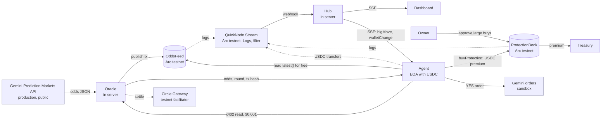

# Hedgehog — plan

> **A probability oracle that lets AI agents insure themselves.**
> UBC 2026 (University Blockchain Conference). "Hedgehog" is a working name; rename any time.
>
> Status: Phase 0 done. Plan reviewed and research re-checked on Nov 16 (§0.7). Phase 1 is planned in detail and waits for go. No project code exists yet.
> Deadline: **Fri Nov 20, 12:00 pm CST = 10:00 am Pacific.** Target: submitted by 9:00 am CST (7:00 am Pacific).

---

## 0. Research findings (checked Nov 15, 2026)

Items marked ⚠ could block us. Items marked *unverified* get proven in a Day 1 unit.

### 0.1 Gemini Prediction Markets API

- **Market data is public, no key.** `GET https://api.gemini.com/v1/prediction-markets/events?status=active&category=…&limit=…` lists events. `GET /v1/prediction-markets/events/{eventTicker}` returns one event. There are also endpoints for strike price, categories, newly listed, recently settled and upcoming events. Volume: `GET /v1/prediction-markets/volume/{date}` and `/hourly`.
- Each contract has an `instrumentSymbol` (example `GEMI-FEDJAN26-DN25`). Always take it from the API. Never build it from the title.
- Contracts carry a `priceHistory` array, which gives us history without a separate candles call. Order book: the existing book API with the `instrumentSymbol`. Live prices and depth come over `wss://ws.gemini.com`.
- **Prices** run from $0.01 to $0.99 per contract and approximate the probability. A winning contract pays $1 and a losing one pays $0.
- **Trading.** REST `POST /v1/prediction-markets/order` takes symbol, `orderType: limit`, side, quantity, price and outcome. Related endpoints: `/order/batch`, `/orders/active`, `/orders/history`, `/positions`. WebSocket `order.place` also works.
  - The Prediction Markets terms must be accepted first (`GET /v1/prediction-markets/terms/status`, `POST /v1/prediction-markets/terms/accept`). Otherwise orders fail with `TERMS_NOT_ACCEPTED`.
  - Auth is HMAC-SHA384, with the payload in `X-GEMINI-PAYLOAD` and an empty body.
  - The API key must be scoped to the trading account, have the Trading permission and use a time-based nonce.
  - The official TypeScript SDK `@gemini-markets/sdk` handles signing and supports `env: "sandbox"`.
- **Sandbox** (Gemini also calls it the demo environment): `exchange.sandbox.gemini.com`, `api.sandbox.gemini.com`, `wss://ws.sandbox.gemini.com`.
  - It needs a separate account and runs on test funds, with bots simulating order books. For 2FA, set the cookie `GEMINI-SANDBOX-2FA=true` and enter `9999999`.
  - The Prediction Markets docs say auth, endpoints and messages are identical to production. Gemini also says to confirm each product is supported there.
  - *Unverified:* which prediction markets exist in sandbox. Unit 3.1 proves this on Day 1.
- ⚠ **Eligibility (production).** US users only, 18+, KYC. Third-party reviews disagree on state coverage (all 50 vs 42–44 states). We trade in production only if you already have a verified US account.
- **Rate limits.** Public endpoints allow 120 requests/min (1 per second recommended). Private endpoints allow 600/min (5 per second recommended). We stay far below both.
- **Categories** seen in the docs: politics, crypto (including BTC 5-minute up/down), sports, economics (Fed decisions), commodities, weather.
- ⚠ **Republishing terms.** The Market Data Agreement allows personal, internal and informational use. It prohibits using the data to create or price financial products, to build benchmarks or indexes, or to sell or license it. Redistribution needs a separate agreement (marketdata@gemini.com or bizdev@gemini.com), with attribution "Data provided by Gemini". An onchain feed sold per read is redistribution.
  - → Ask the Gemini bounty team to OK it for the hackathon (testnet only, attributed). This doesn't block Phase 1.
- **Demo market context.** The live story is the Dec 8–9 FOMC decision. Polymarket priced a 25 bp hike at about 85% on Nov 11, so "hike odds climbing" is real but mostly priced in already.
  - The scripted demo replays the real climb from `priceHistory` (Unit 8.1).
  - The live market is probably the Jan 2027 meeting or a BTC price threshold. Unit 2.1 confirms what Gemini actually lists.

### 0.2 Arc testnet

| Item | Value |
|---|---|
| Chain ID | `5042002` (mainnet `5042` has been live since Sep 16, 2026; we stay on testnet) |
| RPC | `https://rpc.testnet.arc.io`, wss same host. Older docs use `rpc.testnet.arc.network`. Alternatives: QuickNode `rpc.quicknode.testnet.arc.io`, Blockdaemon, dRPC |
| Explorer | `https://explorer.testnet.arc.io` (Blockscout). Older docs: `testnet.arcscan.app` |
| Faucet | `https://faucet.circle.com` → Arc Testnet → USDC. Guides report 10–20 USDC per request |
| USDC | ERC-20 interface at `0x3600000000000000000000000000000000000000` with **6 decimals**. Native gas is USDC with **18 decimals**. They are **one balance** |
| Blocks | About 0.5 s, deterministic finality, no reorgs. `block.timestamp` can repeat, so order by block number. `PREVRANDAO` is always 0 |
| Gas | Minimum base fee 20 gwei, about 0.00042 USDC for a plain transfer. An oracle publish is roughly 0.001–0.002 USDC |
| Tooling | viem ships `arcTestnet`. The standard Foundry deploy flow works (per Arc's tutorial). Arc docs recommend **Arc Foundry** (`arc-forge`, `arc-cast`, `arc-anvil`) because stock anvil can't mimic Arc. We test against the real testnet instead of a local fork |

**Circle tools on Arc testnet today:**

- **Agent Wallets**: Circle CLI, Arc testnet supported. ⚠ Spending policies are mainnet-only; testnet chains are rejected.
- **Nanopayments** through Gateway: a hosted testnet facilitator is available. The buyer must be an EOA, not a smart-contract account.
- **Facilitator Service**: a keyless trial runs on Arc testnet.
- **Contracts** and dev-controlled wallets are also available.
- **Paymaster** isn't needed, since gas is already USDC.

### 0.3 x402 on Arc

There are two working Circle options on Arc testnet:

- **A. Gateway Nanopayments (batched)**: our choice.
  - Seller: `createGatewayMiddleware({ sellerAddress, facilitatorUrl: "https://gateway-api-testnet.circle.com" })`, then `gateway.require("$0.001")` on a route.
  - Buyer: `new GatewayClient({ chain: "arcTestnet", privateKey }).pay(url)`.
  - Packages: `@circle-fin/x402-batching`, `@x402/core`, `@x402/evm`, `viem`.
  - The buyer needs a Gateway balance, which takes one deposit. Circle's reference app (`circlefin/arc-nanopayments`) lists no Circle API key.
  - Payments are signed offchain authorizations that Gateway settles onchain in batches.
- **B. Facilitator Service (exact scheme, EIP-3009)**: fallback.
  - One onchain transfer per payment. A keyless trial works on Arc testnet; production needs a Circle API key.
  - Every call needs a fresh `Facilitator-Seller-Proof` EIP-712 header, which means more code.
- **Why A:** it is the least code, and it is the exact "x402 + Nanopayments" pairing the main track recommends.
- **Tradeoff:** single reads don't show up as separate onchain transfers. The Stream sees Gateway deposits and settlements, and the payments ledger comes from settle responses. If A blocks us, B makes every read visible onchain at the cost of per-call signing.
- **Avoid:** the public `x402.org` facilitator and older x402 npm releases. One sample had to patch x402 v1.1.0 to add Arc.

### 0.4 QuickNode Streams

- **Arc Testnet is supported** for every EVM dataset (Block, Block with Receipts, Transactions, Logs, Receipts, traces). Validator Activity is the one exception.
- **Filter:** a JavaScript `function main(stream)`. Return data to deliver it, or `null` to skip the block.
- **Setup:** a Stream can be created in the dashboard or through the Streams REST API (`api.quicknode.com`, header `x-api-key`, filter sent as base64).
- **Destinations:** webhook and others; one stream can have several.
- ⚠ **Billing.** Credits are charged per block *processed*, and filters don't reduce them.
  - Arc makes about 2 blocks per second, roughly 173k blocks a day.
  - The free trial gives 10M credits for one month.
  - Ethereum blocks cost 20 credits each. At that rate, nonstop streaming uses about 3.5M credits a day, so the free trial lasts about 3 days. Arc's own rate isn't published; check the calculator.
  - Our answer: scripts create the stream at the latest block and delete it when idle. Also ask QuickNode for hackathon credits, or use the Build plan ($49, 80M credits).
- The webhook needs a public HTTPS URL. During development we use a cloudflared quick tunnel (no account needed).

### 0.5 The agent's decision

- **Rules decide. An LLM, if we use one, only proposes the threat map**: one call, cached, reviewed by you.
  - Rules are deterministic, testable, cheap and easy to document for the "decision loop" requirement.
- **Threat map:** each holding maps to (market, the outcome that hurts us, shock %). Illustrative example: ETH → "Fed hikes 25 bp in December", YES hurts, −12%.
- **Trigger:** buy when the probability `p` of the harmful outcome is at least `trigger` (default 0.50).
- **Sizing:**
  - `loss_if_event = exposure × shock`
  - `contracts = ceil(hedgeRatio × loss_if_event / $1) − already_held`
  - `premium ≈ contracts × YES ask`
  - Example sized to faucet amounts: $60 exposure × 12% = $7.20 at risk → 8 contracts × $0.65 ≈ $5.20 premium.

### 0.6 The oracle contract

- `OddsFeed` keeps the latest `{probBps, observedAt, publishedAt, sourceHash, round}` for each market.
- `latest(marketId)` is a view function any contract can read for free.
- Event: `OddsUpdated(marketId indexed, probBps, prevProbBps, observedAt, sourceHash, round)`. Emitting `prevProbBps` lets the Stream filter spot big moves without keeping state.
- `sourceHash = keccak256` of the exact Gemini JSON snapshot used. Phase 7 stores the snapshots so anyone can recompute the hash.

### 0.7 Re-check (Mon Nov 16, 00:45 PST, from the build machine: WSL2 on the user's PC)

| Check | Result |
|---|---|
| `node --version` | `v22.23.1` (npm `10.9.8`) ✅ |
| `forge --version` | `1.8.3`; `cast` is installed too ✅ |
| `cloudflared` | installed ✅ (`jq` and `ngrok` are not; not needed) |
| Gemini `events?status=active&limit=3` | HTTP 200, no key ✅. 959 active events in total |
| `eth_chainId` on `rpc.testnet.arc.io` | `0x4cef52` = 5042002 ✅ |
| `eth_chainId` on `rpc.testnet.arc.network` | `0x4cef52` = 5042002 ✅ (the older host still answers) |

What the Gemini response showed, and what it changes:

- **The response is huge:** 1.3 MB for 3 events. Events nest sub-events (26 under one NFL game) and every contract carries a long rules text. → 2.1 filters by category, keeps `limit` small and prints only chosen fields.
- **Shape:** `{ data: [event], pagination: { limit, offset, total } }`. Prices sit at `contract.prices` as strings: `bestBid`, `bestAsk`, `lastTradePrice`, plus `buy.yes/no` and `sell.yes/no`.
- **`lastTradePrice` can be missing** (seen on player-prop contracts). The "mid, else last trade" rule in 2.3 needs a third case: no publish.
- ⚠ **No `priceHistory` in the list response.** §0.1 said contracts carry it. 2.1 checks the single-event endpoint. If it isn't there either, the replay in 8.1 uses the odds our own oracle records from Tuesday on (`logs/odds.jsonl`).
- `quantityMinimum` varies by market (`0.01` or `1`). We size in whole contracts, so no change.
- The first page is all sports. Category values are capitalized (`"Sports"`); 2.1 confirms the filter values for economics and crypto.

---

## 1. Decisions

| Topic | Decision | Why |
|---|---|---|
| Chain | Arc testnet. RPC: your QuickNode Arc endpoint first, Circle's public RPC as fallback | Track requirement, USDC gas |
| Languages | TypeScript on Node 22 (`tsx`, `viem`) for services. Solidity with Foundry for contracts | As requested |
| Paid reads | Circle Gateway Nanopayments over x402 (fallback: Circle Facilitator Service) | §0.3 |
| Agent wallet | Plain EOA key in `.env`, not a Circle Agent Wallet | Agent Wallets need CLI login with an email code; their policies are mainnet-only; the Gateway buyer must be an EOA. The guardrails live in our own contract |
| Odds | Gemini **production** public API (real data) | Real data needs no account |
| Trading | Gemini **sandbox** (real API, test funds) if it lists prediction markets. Otherwise you choose: a tiny real order on a verified US account, or labeled `PAPER TRADE`s priced off the live book | §0.1 |
| Holdings | A `DECLARED HOLDING` portfolio valued at live Gemini spot prices. The agent's USDC, payments and premiums are real testnet USDC | Testnet has no real ETH or BTC exposure |
| Premium flow | The agent pays the USDC premium onchain through `ProtectionBook` to a treasury address that stands in for funding the Gemini account. The Gemini order is the hedge itself | Keeps the money onchain and the guardrail enforceable |
| Oracle mode | Push and pull. A timer publishes every 5 min, which saves faucet USDC. A paid read also refreshes and publishes | The feed stays free to read onchain; the fee pays for freshness (fetch plus publish gas) |
| Demo | Everything real except the odds path in the 3-minute scenario, which replays real Gemini price history under a separate `replay:` market ID, labeled `REPLAY` on screen | Real markets won't move on cue |
| Processes | 2 Node processes, plus the dashboard dev server. **server** runs the publisher, the x402 endpoint, the Stream webhook and SSE. **agent** is the second | Few moving parts |
| Dashboard | Vite + React + TypeScript, one page | Fast, typechecks |
| Access control | `publish()` is open to any sender in Phase 2 (no allowlists yet, per the rules). Phase 7 limits it to the oracle address | Working rule 3 |
| Wallets | **Two keys only**, both generated in 1.1 and funded in one faucet visit. `DEPLOYER_KEY` is the deployer, oracle publisher, x402 seller, book owner and treasury. `AGENT_KEY` is the agent | 4.1 needs the agent key on Day 1, before 3.3. Fewer keys means fewer faucet trips |
| Deploys | One TypeScript script, `npm run deploy -- <Contract> [constructor args]`. It reads the bytecode from `contracts/out/` after `forge build`, deploys with viem and writes the address to `deployments/arc-testnet.json` | The key comes from `.env` like everywhere else, the address is recorded automatically, and there is no `.s.sol` file per contract |
| ABIs | Written by hand in `src/shared/abi.ts` with viem's `parseAbi` (a few signature lines per contract) | Fully typed, and a clean clone typechecks without running `forge build` first |
| Logs | `logs/*.jsonl`, gitignored, appended with `fs.appendFileSync`. Each file is created by the first unit that writes it: `odds` (2.3), `agent` (3.3), `payments` (4.2), `stream` (5.1) | No logging library |
| Tests | `forge test` for contracts. `npm test` = `tsx --test` (Node's built-in runner), added in 3.2 | No test dependency |

---

## 2. Design

### 2.1 Components

- **Oracle** (in `server`): fetches Gemini odds and publishes them to `OddsFeed`. It serves `GET /odds/:symbol` behind x402.
- **OddsFeed** (Arc): the latest odds for each market, readable by any contract.
- **Agent**: holds testnet USDC. It values its declared holdings, pays per read for odds, decides, and buys protection: USDC premium onchain plus a Gemini order. It re-checks on a slow timer and whenever the Stream signals.
- **ProtectionBook** (Arc): the agent's checkbook for premiums. Phase 7 adds the daily budget and owner approval.
- **QuickNode Stream**: Arc testnet, Logs dataset, filter for our contracts and the agent's USDC transfers. It sends to the `server` webhook.
- **Server hub**: receives Stream webhooks and fans them out over SSE to the dashboard and the agent.
- **Dashboard**: odds over time, holdings vs protection, payments ledger and Stream events, all live.

### 2.2 Diagram



### 2.3 How data and money flow

1. **Data:** Gemini → oracle → `OddsFeed` on Arc. From there three paths read it:
   - any contract, through `latest()`, for free;
   - the agent, through a paid x402 read, which also refreshes the feed;
   - the Stream, which forwards the logs to the hub, then the dashboard and the agent.
2. **Money:**
   - **Reads:** the agent deposits USDC into Gateway once. Each read is a $0.001 nanopayment to the oracle's seller address, settled on Arc in batches.
   - **Protection:** the agent calls `ProtectionBook.buyProtection`, which moves the USDC premium to the treasury. The agent then places the Gemini YES order. Each contract pays $1 if the harmful event happens.
   - **Gas:** the oracle pays publish gas in USDC on Arc, funded in spirit by read fees.
3. **Signals:** a big odds move (≥ 5 points) or a USDC transfer touching the agent's wallet arrives through the Stream and triggers a fresh agent check.

### 2.4 Repo layout (target; each unit creates only its own files)

```
hedgehog/
  PLAN.md  CLAUDE.md  README.md  LOG.md  LESSONS.md
  .env.example  .gitignore  package.json  tsconfig.json
  contracts/                   Foundry project (foundry.toml; no deploy scripts)
    src/  Hello.sol  OddsFeed.sol  ProtectionBook.sol
    test/ OddsFeed.t.sol  ProtectionBook.t.sol
  deployments/arc-testnet.json  contract addresses (committed)
  config/markets.json           markets the oracle publishes
  src/
    shared/  chain.ts  abi.ts
    oracle/  gemini.ts  odds.ts  publisher.ts
    server/  index.ts           x402 /odds, /stream webhook, /events SSE, /state
    agent/   portfolio.json  threats.json  policy.ts  policy.test.ts  trade.ts  agent.ts
    stream/  filter.js
  scripts/   new-key, check-arc, deploy, hello, markets, oracle, feed, gemini-order, agent-dry,
             gateway-deposit, pay-read, stream-up, stream-down, approve, demo
  dashboard/ Vite + React app
  logs/      *.jsonl (gitignored)
```

---

## 3. Phases and units

Every unit ends the same way: it runs end to end, `npm run typecheck` passes, `LOG.md` is up to date, you get a short report plus the git commands (you commit and push), and I wait for your go. Time estimates are my build time; they leave out your account setup and review time.

### Phase 1: Skeleton (detailed plan)

- [ ] **1.1 Repo and environment** (45 min)

- **Goal:** a fresh repo that typechecks, holds two funded keys and talks to Arc testnet.
- **Files (7, plus the generated `package-lock.json`):**

  | File | Contents |
  |---|---|
  | `.gitignore` | `node_modules/`, `.env`, `logs/`, `contracts/out/`, `contracts/cache/`, `*:Zone.Identifier` |
  | `package.json` | `"type": "module"`, `"private": true`. Scripts: `typecheck` = `tsc --noEmit`, `new-key` = `tsx scripts/new-key.ts`, `check:arc` = `tsx scripts/check-arc.ts` |
  | `tsconfig.json` | `strict`, `noEmit`, `module`/`moduleResolution` `nodenext`, `target` `es2022`; includes `src` and `scripts` |
  | `.env.example` | `ARC_RPC_URL=` (empty means the public RPC), `DEPLOYER_KEY=`, `AGENT_KEY=`. Placeholders only |
  | `src/shared/chain.ts` | Loads `.env` (`import "dotenv/config"`). Exports `publicClient` (viem `arcTestnet`, `ARC_RPC_URL` or `https://rpc.testnet.arc.io`) and the `USDC` address. Nothing else yet |
  | `scripts/new-key.ts` | For `DEPLOYER_KEY` and `AGENT_KEY`: if `.env` doesn't have it, generate a key and append the line. Prints `NAME address` only. Never replaces an existing key, because that would strand its funds |
  | `scripts/check-arc.ts` | Prints the chain ID, the latest block number and the USDC balance (ERC-20 `balanceOf`, 6 decimals) of both addresses |

- **Steps, in this order:**
  1. Write `.gitignore`. Run `git check-ignore .env` and see `.env` printed **before anything else exists**.
  2. Write `package.json` and `tsconfig.json`. Run `npm install viem dotenv` and `npm install -D typescript tsx @types/node`. No other dependencies.
  3. Write `.env.example`, `chain.ts`, `new-key.ts` and `check-arc.ts`.
  4. `npm run new-key` → two addresses.
  5. `BLOCKED:` you fund both addresses at the faucet (see below).
  6. `npm run check:arc`, the checks below, then the report and the git commands.
- **Done when** (each line is a command I run and paste the output of):
  - `git check-ignore .env` prints `.env`.
  - `npm run typecheck` exits 0.
  - `npm run new-key` prints two addresses and no key. A second run prints the same two addresses.
  - `npm run check:arc` prints chain `5042002`, a block number that is higher on a second run, and two balances > 0.
  - `git status --short` lists no `.env`, and `git grep -nE "0x[0-9a-fA-F]{64}"` finds nothing.
- **Needs from you:**
  - **Faucet:** `https://faucet.circle.com` → Arc Testnet → USDC, one request for each of the two printed addresses. This covers gas, the Gateway deposit (4.1) and the premiums (3.3).
  - **Optional:** put your QuickNode Arc testnet endpoint URL in `.env` as `ARC_RPC_URL`. The public RPC works until you do; the QuickNode account is needed by 5.1 anyway.

- [ ] **1.2 Hello contract on Arc** (45 min)

- **Goal:** prove the build, deploy, write and read path on Arc, and set the deploy and ABI pattern every later contract reuses.
- **New files (6):**

  | File | Contents |
  |---|---|
  | `contracts/foundry.toml` | `src = "src"`, `out = "out"`, a pinned `solc` version. Written by hand: no `forge init`, so no sample files and no `forge-std` until 2.2 needs it for tests |
  | `contracts/src/Hello.sol` | `string public message`, `event Ping(address indexed from, string message)`, `function ping(string calldata m)` that stores and emits |
  | `scripts/deploy.ts` | `npm run deploy -- Hello`. Reads the ABI and bytecode from `contracts/out/Hello.sol/Hello.json`, deploys with viem from `DEPLOYER_KEY`, waits for the receipt, writes `{"Hello": "0x…"}` into `deployments/arc-testnet.json`, and prints the address and its explorer URL. Constructor arguments, when a later contract has them, are passed after the name |
  | `src/shared/abi.ts` | `helloAbi = parseAbi([...])`, three signature lines |
  | `deployments/arc-testnet.json` | Written by `deploy.ts`, committed |
  | `scripts/hello.ts` | `npm run hello -- gm`. Sends `ping("gm")`, waits for the receipt, reads `message()`, prints the tx hash, its explorer URL and the message |

- **Edited files:** `src/shared/chain.ts` (adds the `deployer` wallet client), `package.json` (scripts `deploy` and `hello`), `CLAUDE.md` (Commands list).
- **Steps:**
  1. Write `foundry.toml` and `Hello.sol`. Run `cd contracts && forge build`. The first run downloads solc from `binaries.soliditylang.org`.
  2. Write `abi.ts`, `deploy.ts`, `hello.ts`. Run `npm run deploy -- Hello`.
  3. Run `npm run hello -- gm`.
- **Done when:**
  - `cd contracts && forge build` compiles with no errors.
  - `npm run deploy -- Hello` prints an address, and `deployments/arc-testnet.json` contains it.
  - `cast code <address> --rpc-url https://rpc.testnet.arc.io` returns bytecode, not `0x`.
  - `npm run hello -- gm` prints a tx hash and `message = gm`. A second run with another word reads that word back.
  - `npm run typecheck` exits 0.
  - You open the printed explorer link and see the `ping` transaction (a glance, not a blocker).
- **Needs from you:** nothing new. The deployer was funded in 1.1.
- **Unknown to settle here:** whether Foundry's default EVM version deploys cleanly on Arc. If the deploy fails, set `evm_version` as Arc's docs say and record it in `LESSONS.md`. Contract verification on the explorer is not part of this unit.

### Phase 2: Oracle, first version (no checks)

**2.1 Gemini reader and market pick** (45 min)

- **Goal:** real Gemini odds in our code, and the demo markets chosen.
- **Files:** `src/oracle/gemini.ts` (typed fetch for `listEvents` and `getEvent`, only the fields we use), `scripts/markets.ts`, `config/markets.json`.
- **Steps:**
  1. Print the economics and crypto events with ticker, title, `instrumentSymbol`, YES bid/ask/last, volume and expiry. Filter by category and keep `limit` small (§0.7: 3 events are 1.3 MB).
  2. Fetch one event by ticker and report whether it carries `priceHistory` (§0.7: the list response doesn't). This decides the replay source for 8.1.
  3. We pick 1–2 live markets and one replay source.
- **Done when:** `npm run markets` prints live economics or crypto markets with the fields above, plus a line saying whether `priceHistory` exists. `config/markets.json` holds the picked `instrumentSymbol`s.

**2.2 OddsFeed contract** (1 h)

- **Goal:** the onchain feed from §0.6.
- **Files:** `contracts/src/OddsFeed.sol`, `contracts/test/OddsFeed.t.sol`, `src/shared/abi.ts` (adds `oddsFeedAbi`). Adds `forge-std` under `contracts/lib/` for the tests; the unit settles whether it is committed or gitignored with an install line in the README.
- **Done when:** `cd contracts && forge test` passes (publish, then `latest()`, and the event carries the previous value). `npm run deploy -- OddsFeed` prints the address and `deployments/arc-testnet.json` contains it.

**2.3 Publisher** (1 h)

- **Goal:** Gemini odds written to Arc and read back.
- **Files:** `src/oracle/odds.ts` (probability = YES mid if there are both a bid and an ask, otherwise the last trade, otherwise no publish; `sourceHash` = keccak of the raw contract JSON), `src/oracle/publisher.ts` (also appends each publish to `logs/odds.jsonl`), `scripts/oracle.ts` (`--once`, or a loop every `ORACLE_INTERVAL_S=300`), `scripts/feed.ts`.
- **Done when:** `npm run oracle -- --once` prints a tx hash for each market, `npm run feed` prints the same probabilities from the chain, and `logs/odds.jsonl` has one line per publish.

### Phase 3: Agent, first version

**3.1 Gemini sandbox trading check** (1 h)

- **Goal:** prove we can place a real Gemini prediction-market order.
- **Files:** `src/agent/trade.ts` (`@gemini-markets/sdk` server client, `GEMINI_ENV=sandbox`), `scripts/gemini-order.ts`.
- **Steps:**
  1. You create the sandbox account and key, accept the Prediction Markets terms in the sandbox UI, and put the key in `.env`.
  2. The script checks the terms status.
  3. It lists the sandbox prediction-market events.
  4. It places a 1-contract YES limit buy.
  5. It prints the order status.
- **Done when:** the order ID is printed and the order is visible in the sandbox UI. If sandbox has no prediction markets, the result is the finding plus your decision (§1 Trading).

**3.2 Portfolio, threats, rules** (1 h)

- **Goal:** the decision logic from §0.5, tested.
- **Files:** `src/agent/portfolio.json` (`DECLARED HOLDING`), `src/agent/threats.json`, `src/agent/policy.ts` (a pure `decide()`), `src/agent/policy.test.ts`, `scripts/agent-dry.ts`.
- **Steps:** value holdings with Gemini's public spot ticker. Read odds from `OddsFeed` (free). `decide()` returns hold, or buy N contracts with a premium estimate.
- **Done when:** `npm test` passes (below trigger → hold; above → buy N; already covered → hold), and `npm run agent:dry` prints exposure, odds and the decision.

**3.3 ProtectionBook and first protection buy** (1.5 h)

- **Goal:** the first full agent cycle, onchain and on Gemini.
- **Files:** `contracts/src/ProtectionBook.sol` (`buyProtection(marketId, contracts, premium, orderRef)` → USDC `transferFrom` from agent to treasury, plus an event), `src/shared/abi.ts` (adds `protectionBookAbi`), `src/agent/agent.ts`, `logs/agent.jsonl`.
- **Steps:**
  1. `npm run deploy -- ProtectionBook <usdc> <treasury>`. The treasury is the deployer address (§1 Wallets). `AGENT_KEY` already exists and is funded (1.1).
  2. The agent approves USDC to the book.
  3. Loop (`--once` flag): read odds → `decide()` → `buyProtection` tx → Gemini order with `clientOrderId = orderRef` → one JSON log line per step.
- **Checkpoint inside the unit:** once the `buyProtection` tx lands, before the Gemini order is wired in.
- **Done when:** `npm run agent -- --once`, with the trigger lowered for the test, prints a `buyProtection` tx hash and a Gemini order ID, and `logs/agent.jsonl` has a line that ties them together.

**3.4 (optional) LLM threat map** (45 min)

- **Goal:** let an LLM propose the threat map once.
- **Files:** `scripts/map-threats.ts`.
- **Steps:** one Claude Haiku call. Input: the holdings plus active Gemini event titles. Output: `threats.json` with `{symbol, outcome, shock, rationale}` for you to review.
- **Done when:** the output loads unchanged into 3.2.

### Phase 4: Paid reads

**4.1 x402 on Arc** (1.25 h)

- **Goal:** one paid read on Arc testnet.
- **Files:** `src/server/index.ts` (Express; `GET /odds/:symbol` behind `gateway.require("$0.001")`, returning live Gemini odds through 2.1), `scripts/gateway-deposit.ts` (one-time agent deposit, for example 2 USDC, following Circle's buyer quickstart), `scripts/pay-read.ts`.
- **Done when:**
  - `curl -i localhost:8787/odds/<symbol>` returns 402 with a `PAYMENT-REQUIRED` header.
  - `npm run pay-read -- <symbol>` returns 200 JSON.
  - The agent's Gateway balance drops by 0.001 and the seller's rises.
- **If blocked:** `BLOCKED:` report, then switch to Facilitator Service.

**4.2 Agent pays per read; the read refreshes the feed** (1 h)

- **Goal:** wire paid reads into the agent.
- **Files:** `src/server/index.ts`, `src/oracle/publisher.ts`, `src/agent/agent.ts`, `logs/payments.jsonl`.
- **Steps:**
  1. `/odds/:symbol` fetches from Gemini, publishes if the value changed, and returns `{probBps, observedAt, sourceHash, round, txHash}`.
  2. The agent uses the paid read, then checks that `latest()` onchain shows the same round.
- **Done when:** the agent's cycle log shows the paid read (amount, payer, settle ID) and the matching onchain round.

### Phase 5: The Stream

**5.1 First Stream on Arc** (1 h)

- **Goal:** prove a Stream on Arc testnet reaches our webhook.
- **Files:** `src/server/index.ts` (`POST /stream` appends to `logs/stream.jsonl`), `src/stream/filter.js` (passes logs from `Hello`), `scripts/stream-up.ts`, `scripts/stream-down.ts`.
- **Steps:**
  1. Open a cloudflared tunnel.
  2. `stream-up` creates the Stream: Arc testnet, Logs, starting at the latest block, with the filter and the webhook.
  3. `npm run hello` sends a `Ping`.
  4. `stream-down` deletes the Stream.
- **Done when:** `logs/stream.jsonl` holds our `Ping` within seconds, and the Stream is deleted afterwards. Confirms the network slug and dataset name.

**5.2 Real filter** (1 h)

- **Goal:** the filter for the real contracts and wallet.
- **Files:** `src/stream/filter.js`.
- **Steps:** keep `OddsFeed.OddsUpdated` (decoded; `bigMove` when |prob − prev| ≥ 500 bps), `ProtectionBook` events, and USDC `Transfer` logs where the agent is sender or receiver. Return a compact array, or `null`.
- **Done when:** a `test:` market publish with a ≥ 5-point move arrives as `{type:"bigMove"}`, and sending 1 USDC to the agent arrives as `{type:"walletChange"}`.

**5.3 Agent re-checks on Stream events** (45 min)

- **Goal:** the agent reacts to the Stream instead of only polling.
- **Files:** `src/server/index.ts` (webhook → SSE `/events`), `src/agent/agent.ts` (subscribes and runs a cycle on `bigMove` or `walletChange`).
- **Done when:** after a test big move, the agent's cycle starts within about 2 s (timestamps in the logs).

### Phase 6: Dashboard

**6.1 State API** (45 min)

- **Goal:** one place the dashboard reads everything from.
- **Files:** `src/server/index.ts`.
- **Steps:** `GET /state` returns odds history, decisions, payments and Stream events (from the `logs/*.jsonl` files and memory). SSE carries the same records.
- **Done when:** `curl /state` returns all four lists.

**6.2 Dashboard page** (2.5 h)

- **Goal:** the live view for the demo.
- **Files:** `dashboard/` (Vite + React + TypeScript).
- **Panels:** odds over time with the trigger line; holdings vs protection coverage; payments ledger (x402 reads and premiums, with explorer links); Stream event feed; `REPLAY` and `PAPER TRADE` banners when they apply.
- **Done when:** with the server and agent running, the page updates live without a refresh, and `npm run typecheck` also runs `tsc --noEmit -p dashboard`.

### Phase 7: Protection layers (built deliberately simple)

**7.1 Oracle checks** (1.5 h)

- **Goal:** the oracle's data checks.
- **Files:** `contracts/src/OddsFeed.sol` (`isFresh(id, maxAge)`, publish limited to the oracle address), `src/oracle/odds.ts`, `src/oracle/publisher.ts`, `src/server/index.ts`, `scripts/checks-demo.ts`.
- **Checks:**
  - **Staleness:** the agent holds if the odds are stale.
  - **Thin market:** skip the publish and flag it if the YES spread is > 10 points or there is no bid or ask.
  - **Smoothing:** median of the last 3 observations.
  - **Source snapshots:** stored by hash, served at `GET /snapshot/:hash`, with a verify script.
- **Done when:** `npm run checks:demo` shows each rule firing once, with a log line.

**7.2 Onchain budget** (1 h)

- **Goal:** the agent can't overspend on protection.
- **Files:** `contracts/src/ProtectionBook.sol` (owner, `dailyBudget`, spent today with a day rollover; reverts over budget), `contracts/test/ProtectionBook.t.sol`, `src/agent/agent.ts` (logs "refused by budget" with the revert reason).
- **Done when:** tests pass, and an over-budget attempt reverts on testnet.

**7.3 Owner approval** (1.5 h)

- **Goal:** large purchases wait for the owner.
- **Files:** `ProtectionBook.sol`, `scripts/approve.ts`, `src/agent/agent.ts`.
- **Steps:** above `approvalThreshold`, the book emits `PurchaseRequested` and holds the request with no transfer. The owner calls `approve(id)`, which makes the transfer and emits `ProtectionBought`. The agent places the Gemini order only after it sees `ProtectionBought`.
- **Done when:** a large buy sits pending; `npm run approve -- <id>` executes it and the Gemini order follows. A small buy goes straight through.

### Phase 8: Demo and submission

**8.1 Scripted scenario** (1.5 h)

- **Goal:** the full story on a short clock.
- **Files:** `scripts/demo.ts`.
- **Steps:** start from a fresh agent state. Replay a real Gemini `priceHistory` series (for example 30% → 65%) as `replay:<symbol>` on a 2-minute clock through the real publisher. x402 reads, Stream triggers, the protection buy and the approval are all real. The banner reads "REPLAY of real Gemini history, <dates>".
- **Done when:** `npm run demo` tells the whole story in ≤ 3 min, twice in a row.

**8.2 README** (1.5 h)

- **Goal:** technical documentation that covers every track's requirements.
- **Sections:** what and why; architecture plus the diagram; setup; the agent's decision loop; safety limits; contract addresses with explorer links; how we use Arc; the Stream (network, dataset, filter logic, destination, and why); Gemini usage (endpoints, sandbox vs production, attribution); the x402 flow; "remove a sponsor and it stops"; labels (`REPLAY`, `PAPER TRADE`, `DECLARED HOLDING`); credits.
- **Done when:** a clean clone that follows the README runs `npm run demo`.

**8.3 Video and submission** (2 h)

- **Goal:** everything submitted.
- **Files:** `SUBMISSION.md` (name, description, the five written answers, technologies and sponsor tools).
- **Steps:** a 2:30 shot list. You record. Final check from a clean clone, then submit.
- **Done when:** the submission is in, with the repo public and the video uploaded.

**8.4 (optional) Deploy** (1 h)

- **Goal:** a hosted demo.
- **Steps:** server, agent and dashboard on one small host (Render or Railway) with a fixed webhook URL.
- **Done when:** the public URL shows live data.

---

## 4. Schedule (Nov 16 → morning of Nov 20)

The riskiest integrations (Gemini read and trade, x402 on Arc, Streams on Arc) all run for real on **Day 1**.

| Day | Units (in order) | Hours | End-of-day proof |
|---|---|---|---|
| **Sun Nov 15** (tonight) | You review this plan. Accounts in parallel (§6) | n/a | Plan approved |
| **Mon Nov 16**: prove the risky three | 1.1 → 1.2 → 2.1 → 4.1 → 5.1 → 3.1 | ~5.5 | Each external integration has run once for real: Arc deploy, Gemini read, x402 read on Arc, Stream to webhook, Gemini sandbox order |
| **Tue Nov 17**: oracle and agent | 2.2 → 2.3 → 3.2 → 3.3 (→ 3.4 if ahead) | ~4.5–5.25 | Agent buys protection from real odds, onchain plus Gemini |
| **Wed Nov 18**: wiring and dashboard | 4.2 → 5.2 → 5.3 → 6.1 → 6.2 | ~6 | Agent pays per read, reacts to the Stream; live dashboard |
| **Thu Nov 19**: guardrails and demo | 7.2 → 7.3 → 7.1 → 8.1 → 8.2; record video in the evening | ~7 | Budget and approval onchain; `npm run demo` works; README done |
| **Fri Nov 20** (morning) | 8.3: edit video, written answers, submit | ~2 | Submitted by 9:00 am CST (7:00 am Pacific) |

Checkpoints that trigger cuts:

- **Mon night:** if 3.1 isn't done, it moves to Tue morning. If sandbox has no prediction markets, you decide right away (§6).
- **Wed night:** if 6.2 isn't done, the dashboard stays minimal.
- **Thu 3 pm:** if 7.x isn't done, cut smoothing and any dashboard approve button.

Total build ≈ 26 h across 4 days.

## 5. Cut list (drop from the top first)

1. 3.4 LLM threat map (a static `threats.json` works).
2. 8.4 deployment (the demo runs locally, live at finals, plus the video).
3. A dashboard approve button (the CLI `approve` stays).
4. Smoothing in 7.1 (keep staleness, thin market and source hash).
5. Dashboard polish (one plain page with the four panels).
6. Real Gemini orders → labeled `PAPER TRADE`s, only if sandbox costs us more than about 1.5 h.

**Never cut:**

- Contracts on Arc with their addresses.
- Real Gemini odds.
- A paid x402 read.
- One Stream with a filter and a webhook.
- The onchain budget and owner approval (the main track requires documented safety limits).
- The README sections each track requires.

## 6. Open questions, blockers, accounts

**Blocks Phase 1:**

1. ✅ **Where we build.** Resolved Nov 16: Claude Code runs on your machine (WSL2). Gemini and both Arc RPC hosts answer from here (§0.7).
2. ✅ **GitHub:** `DhruPtel/UBC-2026-Probability-Oracle`. You commit and push; Claude gives you the commands.
3. **Faucet:** 1.1 generates both keys and prints only the addresses. You fund the two addresses at faucet.circle.com in one visit. There is no separate owner or treasury wallet (§1 Wallets).

**Needed by Mon (Day 1 units):**

4. **Gemini sandbox account** at `exchange.sandbox.gemini.com` with an API key: account-scoped, Trading permission, time-based nonce. You put the key and secret in `.env` yourself; never paste them in chat. Also: do you have a **verified US production Gemini account** (18+, KYC)? Only needed if sandbox fails and you'd rather spend a few real dollars than paper trade.
5. **QuickNode account:** free trial, an Arc testnet endpoint, and an API key with Streams REST permission. Ask the QuickNode sponsor table for hackathon credits (see §0.4 billing).
6. ✅ **cloudflared** is installed on the build machine (§0.7).
7. **Gemini terms:** ask the Gemini bounty team to confirm that publishing their odds onchain (testnet, attributed) and charging per read is OK for the hackathon.

**Decisions for you (defaults in brackets):**

8. Production trading vs paper trades if sandbox lacks prediction markets [paper trades, labeled].
9. Keep the optional LLM threat map 3.4 (needs `ANTHROPIC_API_KEY`) [only if ahead on Tue].
10. Project name [Hedgehog].

---

## 7. Sources

- Gemini prediction markets: https://developer.gemini.com/prediction-markets/getting-started.md · https://developer.gemini.com/products/prediction-markets · https://developer.gemini.com/prediction-markets/market-data · https://developer.gemini.com/prediction-markets-spec/trading · https://developer.gemini.com/get-started/sandbox · https://developer.gemini.com/rate-limit · https://developer.gemini.com/tools · https://support.gemini.com/hc/en-gb/articles/44234371543579-Gemini-Predictions · https://gemini.com/legal/market-data-agreement · https://gemini.com/market-data-fee-schedule
- Arc: https://docs.arc.io/integrate/infrastructure.md · https://docs.arc.io/integrate/connect-to-arc · https://docs.arc.io/build/evm-differences.md · https://docs.arc.io/integrate/deploy-on-arc.md · https://docs.chainstack.com/reference/arc-getting-started.md · https://www.dwellir.com/blog/what-is-arc
- Circle: https://developers.circle.com/gateway/nanopayments/quickstarts/seller.md · https://developers.circle.com/gateway/nanopayments/quickstarts/buyer · https://github.com/circlefin/arc-nanopayments · https://stablecoininsider.org/how-to-enable-circle-x402-facilitator-for-usdc/ · https://developers.circle.com/agent-stack/agent-wallets/wallet-operations/custom-policies · https://circle.com/blog/turn-your-api-into-a-storefront-for-agents
- QuickNode: https://www.quicknode.com/docs/streams/supported-chains · https://www.quicknode.com/de/docs/streams/billing · https://www.quicknode.com/pricing.md · https://www.quicknode.com/guides/quicknode-products/streams/how-to-set-up-a-stream-using-api
- Market context: https://cryptoslate.com/predictions/market/fed-decision-in-december-20260729232808632/
