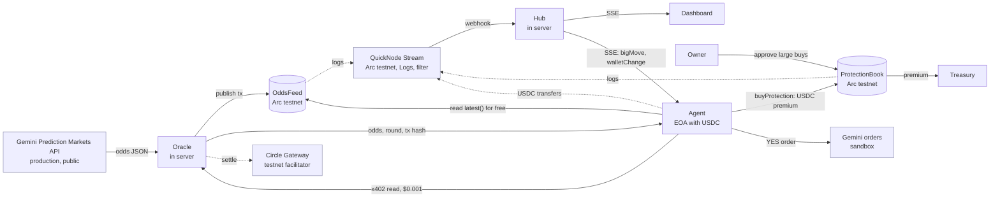

# Hedgehog — plan

> **A probability oracle that lets AI agents insure themselves.**
> UBC 2026 (University Blockchain Conference). "Hedgehog" is a working name; rename any time.
>
> Status: Phase 0 done. Plan reviewed and research re-checked on Nov 16 (§0.7). Phase 1 is planned in detail and waits for go. No project code exists yet.
> Deadline: **Fri Nov 20, 12:00 pm CST = 10:00 am Pacific.** Target: submitted by 9:00 am CST (7:00 am Pacific).

---

## 0. Research findings (checked Nov 15, 2026)

Items marked ⚠ could block us. Items marked *unverified* get proven in a Day 1 unit.

### 0.1 Gemini Prediction Markets API

- **Market data is public, no key.** `GET https://api.gemini.com/v1/prediction-markets/events?status=active&category=…&limit=…` lists events. `GET /v1/prediction-markets/events/{eventTicker}` returns one event. There are also endpoints for strike price, categories, newly listed, recently settled and upcoming events. Volume: `GET /v1/prediction-markets/volume/{date}` and `/hourly`.
- Each contract has an `instrumentSymbol` (example `GEMI-FEDJAN26-DN25`). Always take it from the API. Never build it from the title.
- Contracts carry a `priceHistory` array, which gives us history without a separate candles call. Order book: the existing book API with the `instrumentSymbol`. Live prices and depth come over `wss://ws.gemini.com`.
- **Prices** run from $0.01 to $0.99 per contract and approximate the probability. A winning contract pays $1 and a losing one pays $0.
- **Trading.** REST `POST /v1/prediction-markets/order` takes symbol, `orderType: limit`, side, quantity, price and outcome. Related endpoints: `/order/batch`, `/orders/active`, `/orders/history`, `/positions`. WebSocket `order.place` also works.
  - The Prediction Markets terms must be accepted first (`GET /v1/prediction-markets/terms/status`, `POST /v1/prediction-markets/terms/accept`). Otherwise orders fail with `TERMS_NOT_ACCEPTED`.
  - Auth is HMAC-SHA384, with the payload in `X-GEMINI-PAYLOAD` and an empty body.
  - The API key must be scoped to the trading account, have the Trading permission and use a time-based nonce.
  - The official TypeScript SDK `@gemini-markets/sdk` handles signing and supports `env: "sandbox"`.
  - **Confirmed in unit 3.3 (Nov 16), and what differs:** we use signed REST, not the SDK (a master key needs `account` on every prediction-market call, which the SDK can't send). Terms status is a signed `GET`; orders, positions and order lists are signed `POST`s. The nonce is the time in seconds. Order IDs are 18-digit integers and must be kept as strings. `clientOrderId` is accepted and echoed although the reference omits it from the request. There is no get-one-order endpoint. The sandbox lists 97 events (crypto and commodities, no Economics), with strikes that differ from production.
- **Sandbox** (Gemini also calls it the demo environment): `exchange.sandbox.gemini.com`, `api.sandbox.gemini.com`, `wss://ws.sandbox.gemini.com`.
  - It needs a separate account and runs on test funds, with bots simulating order books. For 2FA, set the cookie `GEMINI-SANDBOX-2FA=true` and enter `9999999`.
  - The Prediction Markets docs say auth, endpoints and messages are identical to production. Gemini also says to confirm each product is supported there.
  - *Unverified:* which prediction markets exist in sandbox. Unit 3.3 proves this on Day 1.
- ⚠ **Eligibility (production).** US users only, 18+, KYC. Third-party reviews disagree on state coverage (all 50 vs 42–44 states). We trade in production only if you already have a verified US account.
- **Rate limits.** Public endpoints allow 120 requests/min (1 per second recommended). Private endpoints allow 600/min (5 per second recommended). We stay far below both.
- **Categories** seen in the docs: politics, crypto (including BTC 5-minute up/down), sports, economics (Fed decisions), commodities, weather.
- ⚠ **Republishing terms.** The Market Data Agreement allows personal, internal and informational use. It prohibits using the data to create or price financial products, to build benchmarks or indexes, or to sell or license it. Redistribution needs a separate agreement (marketdata@gemini.com or bizdev@gemini.com), with attribution "Data provided by Gemini". An onchain feed sold per read is redistribution.
  - → Ask the Gemini bounty team to OK it for the hackathon (testnet only, attributed). This doesn't block Phase 1.
- **Demo market context.** The live story is the Dec 8–9 FOMC decision. Polymarket priced a 25 bp hike at about 85% on Nov 11, so "hike odds climbing" is real but mostly priced in already.
  - The scripted demo replays the real climb from `priceHistory` (Unit 8.1).
  - The live market is probably the Jan 2027 meeting or a BTC price threshold. Unit 2.1 confirms what Gemini actually lists.

### 0.2 Arc testnet

| Item | Value |
|---|---|
| Chain ID | `5042002` (mainnet `5042` has been live since Sep 16, 2026; we stay on testnet) |
| RPC | `https://rpc.testnet.arc.io`, wss same host. Older docs use `rpc.testnet.arc.network`. Alternatives: QuickNode `rpc.quicknode.testnet.arc.io`, Blockdaemon, dRPC |
| Explorer | `https://explorer.testnet.arc.io` (Blockscout). Older docs: `testnet.arcscan.app` |
| Faucet | `https://faucet.circle.com` → Arc Testnet → USDC. Guides report 10–20 USDC per request |
| USDC | ERC-20 interface at `0x3600000000000000000000000000000000000000` with **6 decimals**. Native gas is USDC with **18 decimals**. They are **one balance** |
| Blocks | About 0.5 s, deterministic finality, no reorgs. `block.timestamp` can repeat, so order by block number. `PREVRANDAO` is always 0 |
| Gas | Minimum base fee 20 gwei, about 0.00042 USDC for a plain transfer. An oracle publish is roughly 0.001–0.002 USDC |
| Tooling | viem ships `arcTestnet`. The standard Foundry deploy flow works (per Arc's tutorial). Arc docs recommend **Arc Foundry** (`arc-forge`, `arc-cast`, `arc-anvil`) because stock anvil can't mimic Arc. We test against the real testnet instead of a local fork |

**Circle tools on Arc testnet today:**

- **Agent Wallets**: Circle CLI, Arc testnet supported. ⚠ Spending policies are mainnet-only; testnet chains are rejected.
- **Nanopayments** through Gateway: a hosted testnet facilitator is available. The buyer must be an EOA, not a smart-contract account.
- **Facilitator Service**: a keyless trial runs on Arc testnet.
- **Contracts** and dev-controlled wallets are also available.
- **Paymaster** isn't needed, since gas is already USDC.

### 0.3 x402 on Arc

There are two working Circle options on Arc testnet:

- **A. Gateway Nanopayments (batched)**: our choice.
  - Seller: `createGatewayMiddleware({ sellerAddress, facilitatorUrl: "https://gateway-api-testnet.circle.com" })`, then `gateway.require("$0.001")` on a route.
  - Buyer: `new GatewayClient({ chain: "arcTestnet", privateKey }).pay(url)`.
  - Packages: `@circle-fin/x402-batching`, `@x402/core`, `@x402/evm`, `viem`.
  - The buyer needs a Gateway balance, which takes one deposit. Circle's reference app (`circlefin/arc-nanopayments`) lists no Circle API key.
  - Payments are signed offchain authorizations that Gateway settles onchain in batches.
- **B. Facilitator Service (exact scheme, EIP-3009)**: fallback.
  - One onchain transfer per payment. A keyless trial works on Arc testnet; production needs a Circle API key.
  - Every call needs a fresh `Facilitator-Seller-Proof` EIP-712 header, which means more code.
- **Why A:** it is the least code, and it is the exact "x402 + Nanopayments" pairing the main track recommends.
- **Tradeoff:** single reads don't show up as separate onchain transfers. The Stream sees Gateway deposits and settlements, and the payments ledger comes from settle responses. If A blocks us, B makes every read visible onchain at the cost of per-call signing.
- **Confirmed in unit 3.1 (Nov 16), and what differs from the notes above:**
  - Package versions: `@circle-fin/x402-batching` 4.0.0, `@x402/core` and `@x402/evm` 2.31.0. Imports come from `@circle-fin/x402-batching/server` and `/client`.
  - The middleware accepts every Gateway network unless `networks` is set; we set `"eip155:5042002"`.
  - The 402 response offers two options, `GatewayWalletBatched` versions 1 and 2, both against the Gateway Wallet contract `0x0077777d7eba4688bdef3e311b846f25870a19b9`. The price $0.001 is `amount: "1000"` (6 decimals).
  - The deposit is two transactions (approve, then deposit), and the balance shows up in Gateway within seconds.
  - "Settle" in the middleware means Gateway accepted the authorization. The onchain batch comes later; the per-payment status is readable with `GatewayClient.getTransferById(id)`.
  - Balances: `GatewayClient.getBalances()` for the wallet and Gateway balance, and `getBalance(address)` for anyone's Gateway balance, including the seller's.
- **Avoid:** the public `x402.org` facilitator and older x402 npm releases. One sample had to patch x402 v1.1.0 to add Arc.

### 0.4 QuickNode Streams

- **Arc Testnet is supported** for every EVM dataset (Block, Block with Receipts, Transactions, Logs, Receipts, traces). Validator Activity is the one exception.
- **Filter:** a JavaScript `function main(stream)`. Return data to deliver it, or `null` to skip the block.
- **Setup:** a Stream can be created in the dashboard or through the Streams REST API (`api.quicknode.com`, header `x-api-key`, filter sent as base64).
- **Destinations:** webhook and others; one stream can have several.
- ⚠ **Billing.** Credits are charged per block *processed*, and filters don't reduce them.
  - Arc makes about 2 blocks per second, roughly 173k blocks a day.
  - The free trial gives 10M credits for one month.
  - Ethereum blocks cost 20 credits each. At that rate, nonstop streaming uses about 3.5M credits a day, so the free trial lasts about 3 days. Arc's own rate isn't published; check the calculator.
  - Our answer: scripts create the stream at the latest block and delete it when idle. Also ask QuickNode for hackathon credits, or use the Build plan ($49, 80M credits).
- The webhook needs a public HTTPS URL. During development we use a cloudflared quick tunnel (no account needed).

### 0.5 The agent's decision

- **Rules decide. An LLM, if we use one, only proposes the threat map**: one call, cached, reviewed by you.
  - Rules are deterministic, testable, cheap and easy to document for the "decision loop" requirement.
- **Threat map:** each holding maps to (market, the outcome that hurts us, shock %). Illustrative example: ETH → "Fed hikes 25 bp in December", YES hurts, −12%.
- **Harm probability:** the feed carries YES only. `p` = YES when the market's `harmfulOutcome` is `"YES"`, and 1 − YES when it is `"NO"`.
- **Trigger:** buy when the probability `p` of the harmful outcome is at least `trigger` (default 0.50).
- **Sizing:**
  - `loss_if_event = exposure × shock`
  - `contracts = ceil(hedgeRatio × loss_if_event / $1) − already_held`
  - `premium ≈ contracts × the ask of the harmful side (YES ask, or NO ask)`
  - Example sized to faucet amounts: $60 exposure × 12% = $7.20 at risk → 8 contracts × $0.65 ≈ $5.20 premium.

### 0.6 The oracle contract

- `OddsFeed` keeps the latest `{probBps, observedAt, publishedAt, sourceHash, round}` for each market.
- `latest(marketId)` is a view function any contract can read for free.
- `marketId` = `keccak256(symbol)`, where the symbol is Gemini's `instrumentSymbol` (or a `test:` / `replay:` name). `latestBySymbol(symbol)` reads by name.
- Event: `OddsUpdated(marketId indexed, symbol, probBps, prevProbBps, observedAt, sourceHash, round, publisher indexed)`. Emitting `prevProbBps` lets the Stream filter spot big moves without keeping state.
- `sourceHash = keccak256` of the exact Gemini JSON snapshot used. Phase 7 stores the snapshots so anyone can recompute the hash.

### 0.7 Re-check (Mon Nov 16, 00:45 PST, from the build machine: WSL2 on the user's PC)

| Check | Result |
|---|---|
| `node --version` | `v22.23.1` (npm `10.9.8`) ✅ |
| `forge --version` | `1.8.3`; `cast` is installed too ✅ |
| `cloudflared` | installed ✅ (`jq` and `ngrok` are not; not needed) |
| Gemini `events?status=active&limit=3` | HTTP 200, no key ✅. 959 active events in total |
| `eth_chainId` on `rpc.testnet.arc.io` | `0x4cef52` = 5042002 ✅ |
| `eth_chainId` on `rpc.testnet.arc.network` | `0x4cef52` = 5042002 ✅ (the older host still answers) |

What the Gemini response showed, and what it changes:

- **The response is huge:** 1.3 MB for 3 events. Events nest sub-events (26 under one NFL game) and every contract carries a long rules text. → 2.1 filters by category, keeps `limit` small and prints only chosen fields.
- **Shape:** `{ data: [event], pagination: { limit, offset, total } }`. Prices sit at `contract.prices` as strings: `bestBid`, `bestAsk`, `lastTradePrice`, plus `buy.yes/no` and `sell.yes/no`.
- **`lastTradePrice` can be missing** (seen on player-prop contracts). The "mid, else last trade" rule in 2.3 needs a third case: no publish.
- ⚠ **No `priceHistory` in the list response.** §0.1 said contracts carry it. **Resolved in 2.1:** the single-event endpoint has none either, but `GET /v2/candles/<instrumentSymbol>/<1hr|1day>` returns real history, so 8.1 replays that.
- `quantityMinimum` varies by market (`0.01` or `1`). We size in whole contracts, so no change.
- The first page is all sports. Category values are capitalized (`"Sports"`); 2.1 confirms the filter values for economics and crypto.

---

### 0.8 Hackathon rules (from the organizers' guide, read Nov 16)

- **Submit on Devpost:** `ubc-hackathon-2026.devpost.com`. Deadline Friday Nov 20, 12:00 pm CST. Select one main track, one chain award (Solana, Arc or None) and every bounty, and opt in to the matching prizes.
- **Exactly one main track.** Bounties are optional and unlimited. One chain award at most: Best use of Solana **or** Best use of Arc, never both. All prizes stack except those two.

| Prize | Award | Who is eligible |
|---|---|---|
| Official UBC 2026 Hackathon Winner | 1st $2,500 plus 3 months of ElevenLabs Pro per member, 2nd $1,000, 3rd $500 | every submission, automatically |
| Track Winner | $2,000 per track (3 tracks) | every team, in the track it chose |
| Best use of Solana | $1,500 per track | Solana projects that select it |
| Best use of Arc | $1,000 per track | Arc projects that select it |
| Gemini Prediction Markets bounty | 1st $2,500, 2nd $1,000, 3rd $500 | teams that opt in |
| QuickNode Streams bounty | $500 | teams that opt in |
| ElevenLabs bounty | 3 months of ElevenLabs Scale per member | teams that opt in |
| Grok Bot bounty | mechanical keyboard per member plus swag | teams that opt in |
| Participation | 1 month ElevenLabs Creator, a $49/mo QuickNode plan, X Premium | complete, working submissions, at the judges' discretion |

- **Finalists:** up to 13 teams pitch in person on Saturday Nov 21: 3 from each main track (the top contender for Track Winner, Best use of Solana and Best use of Arc), the top 3 contenders for the overall winner, and the 1st place Gemini bounty team. Finalists are notified by Friday Nov 20, 11:59 pm CST. Each pitch is 5 minutes plus 2 minutes of Q&A.
- **In person on Nov 21:** teams must be present at the closing ceremony to qualify for any prize, including track and bounty prizes.
- **Our track, Agentic Payments and AI, requires:** agents that execute onchain transactions or read the blockchain (testnet is fine), and documentation of the agent's decision loop and the safety limits. It recommends x402 and Circle Nanopayments, per-request payments, budgets, allowlists and human approval for large transactions.
- **Best use of Arc requires:** core onchain functionality on Arc (testnet is fine), the contract addresses in the README, and a README explanation of how the project uses Arc.
- **Gemini bounty requires:** use of the Gemini Prediction Markets API (market data and/or trading endpoints).
- **QuickNode bounty requires:** Streams as a core data source, at least one Stream with a filter and a destination, and a README explanation of the Stream's network, dataset, filter logic and destination, and why.
- **What to submit:** project name, description and team; track, chain award and bounties; written answers (what did you build, what problem, how it works, what makes it unique, what next); technologies used; a public GitHub repo with source and setup instructions; a working demo or deployed app; a 2 to 3 minute demo video on Google Drive or YouTube; a README with technical documentation and an architecture overview.
- **Other rules:** projects must be substantially built during the hackathon. AI tools are allowed. Judging looks at technical execution, product and UX, innovation, impact and the demo.

## 1. Decisions

| Topic | Decision | Why |
|---|---|---|
| Chain | Arc testnet. RPC: your QuickNode Arc endpoint first, Circle's public RPC as fallback | Track requirement, USDC gas |
| Languages | TypeScript on Node 22 (`tsx`, `viem`) for services. Solidity with Foundry for contracts | As requested |
| Paid reads | Circle Gateway Nanopayments over x402 (fallback: Circle Facilitator Service) | §0.3 |
| Agent wallet | Plain EOA key in `.env`, not a Circle Agent Wallet | Agent Wallets need CLI login with an email code; their policies are mainnet-only; the Gateway buyer must be an EOA. The guardrails live in our own contract |
| Odds | Gemini **production** public API (real data) | Real data needs no account |
| Trading | Gemini **sandbox** (real API, test funds) if it lists prediction markets. Otherwise you choose: a tiny real order on a verified US account, or labeled `PAPER TRADE`s priced off the live book | §0.1 |
| Holdings | A `DECLARED HOLDING` portfolio valued at live Gemini spot prices. The agent's USDC, payments and premiums are real testnet USDC | Testnet has no real ETH or BTC exposure |
| Harmful outcome | Each market in `config/markets.json` says which outcome hurts: `"YES"` or `"NO"`. BTC threshold contracts are "$X or above", so the harm for a BTC holder is **NO**; for the Fed hike contract it is YES. The oracle stays neutral and publishes YES only. The agent (units 4.1 and 4.2) computes harm = YES, or 1 − YES, and buys that side on Gemini | Gemini lists no "BTC below X" contracts, and one neutral feed serves any reader |
| Premium flow | The agent pays the USDC premium onchain through `ProtectionBook` to a treasury address that stands in for funding the Gemini account. The Gemini order is the hedge itself | Keeps the money onchain and the guardrail enforceable |
| Oracle mode | Push and pull. A timer publishes every 5 min, which saves faucet USDC. A paid read also refreshes and publishes | The feed stays free to read onchain; the fee pays for freshness (fetch plus publish gas) |
| Demo | Everything real except the odds path in the 3-minute scenario, which replays real Gemini hourly candles (the `replay` entry in `config/markets.json`) under a separate `replay:` market ID, labeled `REPLAY` on screen | Real markets won't move on cue |
| Processes | 2 Node processes, no dev server. **server** runs the Lab page and its `/api` routes, the publisher, the x402 endpoint and SSE on port 8787, and the Stream webhook alone on port 8788. **agent** is the second | Few moving parts. Only 8788 is ever tunneled |
| Dashboard | The Lab: one plain `lab/index.html` served by the server. No framework, no build step, Chart.js from one CDN script tag. It grows a panel per unit, and Phase 6 polishes it into the demo dashboard | You see and click each piece as it's built, and there is no second frontend |
| Access control | `publish()` is open to any sender in Phase 2 (no allowlists yet, per the rules). Phase 7 limits it to the oracle address | Working rule 4 |
| Wallets | **Two keys only**, both generated in 1.1 and funded in one faucet visit. `DEPLOYER_KEY` is the deployer, oracle publisher, x402 seller, book owner and treasury. `AGENT_KEY` is the agent | 3.1 needs the agent key on Day 1, before 4.2. Fewer keys means fewer faucet trips |
| Deploys | One TypeScript script, `npm run deploy -- <Contract>` (runs `forge build --root contracts` first). It loads the artifact, deploys with viem and merges `{address, txHash, block, deployedAt}` into `deployments/arc-testnet.json`. Then verify on the explorer with the command in unit 1.2 | The key comes from `.env` like everywhere else, the address is recorded automatically, and there is no `.s.sol` file per contract |
| ABIs | Read at run time from Foundry's build output by `loadArtifact(name)` in `src/shared/artifacts.ts`. No hand-written ABIs anywhere. `addressOf(name)` in the same file reads `deployments/arc-testnet.json` | One source of truth, so an ABI can't drift from the contract. `npm run deploy` runs `forge build` first; a clean clone still typechecks without it |
| Logs | `logs/*.jsonl`, gitignored, appended with `fs.appendFileSync`. Each file is created by the first unit that writes it: `oracle` (2.3), `agent` (4.2), `payments` (5.1), `stream` (3.2) | No logging library |
| Tests | `forge test` for contracts. `npm test` = `tsx --test` (Node's built-in runner), added in 2.1 | No test dependency |

---

## 2. Design

### 2.1 Components

- **Oracle** (in `server`): fetches Gemini odds and publishes them to `OddsFeed`. It serves `GET /odds/:symbol` behind x402.
- **OddsFeed** (Arc): the latest odds for each market, readable by any contract.
- **Agent**: holds testnet USDC. It values its declared holdings, pays per read for odds, decides, and buys protection: USDC premium onchain plus a Gemini order. It re-checks on a slow timer and whenever the Stream signals.
- **ProtectionBook** (Arc): the agent's checkbook for premiums. Phase 7 adds the daily budget and owner approval.
- **QuickNode Stream**: Arc testnet, Logs dataset, filter for our contracts and the agent's USDC transfers. It sends to the `server` webhook.
- **Server hub**: receives Stream webhooks and fans them out over SSE to the dashboard and the agent.
- **Dashboard**: odds over time, holdings vs protection, payments ledger and Stream events, all live.

### 2.2 Diagram



### 2.3 How data and money flow

1. **Data:** Gemini → oracle → `OddsFeed` on Arc. From there three paths read it:
   - any contract, through `latest()`, for free;
   - the agent, through a paid x402 read, which also refreshes the feed;
   - the Stream, which forwards the logs to the hub, then the dashboard and the agent.
2. **Money:**
   - **Reads:** the agent deposits USDC into Gateway once. Each read is a $0.001 nanopayment to the oracle's seller address, settled on Arc in batches.
   - **Protection:** the agent calls `ProtectionBook.buyProtection`, which moves the USDC premium to the treasury. The agent then places the Gemini YES order. Each contract pays $1 if the harmful event happens.
   - **Gas:** the oracle pays publish gas in USDC on Arc, funded in spirit by read fees.
3. **Signals:** a big odds move (≥ 5 points) or a USDC transfer touching the agent's wallet arrives through the Stream and triggers a fresh agent check.

### 2.4 Repo layout (target; each unit creates only its own files)

```
hedgehog/
  PLAN.md  CLAUDE.md  README.md  LOG.md  LESSONS.md
  .env.example  .gitignore  package.json  tsconfig.json
  contracts/                   Foundry project (foundry.toml; no deploy scripts)
    src/  Hello.sol  OddsFeed.sol  ProtectionBook.sol
    test/ OddsFeed.t.sol  ProtectionBook.t.sol
  deployments/arc-testnet.json  contract addresses (committed)
  config/markets.json           markets the oracle publishes
  src/
    shared/  chain.ts  artifacts.ts
    oracle/  gemini.ts  odds.ts  publisher.ts
    server/  index.ts           8787: Lab page, /api routes, x402 /odds, /events SSE · 8788: /stream webhook
    agent/   portfolio.json  threats.json  policy.ts  policy.test.ts  trade.ts  agent.ts
    stream/  filter.js
  scripts/   new-keys, check-arc, deploy, hello, markets, oracle, feed, gemini-order, agent-dry,
             gateway-deposit, pay-read, stream-up, stream-down, approve, demo
  lab/       index.html         the Lab; Phase 6 polishes it into the demo dashboard
  logs/      *.jsonl (gitignored)
```

---

## 3. Phases and units

Every unit ends the same way: it runs end to end, `npm run typecheck` passes, `LOG.md` is up to date, you get a short report plus the git commands (you commit and push), and I wait for your go. Time estimates are my build time; they leave out your account setup and review time.

**See it.** Every unit has a "See it" line after "Done when": what you open or run, what you click, and what you should see.

**The Lab.** Unit 1.3 starts a small local page at `http://localhost:8787`, served by `src/server/index.ts`. It is a dev tool for seeing and playing with each piece, not the final product. Rules:

- Every unit after 1.3 that produces something new adds one small panel to `lab/index.html` and the matching `/api` route to the server.
- Panels stay plain: a table or a list, plus at most one button or slider.
- The first chart arrives in 2.3, through one CDN script tag for Chart.js. Never add npm frontend dependencies.
- Phase 6 polishes the Lab into the demo dashboard. There is no second frontend.

### Phase 1: Skeleton (detailed plan)

- [x] **1.1 Repo and environment** (45 min) — done Nov 16

- **Goal:** a fresh repo that typechecks, holds two funded keys and talks to Arc testnet.
- **Files (7, plus the generated `package-lock.json`):**

  | File | Contents |
  |---|---|
  | `.gitignore` | `.env`, `node_modules/`, `logs/`, `contracts/out/`, `contracts/cache/`, `contracts/broadcast/`, `*:Zone.Identifier` |
  | `package.json` | `"type": "module"`, `"private": true`. Scripts: `typecheck` = `tsc --noEmit`, `new-keys` = `tsx scripts/new-keys.ts`, `check:arc` = `tsx scripts/check-arc.ts` |
  | `tsconfig.json` | `strict`, `noEmit`, `target` `ES2022`, `module` and `moduleResolution` `NodeNext`, `types: ["node"]` (TypeScript 7 needs it), `include` `["src", "scripts"]` |
  | `.env.example` | `ARC_RPC_URL=https://rpc.testnet.arc.io`, `DEPLOYER_KEY=`, `AGENT_KEY=`. Placeholders only; later units add their own variables |
  | `src/shared/chain.ts` | Loads `.env` (`import "dotenv/config"`). Exports `publicClient` (viem `arcTestnet`, `http(ARC_RPC_URL)`), `account("DEPLOYER_KEY" \| "AGENT_KEY")` (throws a one-line error if the key is empty), `USDC` and `EXPLORER`. The only shared file for now |
  | `scripts/new-keys.ts` | Copies `.env.example` to `.env` if `.env` is missing. For `DEPLOYER_KEY` and `AGENT_KEY`: only if the value is empty, generates a key and writes it into `.env`. Prints the two labeled addresses with explorer links, never a key. Never replaces an existing key, because that would strand its funds |
  | `scripts/check-arc.ts` | Prints the chain ID and the latest block number, then a table with each address's label, USDC balance (ERC-20 `balanceOf`, 6 decimals), native balance (`getBalance`, 18 decimals) and explorer link. The two balances should match |

- **Steps, in this order:**
  1. Write `.gitignore`. Run `git check-ignore .env` and see `.env` printed **before anything else exists**.
  2. Write `package.json` and `tsconfig.json`. Run `npm install viem dotenv` and `npm install -D typescript tsx @types/node`. No other dependencies.
  3. Write `.env.example`, `chain.ts`, `new-keys.ts` and `check-arc.ts`.
  4. `npm run new-keys` → two addresses.
  5. `BLOCKED:` you fund both addresses at the faucet (see below).
  6. `npm run check:arc`, the checks below, then the report and the git commands.
- **Done when** (each line is a command I run and paste the output of):
  - `git check-ignore .env` prints `.env`.
  - `npm run typecheck` exits 0.
  - `npm run new-keys` prints two addresses and no key. A second run prints the same two addresses.
  - `npm run check:arc` prints chain `5042002`, a block number that is higher on a second run, and two balances > 0, with USDC and native matching.
  - `git status --short` lists no `.env`, and `git grep -nE "0x[0-9a-fA-F]{64}"` finds nothing.
- **See it:** in the terminal, `npm run check:arc` shows chain 5042002, the latest block and both balances. In the browser, open both addresses at `https://explorer.testnet.arc.io/address/<address>` and see the faucet transfer.
- **Needs from you:**
  - **Faucet:** `https://faucet.circle.com` → Arc Testnet → USDC, one request for each of the two printed addresses. This covers gas, the Gateway deposit (3.1) and the premiums (4.2).
  - **Optional:** put your QuickNode Arc testnet endpoint URL in `.env` as `ARC_RPC_URL`. The public RPC works until you do; the QuickNode account is needed by 3.2 anyway.

- [x] **1.2 Hello contract on Arc** (45 min) — done Nov 16

- **Goal:** prove the build, deploy, write and read path on Arc, and set the deploy and ABI pattern every later contract reuses.
- **New files (6):**

  | File | Contents |
  |---|---|
  | `contracts/foundry.toml` | `src = "src"`, `out = "out"`, `solc_version = "0.8.28"`, default EVM version. Written by hand: no `forge init`, so no sample files and no `forge-std` until 2.2 needs it for tests |
  | `contracts/src/Hello.sol` | `string public message`, `event Ping(address indexed from, string message)`, `function ping(string calldata m)` that stores and emits. No owner, no access control |
  | `scripts/deploy.ts` | `npm run deploy -- <Name>`. Loads the artifact, deploys with `walletClient("DEPLOYER_KEY").deployContract` (no constructor arguments yet), waits for the receipt, merges `{address, txHash, block, deployedAt}` under `<Name>` into `deployments/arc-testnet.json`, and prints the address with its address and tx explorer links |
  | `src/shared/artifacts.ts` | `loadArtifact(name)` returns `{ abi, bytecode }` from `contracts/out/<name>.sol/<name>.json`. `addressOf(name)` returns the address from `deployments/arc-testnet.json`, or throws `deploy <name> first: npm run deploy -- <name>` |
  | `deployments/arc-testnet.json` | Written by `deploy.ts`, committed |
  | `scripts/hello.ts` | `npm run hello -- <text>`. Sends `ping(text)` to `addressOf("Hello")` as the deployer, waits for the receipt, reads `message()`, prints the tx link and `message = <value>` |

- **Edited files:** `src/shared/chain.ts` (adds `walletClient(name)`), `package.json` (scripts `deploy` = `forge build --root contracts && tsx scripts/deploy.ts` and `hello` = `tsx scripts/hello.ts`), `CLAUDE.md` (Commands list).
- **Steps:**
  1. Write `foundry.toml` and `Hello.sol`. Run `forge build --root contracts`.
  2. Write `artifacts.ts`, `deploy.ts`, `hello.ts`. Run `npm run deploy -- Hello`.
  3. Run `npm run hello -- gm`.
  4. Verify the contract on the explorer (command below).
- **Verify command (worked Nov 16; reuse it for every later contract):**

  ```
  forge verify-contract --root contracts <address> src/<Name>.sol:<Name> --chain-id 5042002 --verifier blockscout --verifier-url https://explorer.testnet.arc.io/api/ --watch
  ```

  It is Arc's documented command with stock `forge` in place of `arc-forge`. A contract with constructor arguments also needs `--constructor-args $(cast abi-encode "constructor(...)" ...)`.
- **Done when:**
  - `forge build --root contracts` compiles with no errors.
  - `npm run deploy -- Hello` prints an address, and `deployments/arc-testnet.json` contains it.
  - The explorer reports the contract as verified.
  - `npm run hello -- gm` prints a tx hash and `message = gm`. A second run with another word reads that word back.
  - `npm run typecheck` exits 0.
  - You open the printed explorer link and see the `ping` transaction (a glance, not a blocker).
- **See it:** the explorer shows the Hello contract, the `ping` tx, and its `Ping` event in the Logs tab.
- **Needs from you:** nothing new. The deployer was funded in 1.1.
- **Settled here:** Foundry's default EVM version (the explorer reports `prague`) deploys and runs on Arc with no `evm_version` setting. Deploy plus one ping cost about 0.011 USDC of gas.
- **Deployed:** Hello at `0xc06b4ee36f838bb1f6ca95caa25ed9d6f2d45e67`, verified.

- [x] **1.3 Lab v1** (1 h) — done Nov 16

- **Goal:** a local page where you see the chain state and send a transaction with a click. Every later unit adds its panel here.
- **Files:** `src/server/index.ts`, `lab/index.html`.
- **Edited files:** `package.json` (script `"lab": "tsx src/server/index.ts"`; dependencies `express` and `@types/express`), `.env.example` (`PORT=8787`), `CLAUDE.md` (Commands list). `chain.ts` and `scripts/hello.ts` are untouched.
- **Server:** one Express app on `PORT` from `.env` (default 8787), bound to `127.0.0.1` only, so it is reachable from this machine and nothing else. It prints `Lab running at http://localhost:8787`. This is the same server that later gets `/odds` (3.1) and the Stream webhook (3.2). Exactly three routes:
  - `GET /` serves `lab/index.html`.
  - `GET /api/status` returns `{ chainId, block, wallets: [{ label, address, usdc, explorerUrl }], contracts: [{ name, address, block, explorerUrl, txUrl }], hello: { message }, explorer }`. `usdc` is a 6-decimal string from ERC-20 `balanceOf`; `contracts` has one row per entry in `deployments/arc-testnet.json`; `hello.message` is read live from the contract.
  - `POST /api/ping` with `{ text }` sends `Hello.ping(text)` as the deployer, waits for the receipt, reads `message()` back, and returns `{ txHash, txUrl, message, block }`. On error it returns status 500 with `{ error }`.
- **Page:** one file with inline CSS and JS; no framework, no build step, no CDN scripts in this unit. A header (chain ID, latest block, "updated <time>"), a Wallets table, a Contracts table and a Hello panel (current message, a text input and a Ping button that shows "sending…", then the tx link and new message, or the error in red). It polls `/api/status` every 3 seconds, shows "server unreachable" in the header when a poll fails, and keeps polling. Monospace for numbers, addresses and hashes.
- **Done when:** with `npm run lab` running, `curl localhost:8787/api/status` returns the JSON above; a `curl -X POST localhost:8787/api/ping` with `{"text":"hello lab"}` returns a tx hash; a second status call shows `hello.message` = `hello lab` and a slightly lower deployer balance; and `npm run typecheck` exits 0.
- **See it:** run `npm run lab` and open `http://localhost:8787`. The block number ticks, the balances match the explorer, and typing text then clicking Ping shows a tx link and the message read back from the chain.

### Phase 2: Oracle, first version (no checks)

**2.1 Gemini reader and market pick** (45 min) — ✅ done Nov 16

- **Goal:** real Gemini probabilities in our code, with every step visible in the Lab (the API URL, the fields, the calculation), and the demo markets chosen.
- **Files:** `src/oracle/gemini.ts`, `src/oracle/odds.ts`, `src/oracle/odds.test.ts`, `config/markets.json` (after the pick), and edits to `src/server/index.ts`, `lab/index.html`, `package.json` (`"test": "tsx --test"`).
- **Reader (`gemini.ts`):** `getCategories()`, `getEvents({ status, category, limit, offset })`, `getEvent(ticker)` and `getCandles(symbol, "1hr" | "1day")`. Types for only the fields we use. Plain fetch, no retries, no caching, calls spaced 1 second apart. Each returns the exact URL it called.
- **Odds math (`odds.ts`), moved here from 2.3:** `probability(contract)` returns `{ prob, method, inputs }`. Bid and ask both present → their middle (`"mid"`). Otherwise a last trade → that (`"last"`). Otherwise `prob = null` (`"none"`), and nothing gets published. Three tests in `odds.test.ts`.
- **Routes:**
  - `GET /api/markets/categories` → `{ categories, apiUrl }`.
  - `GET /api/markets?category=&offset=` → `{ apiUrl, fetchedAt, total, offset, chosen, events: [{ ticker, title, expiry, volume, contracts: [{ symbol, label, yesBid, yesAsk, last, volume, prob, method }] }] }`. 50 events per call, compact rows only. `volume` is the event's; Gemini has none per contract.
  - `GET /api/markets/inspect?event=&symbol=` → `{ apiUrl, rawContract, used, result, history }`, where `history` summarizes the contract's daily candles.
- **Lab:** the visual base (CSS variables, IBM Plex Sans and Mono from one Google Fonts link) and the "Markets" panel: category dropdown, Refresh, the Source URL as a link, one group of rows per event, an Inspect box per contract, "Load more" for categories with over 50 events, and highlighted rows for the symbols in `config/markets.json`. Gemini is called only on a change or a click.
- **Findings (details in `LESSONS.md`):**
  - The events API has **no `priceHistory`** anywhere. History exists at `GET https://api.gemini.com/v2/candles/<instrumentSymbol>/<1hr|1day>`, back to the contract's first trade (Fed December: 38 daily and 911 hourly candles, from Oct 9). `GET /v1/trades/<instrumentSymbol>` also works. So 8.1 can replay real history.
  - Gemini lists **no January 2027 Fed event**. The December one (`FED261211`) has "Hike 25bps" at about 88%.
  - BTC and ETH thresholds are "$X or above" contracts, so for a holder the harmful outcome is **NO**, not YES.
- **Picked (in `config/markets.json`):**
  - Live: `GEMI-BTC2611302200-HI65000` ("BTC price on November 30: $65,000 or above", harmful outcome NO) and `GEMI-FED261211-HIKE25` ("Fed decision in December?: Hike 25bps", harmful outcome YES).
  - Replay: `GEMI-BTC2611302200-HI67500` (harmful outcome NO), hourly candles from Nov 12 to Nov 15, when YES fell from 0.88 to 0.39.
- **Done when:** with the Lab running, the three routes return live data; `npm test` passes 3 tests; `npm run typecheck` exits 0; the history finding is in `LESSONS.md` and here; `config/markets.json` is written after the pick.
- **See it:** Lab "Markets" panel: a category dropdown, live Gemini markets with YES bid/ask/last and volume, and our chosen markets highlighted. One price matches Gemini's website.

**2.2 OddsFeed contract** (1 h) — ✅ done Nov 16

- **Goal:** the onchain feed from §0.6. Anyone can read the latest probability for a market, and every update leaves an event with the previous value. No publisher loop; we publish manually to prove it.
- **Files:** `contracts/src/OddsFeed.sol`, `contracts/test/OddsFeed.t.sol`, `scripts/feed.ts`, `contracts/lib/forge-std/` (vendored), and the `feed` script in `package.json`.
- **forge-std:** installed with `forge install foundry-rs/forge-std --no-git` from `contracts/`. It lands as plain files (1.4 MB, no submodule) and is committed, so a clean clone builds with no extra step. No remapping was needed.
- **Contract:**
  - `struct Odds { uint16 probBps; uint64 observedAt; uint64 publishedAt; bytes32 sourceHash; uint32 round; }`. `probBps` is the YES probability in basis points (5150 = 51.5%).
  - `mapping(bytes32 => Odds) public odds`, keyed by `idOf(symbol)` = `keccak256(bytes(symbol))`.
  - `publish(symbol, probBps, observedAt, sourceHash)`: stores the values with `publishedAt = block.timestamp` and `round + 1`, and emits `OddsUpdated(marketId indexed, symbol, probBps, prevProbBps, observedAt, sourceHash, round, publisher indexed)`. Open to anyone in Phase 2; Phase 7 restricts it.
  - `latest(marketId)` and `latestBySymbol(symbol)` return the `Odds`. An unknown market reads as all zeros (round 0).
- **`scripts/feed.ts`:**
  - `npm run feed [symbols…]` prints a table for every symbol in `config/markets.json` plus any given: YES %, round, observedAt, publishedAt, sourceHash, or "never published".
  - `npm run feed -- publish <test:symbol> <percent>` publishes a manual value as the deployer with `sourceHash` = zero. It refuses symbols that don't start with `test:`, so a manual value can never look like real Gemini data.
- **Done when:** `forge test --root contracts` passes 4 tests. `npm run deploy -- OddsFeed` records the address and the verify command from 1.2 reports it verified. Two manual publishes (42, then 57) read back as round 2 at 57%, and the second event carries `prevProbBps` 4200. `npm run typecheck` and `npm test` pass.
- **Deployed:** OddsFeed at `0xe83a5a53dd68bf395337343cd25a0432a1acc50d`, verified.
- **See it:** the `forge test` output; the explorer shows the OddsFeed contract.

**2.3 Publisher and Oracle panel** (1 h) — ✅ done Nov 16

- **Goal:** real Gemini probabilities flow onto Arc automatically, and the Lab shows the whole connection for each market. The plain path: no checks, no smoothing, no change detection (Phase 7).
- **The oracle is neutral:** it always publishes Gemini's YES probability exactly as `probability()` in `odds.ts` computes it, for every entry under `markets` in `config/markets.json` (not `replay`). It never flips to NO and never reads `harmfulOutcome`.
- **Files:** `src/oracle/publisher.ts`, `scripts/oracle.ts`, and edits to `src/oracle/odds.ts` (`toBps`), `src/oracle/odds.test.ts` (two more cases), `src/server/index.ts`, `lab/index.html`, `.env.example` (`ORACLE_INTERVAL_S=300`), `package.json` (`oracle` script).
- **`publishOnce()`**, per market, one at a time: `getEvent` → find the contract → `probability()` → skip with "no price" if null → `toBps` → `sourceHash` = keccak256 of `JSON.stringify(rawContract)` → read the onchain value for `prev` → `OddsFeed.publish` as the deployer → wait for the receipt → append `{ ts, symbol, probBps, prevProbBps, method, bid, ask, last, sourceHash, txHash, block }` to `logs/oracle.jsonl`. It always publishes, even an unchanged value, as a heartbeat. No retries; a failed market is logged and the next one runs.
- **`scripts/oracle.ts`:** `npm run oracle -- --once` runs it once; `npm run oracle` loops every `ORACLE_INTERVAL_S` seconds (default 300). One line per market: `<symbol>  88.5%  (prev 0% → +88.5 pts)  tx <link>`.
- **Routes:**
  - `GET /api/oracle` → per market `{ symbol, label, harmfulOutcome, gemini: { prob, method, bid, ask, last, fetchedAt, apiUrl }, onchain: { probBps, round, observedAt, publishedAt, sourceHash, prevProbBps, txUrl }, gapPts, last }`.
  - `GET /api/oracle/history?symbol=` → `{ onchain: [{ time, block, probBps, prevProbBps, round, txHash, txUrl }], gemini: [{ time, prob }] }`. `onchain` is the `OddsUpdated` events read with getLogs from the feed's deploy block; `gemini` is the last 7 days of hourly candle closes.
  - `POST /api/oracle/publish` runs `publishOnce()` and returns the results with tx links.
- **getLogs limit:** the public RPC allows at most 10,000 blocks per call (about 83 minutes of Arc). The server reads in 10,000-block chunks and remembers where it stopped, so only the first history request after a start scans from the deploy block (about 17 calls per day elapsed).
- **Lab "Oracle" panel:** a "Publish now" button and a Refresh button; one card per market with Gemini now, the onchain value (round, age, tx link), the gap in points, the change on the last publish and the harmful outcome (for a NO market, "harm (NO) = 100 − YES", display only); a Chart.js chart (one CDN script tag) with Gemini's hourly closes as a line and our publishes as dots; and the publishes as a table. It refreshes every 30 seconds on its own timer, never the 3-second status timer.
- **Gas:** measured about 0.0011 USDC per publish once a market has a value (about 0.0024 for its first). Two markets every 5 minutes is about 0.6 USDC a day from the deployer's balance, so 20 USDC lasts the week. (The estimate before measuring was 0.9.)
- **Known limit of the plain path:** the oracle loop and the Lab's "Publish now" both send from the deployer key. If both fire in the same second, one transaction can fail on its nonce; it is logged and the next cycle publishes.
- **Done when:** `npm run oracle -- --once` prints a tx link for each market, `npm run feed` (built in 2.2) prints the same probabilities from the chain, `logs/oracle.jsonl` has one line per publish, the three routes return live data, and `npm test` and `npm run typecheck` pass.
- **See it:** Lab "Oracle" panel: for each market, Gemini's price next to the onchain value, the last publish time with a tx link, and a "Publish now" button. The explorer shows the `OddsUpdated` events.

### Phase 3: Prove the integrations

**3.1 Paid read over x402 on Arc** (1.25 h) — ✅ done Nov 16

- **Goal:** one real paid read on Arc testnet, using x402 with Circle Gateway Nanopayments. The agent's wallet pays $0.001 to read live odds, and the Lab shows the payment. The agent logic doesn't exist yet (Phase 4), so the Lab button pays as the agent.
- **Files:** `scripts/gateway-deposit.ts`, `scripts/pay-read.ts`, and edits to `src/server/index.ts`, `lab/index.html`, `package.json` (scripts `gateway:deposit` and `pay-read`; dependencies `@circle-fin/x402-batching`, `@x402/core`, `@x402/evm`).
- **Paid endpoint:** `GET /odds/:symbol`, outside `/api` because it is the product endpoint. An unknown symbol returns 404 before any payment is asked for. Otherwise `createGatewayMiddleware({ sellerAddress: <deployer>, facilitatorUrl: "https://gateway-api-testnet.circle.com", networks: "eip155:5042002" }).require("$0.001")` guards it. The handler fetches the market live from Gemini and returns `{ symbol, prob, probBps, method, bid, ask, observedAt, source: "Gemini (live)" }`. It does not publish onchain (that is 5.1).
- **Payments log:** each paid request appends `{ ts, symbol, amount, payer, network, transaction, probBps }` to `logs/payments.jsonl`. `transaction` is Gateway's transfer id (a UUID), not an onchain tx hash.
- **Scripts:**
  - `npm run gateway:deposit -- <usdc>` deposits from `AGENT_KEY` into Gateway with `GatewayClient.deposit()` (an approve tx and a deposit tx), and prints the wallet and Gateway balances before and after.
  - `npm run pay-read -- <symbol>` pays for one read with `GatewayClient.pay()` against `http://127.0.0.1:$PORT/odds/<symbol>` and prints the status, the body, the amount, the transfer id and the Gateway balance before and after.
- **Lab routes:** `GET /api/payments` (agent wallet and Gateway balances, the seller's Gateway balance, the price, the symbols, the 50 newest paid reads, and Gateway's settlement status for the 5 newest) and `POST /api/pay-read { symbol }` (the same buyer flow, run on the server with `AGENT_KEY`).
- **Lab "Payments" panel:** the balances, a market dropdown, "Pay for a read (as agent)", a line on when payments settle, and the table of paid reads with a Settlement column. It refreshes every 10 seconds and after a click, with no Gemini call on the timer.
- **Settlement:** Gateway accepts a payment at once, off chain, and returns the resource. It settles onchain later in batches (Circle's docs: "often several minutes"). A transfer moves through `received → batched → confirmed → completed`; its `txHash` is empty until its batch lands. The seller's Gateway balance rises only after that.
- **No Circle API key** is needed for this path (self-managed EOA buyer, Gateway middleware seller).
- **Done when:**
  - `curl -i 127.0.0.1:8787/odds/<symbol>` returns 402 with a `PAYMENT-REQUIRED` header.
  - `npm run pay-read -- <symbol>` returns 200 with live odds, and the agent's Gateway balance drops by 0.001.
  - `curl -X POST 127.0.0.1:8787/api/pay-read` does the same through the Lab route.
  - `logs/payments.jsonl` has one line per paid read.
  - `npm run typecheck` and `npm test` pass.
- **See it:** in the terminal, the curl shows 402. Lab "Payments" panel: the Gateway balance, a "Pay for a read" button, and the list of paid reads.
- **If blocked:** `BLOCKED:` report, then propose Circle Facilitator Service (§0.3 option B) and wait.

**3.2 QuickNode Stream to webhook** (1 h) — ✅ done Nov 16

- **Goal:** prove that a QuickNode Stream on Arc testnet delivers our contracts' logs to our webhook within seconds, show the deliveries in the Lab, then delete the stream so it stops using credits. No decoding, no big-move logic (5.2), no agent (5.3).
- **Files:** `src/stream/filter.js`, `scripts/stream-up.ts`, `scripts/stream-down.ts`, and edits to `src/server/index.ts`, `lab/index.html`, `.env.example` (`QUICKNODE_API_KEY`, `STREAM_WEBHOOK_URL`, `STREAM_PORT=8788`) and `package.json` (scripts `stream:up`, `stream:down`).
- **Ports:** the Lab and its buttons stay on 8787, which is never tunneled. The webhook is a second Express app in the same process on 8788 with one route, `POST /stream`, and cloudflared tunnels only 8788. The Lab's buttons are therefore never reachable from the internet. Webhook signatures are not verified yet.
- **Webhook:** reads the body as text whatever the Content-Type (QuickNode sends none), parses it, appends `{ receivedAt, contentType, body }` to `logs/stream.jsonl`, answers 200 at once and prints a one-line summary.
- **Filter:** `function main(stream)` keeps logs whose address is OddsFeed or Hello (hardcoded, lowercase) and returns them as a flat array, or `null`. The webhook body is exactly that array.
- **`npm run stream:up`:** tests the filter with `POST /streams/test_filter` on the block of the latest publish in `logs/oracle.jsonl`, then creates the stream "ubc-oracle-test": network `arc-testnet`, dataset `logs`, region `usa_east`, `start_range` = current block, no `end_range`, `dataset_batch_size` 5 with `elastic_batch_enabled`, base64 filter, webhook `STREAM_WEBHOOK_URL + "/stream"`, compression `none`. Saves the id to `logs/stream-id.txt`.
- **`npm run stream:down`:** deletes the saved stream, removes `logs/stream-id.txt`, and lists the account's streams.
- **Lab:** `GET /api/stream` returns `{ streamId, deliveries (last 20, newest first), contracts }`. The "Stream" panel shows up or down, and a table of received time, block, number of logs, contract, tx links and delay (received minus `blockTimestamp`). It refreshes every 3 seconds from the local file.
- **Steps:**
  1. With `npm run lab` running, open the tunnel: `cloudflared tunnel --url http://localhost:8788`. Put the printed `https://….trycloudflare.com` URL in `.env` as `STREAM_WEBHOOK_URL`.
  2. `npm run stream:up`.
  3. `npm run oracle -- --once` and `npm run hello -- <text>`.
  4. `npm run stream:down`.
- **Done when:** the deliveries arrive with our tx hashes, the Lab route returns them, the stream is confirmed deleted, and typecheck and tests pass.
- **Result (Nov 16):** two `OddsUpdated` logs and one `Ping` arrived 0.5 to 5.5 seconds after their blocks. The stream was up for under a minute and is deleted.
- **See it:** Lab "Stream" panel: a live list of webhook deliveries. The QuickNode dashboard shows the stream and its deliveries.

**3.3 Gemini sandbox order** (1 h) — ✅ done Nov 16

- **Goal:** prove we can place real Gemini prediction-market orders through the API in the sandbox (test funds), on both sides: one YES and one NO. Production is impossible in this unit.
- **Files:** `src/agent/trade.ts`, `scripts/gemini-order.ts`, and edits to `package.json` (script `gemini:order`) and `.env.example` (`GEMINI_SANDBOX_API_KEY`, `GEMINI_SANDBOX_API_SECRET`). No new dependency.
- **`src/agent/trade.ts`:** the host `https://api.sandbox.gemini.com` is hardcoded; there is no environment switch and no production client. Private calls are signed REST (HMAC-SHA384, payload in `X-GEMINI-PAYLOAD`, time-based nonce in seconds, `account: "primary"`). Functions: `termsStatus()`, `balances()`, `listEvents()`, `placeLimitBuy({ symbol, outcome, price, quantity, clientOrderId })`, `getOrder(orderId)`, `positions()`. It never calls the terms-accept endpoint.
- **Why REST and not the SDK:** the API key is a master key, so every prediction-market call needs an `account` field, and `@gemini-markets/sdk` 0.1.1 has no way to send one (`MissingAccounts`). The SDK was installed, tried and removed.
- **`npm run gemini:order -- <mode>`:**
  - `list`: terms status, USD balance, then every active sandbox event with each contract's symbol, `prices.buy.yes` and `prices.buy.no`.
  - `buy <symbol> <yes|no> <price>`: a 1-contract limit buy, price rounded to `priceIncrement`, with `clientOrderId` "test-<timestamp>". Prints the order ID, status and fill.
  - `status <orderId>`: looks in the open orders, then the history (there is no get-one-order endpoint).
  - `positions`.
- **Result (Nov 16):** terms accepted (v2), USD 100,000 test funds, 97 sandbox events.
  - Filled: order `145853902320002153`, 1 YES `GEMI-BTC2611162000-HI64500` at 0.16; order `145853902320002188`, 1 NO `GEMI-BTC2611162000-HI65000` at 0.97. Both showed as positions. Both contracts expired the same day at 3 pm ET.
  - Open: order `145853902320000856`, 1 YES `GEMI-BTC2611302200-HI67500` at 0.32 (the sandbox book has no asks).
  - Cancelled by Gemini: order `145853902320000887`, 1 NO on the same contract at 0.98, because it would have traded against our own open YES order.
- **Sandbox vs production:** neither of our production symbols exists in the sandbox. See the note under 4.2.
- **Done when:** both orders have IDs and show filled or open, `positions` lists them, they are visible in the sandbox web UI, and typecheck and tests pass.
- **See it:** the orders and positions show in the Gemini sandbox web UI.

### Phase 4: Agent

**4.1 Rules and Agent panel** (1 h)

- **Goal:** the decision logic from §0.5, tested.
- **Files:** `src/agent/portfolio.json` (`DECLARED HOLDING`), `src/agent/threats.json`, `src/agent/policy.ts` (a pure `decide()`), `src/agent/policy.test.ts`, `scripts/agent-dry.ts`, `lab/index.html` ("Agent" panel), `src/server/index.ts` (`GET /api/agent`).
- **Steps:** value holdings with Gemini's public spot ticker. Read the YES odds from `OddsFeed` (free). The agent derives the harm probability from the market's `harmfulOutcome` in `config/markets.json`: harm = YES, or 1 − YES when it is `"NO"`. `decide()` takes the harm probability and returns hold, or buy N contracts of the harmful side (YES or NO) with a premium estimate.
- **Done when:** `npm test` passes (below trigger → hold; above → buy N; already covered → hold), and `npm run agent:dry` prints exposure, odds and the decision.
- **See it:** Lab "Agent" panel: holdings and exposure, threats, and the decision at current odds, plus a what-if odds slider that shows how the decision and contract count change.

**4.2 ProtectionBook and first protection buy** (1.5 h)

- **Goal:** the first full agent cycle, onchain and on Gemini.
- **Files:** `contracts/src/ProtectionBook.sol` (`buyProtection(marketId, contracts, premium, orderRef)` → USDC `transferFrom` from agent to treasury, plus an event), `src/agent/agent.ts`, `logs/agent.jsonl`, `lab/index.html` ("Run agent once" button and the run's steps), `src/server/index.ts` (`POST /api/agent/run`).
- **Steps:**
  1. `npm run deploy -- ProtectionBook <usdc> <treasury>`. The treasury is the deployer address (§1 Wallets). `AGENT_KEY` already exists and is funded (1.1).
  2. The agent approves USDC to the book.
  3. Loop (`--once` flag): read YES odds → harm from `harmfulOutcome` → `decide()` → `buyProtection` tx → Gemini order for the harmful side (`outcome` = YES or NO) with `clientOrderId = orderRef` → one JSON log line per step.
- **Sandbox markets (found in 3.3, to confirm with the user before building):** our production symbols `GEMI-BTC2611302200-HI65000` and `GEMI-FED261211-HIKE25` do not exist in the sandbox. The sandbox lists crypto and commodities only, with no Economics events.
  - BTC market: trade `GEMI-BTC2611302200-HI67500`, labeled `SANDBOX STAND-IN`. It is the same Nov 30 event, one strike higher, and exists in production too. In the sandbox it had bot YES bids at 0.01 to 0.02 and no asks, so a NO buy at 0.98 fills and a YES buy rests open.
  - Fed market: there is no sandbox stand-in. Proposed: a labeled `PAPER TRADE` priced off the production book. The user decides.
  - Never rest a YES and a NO order on the same contract: Gemini cancels the one that would trade against our own order. The open YES order from 3.3 on `GEMI-BTC2611302200-HI67500` must be cancelled before NO buys there can fill.
  - Odds always come from production. Sandbox prices are unrelated and anything traded there is labeled `SANDBOX`.
- **Checkpoint inside the unit:** once the `buyProtection` tx lands, before the Gemini order is wired in.
- **Done when:** `npm run agent -- --once`, with the trigger lowered for the test, prints a `buyProtection` tx hash and a Gemini order ID, and `logs/agent.jsonl` has a line that ties them together.
- **See it:** click the Lab's "Run agent once" button: the steps appear (odds → decision → `buyProtection` tx → Gemini order ID). The ProtectionBook event is on the explorer and the order is in the sandbox UI.

**4.3 LLM threat map, optional** (45 min)

- **Goal:** let an LLM propose the threat map once.
- **Files:** `scripts/map-threats.ts`, `lab/index.html` (a rationale column in the Agent panel).
- **Steps:** one Claude Haiku call. Input: the holdings plus active Gemini event titles. Output: `threats.json` with `{symbol, outcome, shock, rationale}` for you to review.
- **Done when:** the output loads unchanged into 4.1.
- **See it:** the Agent panel shows each threat's rationale.

### Phase 5: Live wiring

**5.1 Agent pays per read; the read refreshes the feed** (1 h)

- **Goal:** wire paid reads into the agent.
- **Files:** `src/server/index.ts`, `src/oracle/publisher.ts`, `src/agent/agent.ts`, `logs/payments.jsonl`, `lab/index.html` (the agent run shows the paid read and the round).
- **Steps:**
  1. `/odds/:symbol` fetches from Gemini, publishes if the value changed, and returns `{probBps, observedAt, sourceHash, round, txHash}`.
  2. The agent uses the paid read, then checks that `latest()` onchain shows the same round.
- **Done when:** the agent's cycle log shows the paid read (amount, payer, settle ID) and the matching onchain round.
- **See it:** an agent run in the Lab shows the paid read and the matching onchain round.

**5.2 Real Stream filter** (1 h)

- **Goal:** the filter for the real contracts and wallet.
- **Files:** `src/stream/filter.js`, `lab/index.html` ("Send test move" button), `src/server/index.ts` (`POST /api/test-move`).
- **Steps:** keep `OddsFeed.OddsUpdated` (decoded; `bigMove` when |prob − prev| ≥ 500 bps), `ProtectionBook` events, and USDC `Transfer` logs where the agent is sender or receiver. Return a compact array, or `null`.
- **Done when:** a `test:` market publish with a ≥ 5-point move arrives as `{type:"bigMove"}`, and sending 1 USDC to the agent arrives as `{type:"walletChange"}`.
- **See it:** the Lab's "Send test move" button publishes a ≥ 5-point move on a `test:` market, and a `bigMove` appears in the Stream panel.

**5.3 Agent re-checks on Stream events** (45 min)

- **Goal:** the agent reacts to the Stream instead of only polling.
- **Files:** `src/server/index.ts` (webhook → SSE `/events`), `src/agent/agent.ts` (subscribes and runs a cycle on `bigMove` or `walletChange`), `lab/index.html` (the Agent panel lists runs with what triggered them).
- **Done when:** after a test big move, the agent's cycle starts within about 2 s (timestamps in the logs).
- **See it:** after a test move, the Agent panel shows a new run that the Stream triggered.

### Phase 6: Dashboard

The Lab becomes the dashboard. There is no Vite or React app and no second frontend.

**6.1 Lab goes live over SSE** (45 min)

- **Goal:** switch the Lab from polling to live updates over SSE.
- **Files:** `src/server/index.ts`, `lab/index.html`.
- **Steps:** the server pushes each new record (odds, agent steps, payments, Stream events) on the SSE `/events` route from 5.3. The page loads the current state once, then subscribes with `EventSource` and drops its polling timers.
- **Done when:** the page's network tab shows one open `/events` connection and no repeating `/api` requests, and a "Publish now" click updates the Oracle panel.
- **See it:** Lab events appear instantly, without polling.

**6.2 Polish the Lab into the demo dashboard** (1.5 h)

- **Goal:** the live view for the demo.
- **Files:** `lab/index.html`.
- **Work:** layout; the odds chart with the trigger line; `REPLAY`, `PAPER TRADE` and `DECLARED HOLDING` banners when they apply. The panels already exist: holdings vs protection, the payments ledger (x402 reads and premiums, with explorer links) and the Stream event feed.
- **Done when:** with the server and agent running, the page shows every panel and banner and updates live without a refresh.
- **See it:** the polished demo dashboard at `http://localhost:8787`.
- **Schedule buffer:** this unit was 2.5 h as a new Vite + React app. The saved hour is buffer on Wednesday.

### Phase 7: Guardrails (built deliberately simple)

**7.1 Onchain budget** (1 h)

- **Goal:** the agent can't overspend on protection.
- **Files:** `contracts/src/ProtectionBook.sol` (owner, `dailyBudget`, spent today with a day rollover; reverts over budget), `contracts/test/ProtectionBook.t.sol`, `src/agent/agent.ts` (logs "refused by budget" with the revert reason), `lab/index.html` (budget row in the Agent panel), `src/server/index.ts` (the budget in `GET /api/agent`).
- **Done when:** tests pass, and an over-budget attempt reverts on testnet.
- **See it:** the Agent panel shows the budget used and remaining, and an over-budget attempt shows the onchain revert.

**7.2 Owner approval** (1.5 h)

- **Goal:** large purchases wait for the owner.
- **Files:** `ProtectionBook.sol`, `scripts/approve.ts`, `src/agent/agent.ts`, `lab/index.html` ("Pending approvals" list with an Approve button), `src/server/index.ts` (`GET /api/approvals`, `POST /api/approve`).
- **Steps:** above `approvalThreshold`, the book emits `PurchaseRequested` and holds the request with no transfer. The owner calls `approve(id)`, which makes the transfer and emits `ProtectionBought`. The agent places the Gemini order only after it sees `ProtectionBought`.
- **Done when:** a large buy sits pending; `npm run approve -- <id>` executes it and the Gemini order follows. A small buy goes straight through.
- **See it:** a "Pending approvals" list with an Approve button. Approving shows the transfer, then the Gemini order.

**7.3 Oracle data checks** (1.5 h)

- **Goal:** the oracle's data checks.
- **Files:** `contracts/src/OddsFeed.sol` (`isFresh(id, maxAge)`, publish limited to the oracle address), `src/oracle/odds.ts`, `src/oracle/publisher.ts`, `src/server/index.ts` (`GET /snapshot/:hash`), `scripts/checks-demo.ts`, `lab/index.html` (stale and thin flags and a snapshot link in the Oracle panel).
- **Checks:**
  - **Staleness:** the agent holds if the odds are stale.
  - **Thin market:** skip the publish and flag it if the YES spread is > 10 points or there is no bid or ask.
  - **Smoothing:** median of the last 3 observations.
  - **Source snapshots:** stored by hash, served at `GET /snapshot/:hash`, with a verify script.
- **Done when:** `npm run checks:demo` shows each rule firing once, with a log line.
- **See it:** the Oracle panel flags stale and thin markets, and a snapshot link opens the source JSON.

### Phase 8: Demo and submission

**8.1 Scripted scenario** (1.5 h)

- **Goal:** the full story on a short clock.
- **Files:** `scripts/demo.ts`.
- **Steps:** start from a fresh agent state. Replay the real hourly candles of the `replay` entry in `config/markets.json` (`GEMI-BTC2611302200-HI67500`, Nov 12 to Nov 15, from `/v2/candles/<symbol>/1hr`) as `replay:<symbol>` on a 2-minute clock through the real publisher. x402 reads, Stream triggers, the protection buy and the approval are all real. The banner reads "REPLAY of real Gemini history, <dates>".
- **Fallback, only if the candles fetch fails:** a scripted series, labeled `SCENARIO` on screen and in the README as scripted and not real history.
- **Done when:** `npm run demo` tells the whole story in ≤ 3 min, twice in a row.
- **See it:** `npm run demo` plays the story in the dashboard in 3 minutes or less.

**8.2 README** (1.5 h)

- **Goal:** technical documentation that covers every track's requirements.
- **Sections:** what and why; architecture plus the diagram; setup; the agent's decision loop; safety limits; contract addresses with explorer links; how we use Arc; the Stream (network, dataset, filter logic, destination, and why); Gemini usage (endpoints, sandbox vs production, attribution); the x402 flow; "remove a sponsor and it stops"; labels (`REPLAY`, `PAPER TRADE`, `DECLARED HOLDING`); credits.
- **Done when:** a clean clone that follows the README runs `npm run demo`.
- **See it:** the README on GitHub: the diagram renders and every contract link opens on the explorer.

**8.3 Video and submission** (2 h)

- **Goal:** everything submitted.
- **Files:** `SUBMISSION.md` (name, description, the five written answers, technologies and sponsor tools).
- **Steps:** a 2:30 shot list. You record. Final check from a clean clone, then submit.
- **Done when:** the submission is in, with the repo public and the video uploaded.
- **See it:** the submission page shows the entry, and the video link plays.

**8.4 (optional) Deploy** (1 h)

- **Goal:** a hosted demo.
- **Steps:** server, agent and dashboard on one small host (Render or Railway) with a fixed webhook URL.
- **Done when:** the public URL shows live data.
- **See it:** the public URL shows the dashboard updating live.

---

## 4. Schedule (Nov 16 → morning of Nov 20)

The riskiest integrations (Gemini read and trade, x402 on Arc, Streams on Arc) all run for real on **Day 1**. Unit numbers match build order: each day works through its units in number order.

| Day | Units (in order) | Hours | End-of-day proof |
|---|---|---|---|
| **Sun Nov 15** (tonight) | You review this plan. Accounts in parallel (§6) | n/a | Plan approved |
| **Mon Nov 16**: oracle, then prove the integrations | 1.1 → 1.2 → 1.3 → 2.1 → 2.2 → 2.3 (all done) → 3.1 → 3.2 → 3.3 | ~8.5 (5.25 done, 3.25 to go) | Each external integration has run once for real: Arc deploy, Gemini read, oracle publishing to Arc, x402 read on Arc, Stream to webhook, Gemini sandbox order |
| **Tue Nov 17**: agent | 4.1 → 4.2 (→ 4.3 if ahead) → 5.1 if there's time | ~2.5–4.25 | Agent buys protection from real odds, onchain plus Gemini |
| **Wed Nov 18**: live wiring and dashboard | 5.1 (if not done Tuesday) → 5.2 → 5.3 → 6.1 → 6.2 | ~4–5, plus 1 h buffer (6.2 shrank) | Agent pays per read, reacts to the Stream; live dashboard |
| **Thu Nov 19**: guardrails and demo | 7.1 → 7.2 → 7.3 → 8.1 → 8.2; record video in the evening | ~7 | Budget and approval onchain; `npm run demo` works; README done |
| **Fri Nov 20** (morning) | 8.3: edit video, written answers, submit | ~2 | Submitted by 9:00 am CST (7:00 am Pacific) |

Checkpoints that trigger cuts:

- **Mon night:** if 3.3 isn't done, it moves to Tue morning. If sandbox has no prediction markets, you decide right away (§6).
- **Wed night:** if 6.2 isn't done, the dashboard stays minimal.
- **Thu 3 pm:** if 7.x isn't done, cut smoothing and any dashboard approve button.

Total build ≈ 26 h across 4 days.

## 5. Cut list (drop from the top first)

1. 4.3 LLM threat map (a static `threats.json` works).
2. 8.4 deployment (the demo runs locally, live at finals, plus the video).
3. A dashboard approve button (the CLI `approve` stays).
4. Smoothing in 7.3 (keep staleness, thin market and source hash).
5. Dashboard polish (one plain page with the four panels).
6. Real Gemini orders → labeled `PAPER TRADE`s, only if sandbox costs us more than about 1.5 h.

**Never cut:**

- Contracts on Arc with their addresses.
- Real Gemini odds.
- A paid x402 read.
- One Stream with a filter and a webhook.
- The onchain budget and owner approval (the main track requires documented safety limits).
- The README sections each track requires.

## 6. Open questions, blockers, accounts

**Blocks Phase 1:**

1. ✅ **Where we build.** Resolved Nov 16: Claude Code runs on your machine (WSL2). Gemini and both Arc RPC hosts answer from here (§0.7).
2. ✅ **GitHub:** `DhruPtel/UBC-2026-Probability-Oracle`. You commit and push; Claude gives you the commands.
3. **Faucet:** 1.1 generates both keys and prints only the addresses. You fund the two addresses at faucet.circle.com in one visit. There is no separate owner or treasury wallet (§1 Wallets).

**Needed by Mon (Day 1 units):**

4. **Gemini sandbox account** at `exchange.sandbox.gemini.com` with an API key: account-scoped, Trading permission, time-based nonce. You put the key and secret in `.env` yourself; never paste them in chat. Also: do you have a **verified US production Gemini account** (18+, KYC)? Only needed if sandbox fails and you'd rather spend a few real dollars than paper trade.
5. **QuickNode account:** free trial, an Arc testnet endpoint, and an API key with Streams REST permission. Ask the QuickNode sponsor table for hackathon credits (see §0.4 billing).
6. ✅ **cloudflared** is installed on the build machine (§0.7).
7. **Gemini terms:** ask the Gemini bounty team to confirm that publishing their odds onchain (testnet, attributed) and charging per read is OK for the hackathon.

**Decisions for you (defaults in brackets):**

8. Production trading vs paper trades if sandbox lacks prediction markets [paper trades, labeled].
9. Keep the optional LLM threat map 4.3 (needs `ANTHROPIC_API_KEY`) [only if ahead on Tue].
10. Project name [Hedgehog].

---

## 7. Sources

- Gemini prediction markets: https://developer.gemini.com/prediction-markets/getting-started.md · https://developer.gemini.com/products/prediction-markets · https://developer.gemini.com/prediction-markets/market-data · https://developer.gemini.com/prediction-markets-spec/trading · https://developer.gemini.com/get-started/sandbox · https://developer.gemini.com/rate-limit · https://developer.gemini.com/tools · https://support.gemini.com/hc/en-gb/articles/44234371543579-Gemini-Predictions · https://gemini.com/legal/market-data-agreement · https://gemini.com/market-data-fee-schedule
- Arc: https://docs.arc.io/integrate/infrastructure.md · https://docs.arc.io/integrate/connect-to-arc · https://docs.arc.io/build/evm-differences.md · https://docs.arc.io/integrate/deploy-on-arc.md · https://docs.chainstack.com/reference/arc-getting-started.md · https://www.dwellir.com/blog/what-is-arc
- Circle: https://developers.circle.com/gateway/nanopayments/quickstarts/seller.md · https://developers.circle.com/gateway/nanopayments/quickstarts/buyer · https://github.com/circlefin/arc-nanopayments · https://stablecoininsider.org/how-to-enable-circle-x402-facilitator-for-usdc/ · https://developers.circle.com/agent-stack/agent-wallets/wallet-operations/custom-policies · https://circle.com/blog/turn-your-api-into-a-storefront-for-agents
- QuickNode: https://www.quicknode.com/docs/streams/supported-chains · https://www.quicknode.com/de/docs/streams/billing · https://www.quicknode.com/pricing.md · https://www.quicknode.com/guides/quicknode-products/streams/how-to-set-up-a-stream-using-api
- Market context: https://cryptoslate.com/predictions/market/fed-decision-in-december-20260729232808632/
