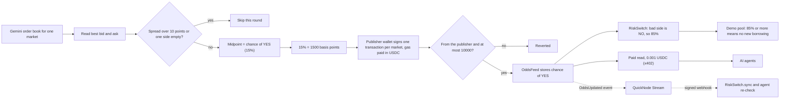
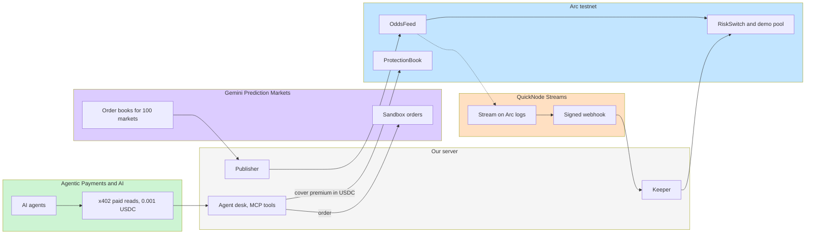

# Probability Oracle

A probability oracle that automates risk management and opens up AI agent insurance. UBC 2026.

**Website: https://web-production-195a7b1c.up.railway.app** · Live demo: https://web-production-195a7b1c.up.railway.app/overview

Video: coming soon

## What it does

Blockchains know prices, not what is likely to happen next. Prediction markets do. Probability Oracle reads Gemini's prediction-market order books and posts each market's chance on Arc, where contracts and AI agents can act on it. Two users are built in: an AI agent that holds Bitcoin and buys its own cover, paying in USDC, and a lending pool whose loan limit tightens as the chance of a price drop rises. Everything runs on Arc testnet with testnet USDC. The stand-ins are labelled on every page: an agent's holding is declared, its Gemini order is a ticket plus a sandbox order, and our pool is a demo pool with no deposits.


## How the oracle works



- **Gemini order book.** About 100 open markets, read every minute.
- **Thin check.** No bid, no ask, or more than 10 points between them: the market is not posted.
- **Midpoint.** A $0.14 bid and a $0.16 ask are a 15% chance of YES, written as 1500 basis points.
- **Publisher.** One wallet signs one transaction per market, when the value moved 0.5 points or once an hour. Gas is about 0.0011 USDC.
- **OddsFeed.** Accepts posts only from the publisher and only up to 10000. Free to read.
- **RiskSwitch and demo pool.** The switch flips the value to the pool's bad side and sets its tier: lend 75%, 60%, 40% of collateral, then no new borrowing.
- **Paid read.** `GET /odds/:symbol` costs 0.001 USDC over x402, settled by Circle Gateway.
- **QuickNode Stream.** Each `OddsUpdated` event reaches our server 1 to 2 seconds later as a signed webhook, which syncs the pool and makes covered agents re-check.

More: [one post followed end to end](docs/how-it-works.md) · [architecture](docs/architecture.md) · [the audit of every claim](docs/oracle-audit.md).

## Tracks



### Agentic Payments and AI

- **The track asks for** agents that transact onchain and pay per request, with the decision loop and its limits documented.
- **We built** an insurance desk. An agent signs up, pays 0.001 USDC per odds read over x402, compares Gemini's contracts and pays its own premium in USDC. The desk offers only strikes below today's price (one already passed is no risk, and its cover costs nearly its payout). The built-in agent takes the nearest strike below today's price on the latest date and buys it at a 25% chance or more: enough $1 contracts to pay holding × (1 − strike / price). Before a purchase the desk tops the agent's wallet up by exactly what it is short. Any LLM can use the same desk through six MCP tools.
- **Code:** [`src/desk/desk.ts`](src/desk/desk.ts), [`src/desk/mcp.ts`](src/desk/mcp.ts), [`src/agent/policy.ts`](src/agent/policy.ts).
- **On the live site:** Agents → "Create demo agent" → Run. "Connect your agent" gives one line for Claude Code or any MCP client.
- **Proof:** [a premium paid by Claude Code's agent](https://explorer.testnet.arc.io/tx/0xebff2e19c4487122ba65bd9b3f056c2641f9689defc0c4761ddea6f81998dcc9) · [a read in Circle's record](https://gateway-api-testnet.circle.com/v1/x402/transfers/92fc7c71-d798-4058-aa53-35d95d601769) · [details](docs/tracks/agentic-payments.md).

### Best use of Arc

- **The award asks for** core onchain functionality on Arc, the contract addresses, and how Arc is used.
- **We built** four contracts on Arc testnet: the feed, the premium book, the risk switch and the demo pool. USDC is the gas, so every fee is small and in dollars: a post used 45,274 gas, about $0.001, which makes one transaction per market practical. Reads settle through Circle Gateway on Arc. We also read Aave V4 on Arc mainnet, read only, to suggest a real collateral-factor change.
- **Code:** [`contracts/src`](contracts/src), 20 Foundry tests in [`contracts/test`](contracts/test).
- **On the live site:** Oracle → any row's Arc link; BTC pools → "Our pool on Arc" → "Run the replay".
- **Proof:** [a post from the hosted publisher](https://explorer.testnet.arc.io/tx/0x8a364294c53a4a9558ab02ab531e138015f0b61b6d2664db4c4c4d033fd9f0ae) · [a sync to the top tier](https://explorer.testnet.arc.io/tx/0x1be0c1a3f87dbc35eaeffa28fd983c905a1a35ee89ae3912b2757af21544562c) · [details](docs/tracks/arc.md).

### Gemini Prediction Markets

- **The bounty asks for** an application on Gemini's Prediction Markets API: market data, trading, or both.
- **We built** on both. Order books every minute become chances on Arc. Hourly candles feed the 7-day charts, the two replays and "Play the week". Each cover purchase produces the exact order body for Gemini (for example: buy 2, outcome no, limit $0.31, good-til-cancel), sent signed to the sandbox when the sandbox lists the contract. No production order is sent. Data provided by Gemini.
- **Code:** [`src/oracle/gemini.ts`](src/oracle/gemini.ts), [`src/agent/trade.ts`](src/agent/trade.ts), [`src/desk/cover.ts`](src/desk/cover.ts).
- **On the live site:** Oracle → a market's chart and result; Agents → a covered agent → "See the order".
- **Proof:** [the post of a 15% chance read from Gemini](https://explorer.testnet.arc.io/tx/0xfc51ab1cb85157f068924d884fc4a4774d34de267c40031dee32286185fc66a0) · [details](docs/tracks/gemini.md).

### QuickNode Streams

- **The bounty asks for** Streams as a core data source, with the network, dataset, filter and destination explained.
- **We built** one Stream on Arc testnet logs. Its filter runs at QuickNode, keeps the logs of our three contracts and the agent's USDC transfers, and decodes them into typed events. The destination is our webhook, which checks QuickNode's signature on every delivery. A delivery makes the keeper call `RiskSwitch.sync`, makes a covered agent re-check, and updates the pages, 1 to 2 seconds after the block and without polling a rate-limited RPC.
- **Code:** [`src/stream/filter.js`](src/stream/filter.js), [`scripts/stream-up.ts`](scripts/stream-up.ts), `streamDelivery` in [`src/server/index.ts`](src/server/index.ts).
- **On the live site:** click "QuickNode Stream: on" in the top bar for its last 10 deliveries and their delay.
- **Proof:** [a sync a delivery triggered](https://explorer.testnet.arc.io/tx/0x1be0c1a3f87dbc35eaeffa28fd983c905a1a35ee89ae3912b2757af21544562c) · [73 signed deliveries, one forgery rejected](docs/oracle-audit.md#103-the-stream-webhook) · [details](docs/tracks/quicknode.md).

## Run it yourself

Needs Node 22 and [Foundry](https://book.getfoundry.sh/); for the Stream, `cloudflared` and a QuickNode key.

```
git clone https://github.com/DhruPtel/UBC-2026-Probability-Oracle && cd UBC-2026-Probability-Oracle
npm install && forge build --root contracts
npm run new-keys      # creates .env; prints addresses only. Fund both at https://faucet.circle.com
npm run preflight     # PASS or FAIL lines
npm run demo          # the site and the Stream; open http://localhost:8787
```

`.env` names: `ARC_RPC_URL`, `DEPLOYER_KEY`, `AGENT_KEY`, `DESK_SEED`, and optionally `QUICKNODE_API_KEY`, `GEMINI_SANDBOX_API_KEY`, `GEMINI_SANDBOX_API_SECRET`. The contracts are already deployed and are used as they are. Without a QuickNode key, `npm run lab` runs everything but the Stream. [Setup details](docs/how-it-works.md#setup-details).

## Contracts

Arc testnet, chain 5042002. Addresses are also in [`deployments/arc-testnet.json`](deployments/arc-testnet.json).

| Contract | Address | What it does |
|---|---|---|
| [`OddsFeed`](contracts/src/OddsFeed.sol) | [`0x1857639d8e6b3db0c04aa1288afb278f848d7f6a`](https://explorer.testnet.arc.io/address/0x1857639d8e6b3db0c04aa1288afb278f848d7f6a) | The latest chance per market |
| [`ProtectionBook`](contracts/src/ProtectionBook.sol) | [`0x31f88462ddb390cfe8484674509fe83514110692`](https://explorer.testnet.arc.io/address/0x31f88462ddb390cfe8484674509fe83514110692) | Takes an agent's USDC premium and records the cover |
| [`RiskSwitch`](contracts/src/RiskSwitch.sol) | [`0x900f9f4406884c75ba124e661f858d6a38e9e620`](https://explorer.testnet.arc.io/address/0x900f9f4406884c75ba124e661f858d6a38e9e620) | `sync` reads the feed and sets a pool's tier |
| [`DemoLendingPool`](contracts/src/DemoLendingPool.sol), BTC market | [`0xc23095a7f8932c8947b0f898ec57ee30a12c6e1e`](https://explorer.testnet.arc.io/address/0xc23095a7f8932c8947b0f898ec57ee30a12c6e1e) | The demo pool: its loan limit follows the switch |
| The same pool, ETH replay | [`0xbfe83bbb52e808121b936ef63bf68e1ba371c132`](https://explorer.testnet.arc.io/address/0xbfe83bbb52e808121b936ef63bf68e1ba371c132) | "Our pool on Arc" on the BTC pools tab |

Replay, test and replaced v1 copies are in [docs/how-it-works.md](docs/how-it-works.md#replaced-v1-contracts) and [docs/tracks/arc.md](docs/tracks/arc.md).

## Docs

- [docs/tracks/README.md](docs/tracks/README.md): the submission checklist, with one page per track.
- [docs/how-it-works.md](docs/how-it-works.md): one post end to end, each piece, screenshots, stand-ins, setup.
- [docs/architecture.md](docs/architecture.md) · [docs/stream.md](docs/stream.md) · [docs/oracle-audit.md](docs/oracle-audit.md) · [docs/deploy.md](docs/deploy.md) · [docs/submission.md](docs/submission.md) · [docs/video-script.md](docs/video-script.md).

## Credits

Circle Gateway Nanopayments ([seller](https://developers.circle.com/gateway/nanopayments/quickstarts/seller) and [buyer](https://developers.circle.com/gateway/nanopayments/quickstarts/buyer) quickstarts, `@circle-fin/x402-batching`, [circlefin/arc-nanopayments](https://github.com/circlefin/arc-nanopayments)) · [aave-dao/aave-address-book](https://github.com/aave-dao/aave-address-book) and [aave/aave-v4](https://github.com/aave/aave-v4) · Morpho's and Aave's public APIs · the [MCP TypeScript SDK](https://github.com/modelcontextprotocol/typescript-sdk) · QuickNode Streams · viem · Foundry · Express · [Chart.js](https://www.chartjs.org/) · [Barlow](https://fonts.google.com/specimen/Barlow). Data provided by Gemini. Built with Claude Code; no code was copied from other projects. Full list in [docs/how-it-works.md](docs/how-it-works.md#credits).
