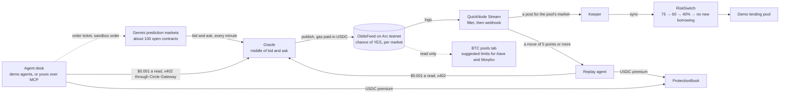
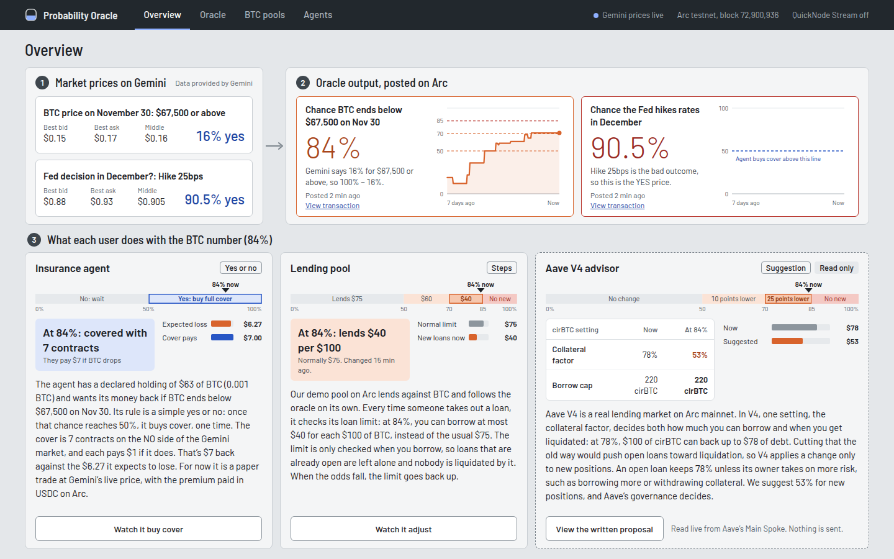
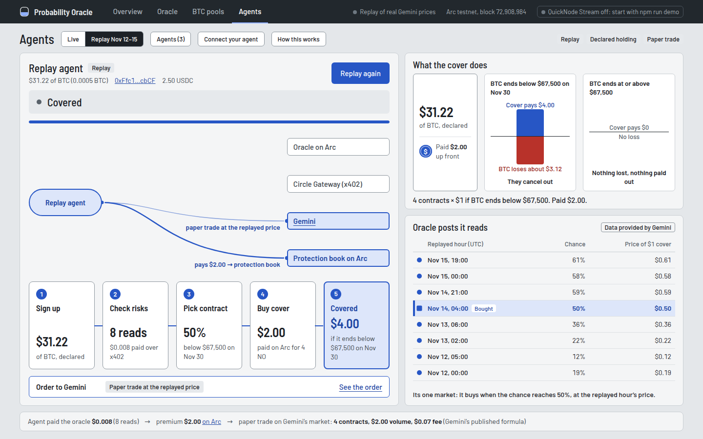
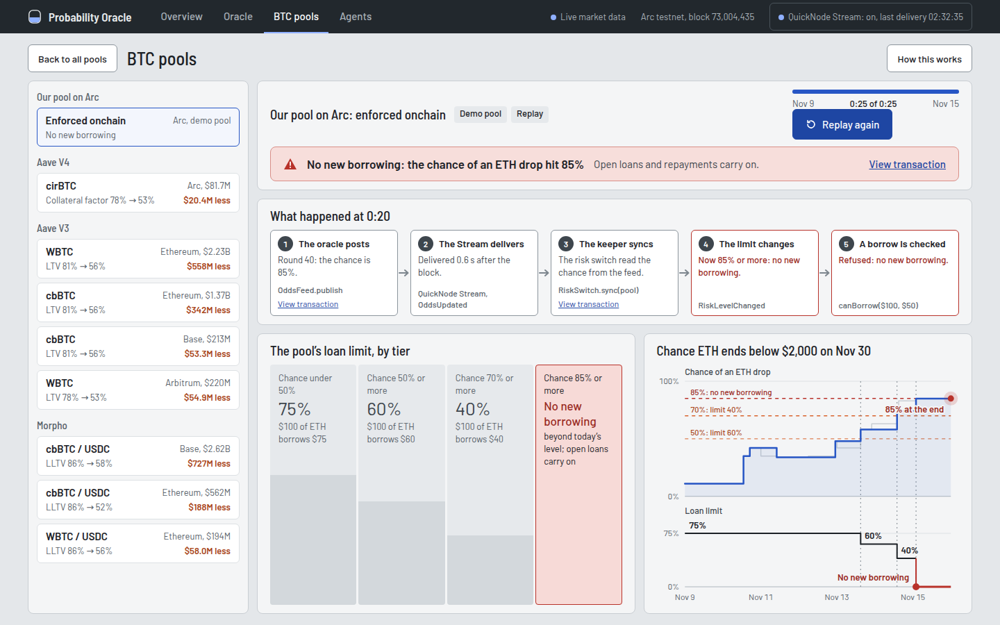
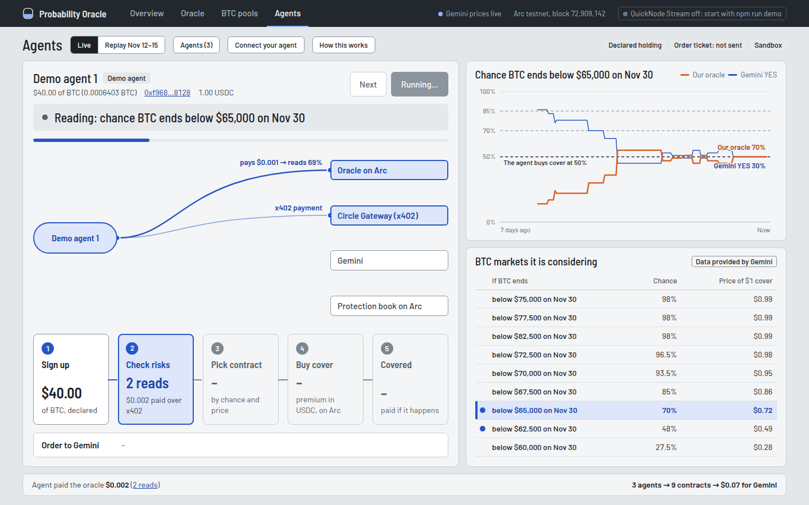
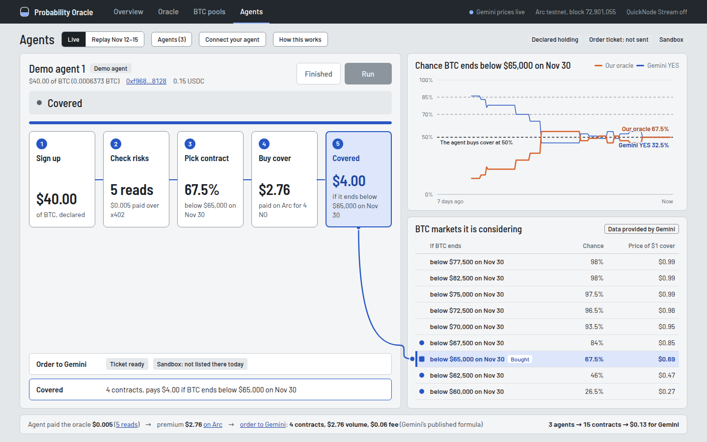

# Probability Oracle

**A probability oracle that lets AI agents insure themselves.** Built for UBC 2026 (University Blockchain Conference), Nov 12–20, 2026. Working name in the code: Hedgehog.

The oracle reads live prices from Gemini's prediction markets and posts each one on Arc testnet as a chance, for example "79% chance BTC ends below $67,500 on Nov 30". Two users act on that number. An agent that holds BTC pays $0.001 per read over x402 and, when the chance reaches 50%, buys cover: prediction-market contracts that pay $1 each if the bad outcome happens. A lending pool lowers its loan limit in steps as the chance rises, enforced onchain by a small contract called the risk switch. A QuickNode Stream carries every post from the chain to the agent and to the pool's keeper.



Everything runs on Arc testnet with testnet USDC. What is a stand-in is listed under [Stand-ins](#stand-ins). What was checked, how, and what it found is in the [oracle correctness audit](docs/oracle-audit.md).

## What is built

| Page | What it shows |
|---|---|
| Overview, `/` | Gemini's price, our output, and what each of the two users does with it |
| Oracle, `/oracle` | The live feed: about 100 Gemini markets, each with Gemini's bid and ask, our chance, and its last post on Arc |
| BTC pools, `/pools` | Our demo pool on Arc, enforced onchain, with a 30-second replay of a real week; and eight real Aave and Morpho BTC markets, read live, each with the limit our rule would suggest. Read only |
| Agents, `/agents` | The agent insurance desk. **Live:** create a demo agent, or connect your own over MCP ("Connect your agent"), and watch it sign up, pay for reads, pick a contract and buy cover. **Replay Nov 12–15:** our own agent on four real days of BTC prices |
| Lab, `/lab` | The workbench behind them |

## Screenshots

| | |
|---|---|
|  Overview: Gemini's price, our output, and what each user does with it |  Oracle: a live feed of about 100 markets, each posted on Arc |
|  Agents, replay mode: Nov 12 to 15, from watching to covered |  Our pool on Arc: the limit steps down as the chance rises |
|  Agents, live mode: the line runs from the step the agent is on to the market it is reading |  A Claude Code agent over MCP, covered |
|  BTC pools: the same rule as a suggestion for real Aave and Morpho markets |  One pool: its live settings, our suggestion, and the month since Gemini listed the market |

## Run it locally

Needs Node 22 and [Foundry](https://book.getfoundry.sh/) (`forge`). For the Stream you also need `cloudflared` and a QuickNode API key. Tested from a clean copy of the repository on Nov 18.

```
npm install
forge build --root contracts   # the server reads the contract ABIs from this build (forge-std is in the repo; nothing to install)
npm run typecheck && npm test  # optional: 30 tests; forge test --root contracts runs 20 more
npm run new-keys               # creates .env, two wallets and the desk's seed; prints addresses only
```

Fund both addresses with testnet USDC at https://faucet.circle.com (Arc Testnet): about 10 for the deployer, 1 for the agent. Then:

```
npm run check:arc                 # chain 5042002 and both balances
npm run gateway:deposit -- 1      # once: the agent's balance for paid reads
npm run lab                       # the site, at http://localhost:8787
npm run oracle                    # in a second terminal: posts the nine configured markets every 5 minutes
npm run preflight                 # seven PASS or FAIL lines: RPC, Gemini, contracts, balances, Streams, Lab
```

The contracts are already deployed (addresses below, in [`deployments/arc-testnet.json`](deployments/arc-testnet.json)). The server and the agent use them as they are. `npm run deploy -- <Name>` deploys your own copies.

Open `http://localhost:8787`. The tabs are Overview, Oracle, BTC pools and Agents. `/lab` is the workbench behind them.

- **Agent replay:** Agents → Replay Nov 12–15 → Start replay (or `npm run demo -- agent`). About 30 seconds; costs about 2.03 testnet USDC from the agent's wallet. `npm run fund:agent -- 2` moves USDC back from the deployer.
- **Pool replay:** BTC pools → Our pool on Arc → Run the replay (or `npm run demo -- protocol`). About 0.02 USDC of gas.
- **A live agent:** Agents → Create demo agent → Run. About 20 seconds. The premium returns to the deployer, so it costs only gas.
- **Your own agent:** Agents → Connect your agent shows the one line that adds the desk's MCP server to Claude Code.
- **With the Stream:** `npm run stream:demo` before a replay; Ctrl+C afterwards deletes the Stream. Without it the server triggers the agent and the keeper directly, and the page says so.
- **Before a demo:** `npm run demo:reset` puts the desk's log aside (kept, under a dated name), tops the agent and the desk's wallets up from the deployer, and checks that no Stream is up.

Environment variables, all in `.env` (see [`.env.example`](.env.example); never commit this file):

| Variable | For |
|---|---|
| `ARC_RPC_URL` | Arc testnet RPC. Default `https://rpc.testnet.arc.io` |
| `DEPLOYER_KEY`, `AGENT_KEY` | The two wallets. `npm run new-keys` fills them in |
| `DESK_SEED` | The agent desk's four demo wallets are derived from it. `npm run new-keys` fills it in; the deployer tops the wallets up |
| `PORT`, `STREAM_PORT` | The site (8787) and the Stream webhook (8788) |
| `ORACLE_INTERVAL_S`, `AGENT_INTERVAL_S` | Loop intervals, 300 s by default |
| `QUICKNODE_API_KEY`, `STREAM_WEBHOOK_URL` | Only for the Stream. `stream:demo` sets the webhook address itself |
| `GEMINI_SANDBOX_API_KEY`, `GEMINI_SANDBOX_API_SECRET` | Only for sandbox orders: `npm run gemini:order` and the agent desk. Without them the desk still writes the order ticket |

None of them is needed to build, typecheck or test. The site needs the first four; without the QuickNode and Gemini sandbox keys everything else still runs.

A running Lab posts the feed's markets on Arc and so spends deployer gas: up to about 0.13 USDC an hour, plus about 0.11 for the 5-minute loop. All commands are listed in [`CLAUDE.md`](CLAUDE.md).

## Agentic Payments and AI

**The agent's decision loop** is in [`src/agent/agent.ts`](src/agent/agent.ts); the rule itself is the pure function `decide()` in [`src/agent/policy.ts`](src/agent/policy.ts), with tests in [`src/agent/policy.test.ts`](src/agent/policy.test.ts). A run starts on a timer, or when the Stream reports a move of 5 points or more on a watched market or a USDC transfer touching the agent's wallet. For each risk in [`src/agent/threats.json`](src/agent/threats.json):

1. **Pay to read.** `GET /odds/:symbol` answers 402; the agent pays $0.001 in USDC through Circle Gateway and gets the chance and the feed's round.
2. **Check onchain.** It reads `OddsFeed.latestBySymbol` for free and stops if the round or the value differ from what it paid for.
3. **Decide.** Chance of the bad outcome = YES, or 100% − YES, as the risk says. Under the trigger (50%) it holds. At or above it, contracts needed = ceil(holding value × shock × hedge ratio), minus what it already holds.
4. **Buy.** It approves exactly the premium and calls `ProtectionBook.buyProtection`, which moves the USDC to the treasury and emits `ProtectionBought`. The contracts themselves are recorded as a paper trade at Gemini's live price.

Every step is a line in `logs/agent.jsonl` and shows live on the Agents page (replay mode) and in the Lab. A replay from Nov 18, with the Stream up: [the post that reached 50%](https://explorer.testnet.arc.io/tx/0xd16112f34c0fb6bac20325cb8f8c6be6f415802c310a5d16c8e33900ea2b0eb6) · [the agent's 2 USDC premium for 4 contracts](https://explorer.testnet.arc.io/tx/0x71dbc20286c7d6b4d57ebe27de42e2f0d7226c3b0101e0bd5b49b7cf2a09df72).

**x402 nanopayments.** The seller is [`src/server/index.ts`](src/server/index.ts) (`createGatewayMiddleware` from `@circle-fin/x402-batching`, network `eip155:5042002`, price $0.001); the buyer is `GatewayClient` in [`src/agent/inputs.ts`](src/agent/inputs.ts). A payment is a signed authorization that Gateway accepts at once and settles on Arc later in a batch, so a single read has a Gateway transfer id, not its own transaction. The Gateway Wallet contract is [`0x0077777d…19b9`](https://explorer.testnet.arc.io/address/0x0077777d7eba4688bdef3e311b846f25870a19b9). For the nine markets of the 5-minute loop and for the replays, a paid read returns the onchain value, and publishes first when Gemini has moved. For the other feed markets the desk's read returns the feed's Gemini value from the last minute, which can be a point or two ahead of the last post on Arc; the response says so (`"method": "feed"`). Settlement, as Circle's public record shows it: [two reads accepted five minutes apart](https://gateway-api-testnet.circle.com/v1/x402/transfers/c683327d-fd42-4bff-ba62-809a38e48a16) settled in [one transaction on Arc](https://explorer.testnet.arc.io/tx/0x20e3339be04d92bef7e0ac0a503a2b3933fc96e97f8e8a30b9cea5775993dfe0).

**The agent insurance desk** ([`/agents`](demo/agents.html), [`src/desk/desk.ts`](src/desk/desk.ts)). The same loop, opened to any agent. The page has two modes: "Live" is the desk, "Replay Nov 12–15" is the agent above on real past prices. One stage shows one agent: five steps, and a line from the step it is on to the market it is reading. There are two ways in and one desk underneath:

- **A demo agent.** "Create demo agent" on the page picks an asset and a holding; "Run" or "Next" walks our built-in agent through the steps. It prefers the contracts that run longest (through month end).
- **Your own agent.** An MCP server ([`src/desk/mcp.ts`](src/desk/mcp.ts)) gives any MCP client six tools: `sign_up`, `check_risks`, `list_contracts`, `quote_cover`, `buy_cover`, `my_cover`. The page shows the one-line setup for Claude Code. We tested it with a headless Claude Code session that was given only this server: it signed up, paid for five reads, chose a contract by its own reasoning (not the one our rule picks) and bought it.

Each agent gets one of four reusable Arc testnet wallets. `check_risks` pays $0.001 over x402 per read from that wallet. `buy_cover` pays the premium through `ProtectionBook` from that wallet, writes an order ticket (the exact body for Gemini's order API at the live price, not sent), and places the same order in Gemini's sandbox when the sandbox lists the contract. A demo agent from Nov 18 that held $40 of BTC: five paid reads, then [a $2.52 premium for 4 contracts](https://explorer.testnet.arc.io/tx/0xaa04ce9f2b2385f9883f25deb3082e9ae4bd6573d384fa29156315b6ba71468a) that pay $4 if BTC ends below $65,000. More: [Claude Code's premium](https://explorer.testnet.arc.io/tx/0x83f443c591dfb4d7240a96dce882bde8ba1206750d3f394baa2b2d659f1b42da) · [one of its x402 payments, as Circle Gateway records it](https://gateway-api-testnet.circle.com/v1/x402/transfers/6ce6e8a9-13a0-4427-b0a4-942f5e6ee8ce) · [a demo agent's premium](https://explorer.testnet.arc.io/tx/0x89364dbcb0ff45e7c6064bc7a27605c7c3d0bc71884af0c862ddf7e273396728).

**Safety limits, as they are today.** There is no spending budget, no maximum price and no owner approval yet. Those agent guardrails are planned (Phase 11 in [`PLAN.md`](PLAN.md)) and are not built. What does limit the agent now:

- It buys only what the rule computes, and never more than the contracts still missing, so a second run buys nothing.
- It refuses to act if the paid value and the onchain value differ.
- Its USDC approval is for the exact premium of one purchase.
- One run at a time; a second trigger is skipped.
- It holds testnet USDC only, and its trades are paper trades. No real money can move.
- The server listens on this machine only; only the Stream webhook port is ever tunnelled.
- The desk has no limits of its own: an agent that signs up can buy any cover it is quoted, and the desk's treasury lends its wallet the premium (which returns to the treasury). Its wallets hold testnet USDC only, their keys never leave the server, and no order goes to Gemini's production exchange.

What protects the oracle (built on Nov 18 after the [audit](docs/oracle-audit.md#findings-closed-in-phase-10) found each of these open):

- **Only our publisher can post.** `OddsFeed.publish` reverts for any other sender: [a post from the agent's wallet, reverted](https://explorer.testnet.arc.io/tx/0x56cc92d70a76d369c38dc048379630188abbecb9e5ae0f75e803d33e1adf5d18).
- **No value above 100%.** [A post of 100.01% by the publisher itself, reverted](https://explorer.testnet.arc.io/tx/0x72b7060aa56cab83ec296ba7d1956ee6bf4a9225192fefeb26d5ec414eeedda6).
- **Thin books are not posted.** A market with no bid, no ask, or more than 10 points between them keeps its last value; the Oracle tab shows "Too thin to post".
- **Stale values are marked.** "Stale" appears where a posted value is over 15 minutes old and Gemini has since moved half a point or more away from it. The desk offers an agent neither thin nor stale markets.
- **The Stream webhook checks QuickNode's signature** on every delivery and rejects anything else with 401.

What is still open:

- `RiskSwitch.sync` can be called by anyone, on purpose: it takes no value from the caller, only copies what the feed says, and a pool is never stuck waiting for one keeper.
- The publisher is one key and cannot be changed; there is no second source, no smoothing and no dispute step.
- The contract does not know a value's age. A contract reading the feed gets `publishedAt` and must set its own limit.
- The agent guardrails above.
- A pool's stored level changes only when someone calls `sync`. The Lab does, on each Stream event; with no Stream up, the live demo pool waits.

Example transactions: [the agent pays a 2 USDC premium](https://explorer.testnet.arc.io/tx/0xca3342039d25e298467e80d0d88e20a7f14c2ca1802c7dffba8ebaa2820c0745) (`buyProtection`, a replay) · [its first purchase on the live Fed market](https://explorer.testnet.arc.io/tx/0xb62b848bcb4593ec0b59a9949a9259acd9778ae8c164164c2f3e36df0e884ead) · agent wallet [`0xFfc1A84E…cbCF`](https://explorer.testnet.arc.io/address/0xFfc1A84E7050fd8F6648483B79B18074d0cacbCF).

## Best use of Arc

Contracts on Arc testnet (chain 5042002), sources in [`contracts/src`](contracts/src), tests in [`contracts/test`](contracts/test):

| Contract | Address | What it does |
|---|---|---|
| [`OddsFeed`](contracts/src/OddsFeed.sol) | [`0x1857639d8e6b3db0c04aa1288afb278f848d7f6a`](https://explorer.testnet.arc.io/address/0x1857639d8e6b3db0c04aa1288afb278f848d7f6a) | The latest chance per market; free to read by any contract; only our publisher can post, and never a value above 100%; emits `OddsUpdated` with the previous value |
| [`ProtectionBook`](contracts/src/ProtectionBook.sol) | [`0x31f88462ddb390cfe8484674509fe83514110692`](https://explorer.testnet.arc.io/address/0x31f88462ddb390cfe8484674509fe83514110692) | Takes the agent's USDC premium and records each purchase |
| [`RiskSwitch`](contracts/src/RiskSwitch.sol) | [`0x900f9f4406884c75ba124e661f858d6a38e9e620`](https://explorer.testnet.arc.io/address/0x900f9f4406884c75ba124e661f858d6a38e9e620) | A protocol opts in with its own tiers; `sync` reads the feed and sets its level |
| [`DemoLendingPool`](contracts/src/DemoLendingPool.sol) (BTC market) | [`0xc23095a7f8932c8947b0f898ec57ee30a12c6e1e`](https://explorer.testnet.arc.io/address/0xc23095a7f8932c8947b0f898ec57ee30a12c6e1e) | Demo pool: its loan limit follows the switch |
| The same pool for the ETH replay | [`0xbfe83bbb52e808121b936ef63bf68e1ba371c132`](https://explorer.testnet.arc.io/address/0xbfe83bbb52e808121b936ef63bf68e1ba371c132) | "Our pool on Arc" on the BTC pools tab |
| The same pool for the BTC replay and for tests | [`0x201cb684…2289`](https://explorer.testnet.arc.io/address/0x201cb68496959ccf555be97df91dff46d1c82289), [`0xac1a328f…a742`](https://explorer.testnet.arc.io/address/0xac1a328fafede307c34981997e5a86a949f2a742) | Replay and test copies |

**v1 (Nov 16 to 18, replaced on Nov 18).** The first `OddsFeed` let any address post. Hardening it meant a new feed, and with it a new switch and new pools, because each holds the address of the one before. The v1 contracts still hold their history, and older links in this README and in the audit point at them: `OddsFeed` [`0xe83a5a53…c50d`](https://explorer.testnet.arc.io/address/0xe83a5a53dd68bf395337343cd25a0432a1acc50d) · `RiskSwitch` [`0x6a961276…2525`](https://explorer.testnet.arc.io/address/0x6a961276b85bc64214b4a7810a01256363552525) · `DemoLendingPool` [`0x46199416…149f`](https://explorer.testnet.arc.io/address/0x461994160526949cae165850a45c7a36e8e2149f) · ETH replay pool [`0xc011d750…f588`](https://explorer.testnet.arc.io/address/0xc011d750e2d86b299a6ac9d770fbf58e49d4f588) · BTC replay pool [`0x3a211c22…1ee6`](https://explorer.testnet.arc.io/address/0x3a211c22595425615754823e67928d4af9881ee6) · test pool [`0x9ff1c68b…158f`](https://explorer.testnet.arc.io/address/0x9ff1c68b935264add1a7251e107b9b85d860158f). `ProtectionBook` was not replaced.

How the project uses Arc:

- **USDC is the gas.** The oracle's posts, the keeper's syncs and the agent's purchases all pay gas in the same USDC the product moves. A post costs about 0.0011 USDC, which is what makes posting 100 markets practical.
- **x402 settlement.** Paid reads are Circle Gateway nanopayments on Arc testnet.
- **OddsFeed** is the shared source: the agent, the risk switch and the Stream all read the same rounds. [A post from the live feed](https://explorer.testnet.arc.io/tx/0xbd61cbc952db74196e871d9fe73ffaa60409ee5801f28315544dc1c44d046371) · [a post from the 5-minute loop](https://explorer.testnet.arc.io/tx/0xfecfb8783e8df48a5d72256bb20215b4f050f7fbe1bfeb93a04ceed5454cd064).
- **ProtectionBook** keeps the premium onchain in USDC.
- **RiskSwitch** changes a pool's limit in one transaction when the chance crosses a tier: 75% of collateral normally, 60% at a 50% chance, 40% at 70%, and at 85% no new borrowing beyond today's level. [The sync that reached the top tier in a replay](https://explorer.testnet.arc.io/tx/0x1be0c1a3f87dbc35eaeffa28fd983c905a1a35ee89ae3912b2757af21544562c). The audit walked a test pool through every boundary (49.99% and 50%, 69.99% and 70%, 84.99% and 85%).
- **A read of Aave V4 on Arc mainnet.** The server reads the cirBTC reserve of Aave V4's Main Spoke on Arc mainnet (chain 5042, [`0xB843bdC3…134d`](https://explorer.arc.io/address/0xB843bdC3a87A05E77E07Df9FE48928b3A34b134d)): collateral factor, caps, supplied and borrowed. From that and our chance it writes a suggested parameter change. This is read only; nothing is sent to Aave.

## Gemini Prediction Markets

- **Market data at scale.** The server reads every open contract in the Crypto, Economics, Economy and Finance categories each minute from `GET /v1/prediction-markets/events` ([`src/oracle/gemini.ts`](src/oracle/gemini.ts)): at the last count 111 events with 471 contracts. It posts about 100 of them on Arc (events closing within a day left out; per event the 10 contracts nearest 50%): a market is posted when it has moved half a point or more, and once an hour, at most two posts a minute and 120 an hour. Hourly history comes from `GET /v2/candles/<instrumentSymbol>/1hr`, for the 7-day charts, the replays, and the pool view's month ("Since the market opened": the contract that was nearest 50% when Gemini listed the November market). Gemini's first month-long BTC market was listed on Oct 31, so one month of history is all there is; we did not chain or fill in anything earlier.
- **The chance of YES.** The middle of the best bid and best ask. A book with a side missing, or with more than 10 points between the sides, is too thin: nothing is posted and the last value stays ([`src/oracle/odds.ts`](src/oracle/odds.ts), tests beside it).
- **The flip to the bad outcome.** Gemini lists "BTC $67,500 or above"; a holder cares about the opposite. Where one outcome is clearly bad (a price ending below a level, a rate hike) the pages show the chance of that outcome: 100% − YES for an "or above" market. The feed onchain stays neutral and always holds YES.
- **Paper trades at live prices.** The agent's cover is recorded at Gemini's real production ask for the side it needs (`logs/paper.jsonl`). No order is sent to Gemini.
- **Sandbox orders.** `npm run gemini:order` ([`src/agent/trade.ts`](src/agent/trade.ts)) places, lists and checks prediction-market orders on Gemini's sandbox with signed REST. It was used to prove the order API. The agent does not use it, because the sandbox lists different markets at unrelated prices.
- **Order tickets and sandbox orders at the desk.** Every purchase at the agent desk carries the exact body for `POST /v1/prediction-markets/order` at Gemini's live price, and Gemini's fee by its [published formula](https://www.gemini.com/fees/predictions): 0.07 × contracts × price × (1 − price), rounded up to the next cent ([`src/desk/cover.ts`](src/desk/cover.ts), tests beside it). The ticket is not sent: production needs a verified, funded US account. Where Gemini's sandbox lists the same contract, the same order is placed there and its order id is shown, labelled "Sandbox". The page's "What this means for Gemini" panel counts the desk's real orders and adds a projection that is labelled as one.
- **Attribution.** Data provided by Gemini. The pages say so wherever Gemini's prices appear.

## QuickNode Streams

- **Network:** Arc testnet. **Dataset:** Logs.
- **Filter:** [`src/stream/filter.js`](src/stream/filter.js), a `function main(stream)` that runs on QuickNode. It keeps only logs from our three contracts and USDC transfers to or from the agent, decodes them by hand, and returns small typed events: `oddsUpdated` (or `bigMove` when the value moved 5 points or more), `protectionBought`, `walletChange`, `riskLevelChanged`. A block with none of these delivers nothing.
- **Destination:** a webhook, `POST /stream` on port 8788 of the server, reached through a cloudflared tunnel. Created by [`scripts/stream-up.ts`](scripts/stream-up.ts) through the Streams REST API, deleted by [`scripts/stream-down.ts`](scripts/stream-down.ts); `npm run stream:demo` does both around a demo. Every delivery carries QuickNode's signature (HMAC-SHA256 with the Stream's security token); the webhook verifies it and answers 401 to anything else.
- **Why:** the Stream is what makes the system react instead of poll. A post on Arc reaches the server about a second after its block; the server then starts an agent run (on a big move or a wallet change) and calls `RiskSwitch.sync` for the pool whose market moved. The pages show the same events live, and our pool's view prints the measured delay ("Delivered 1.1 s after the block").
- The filter is tested against each event type ([`src/stream/filter.test.ts`](src/stream/filter.test.ts)). On Nov 18, after the signature check went in, one `stream:demo` session carried two live desk agents, two agent replays and the pool replay: 73 signed deliveries accepted, every trigger through the Stream, a forged delivery rejected, and no Stream left afterwards ([audit](docs/oracle-audit.md#103-the-stream-webhook)).
- The Stream bills per block, so it runs only while it is in use. `npm run preflight` fails if one is still up.

## Stand-ins

- **Paper trade.** The agent's Gemini contracts are recorded, not ordered. The price is Gemini's live price; the USDC premium onchain is real testnet USDC.
- **Order ticket and Sandbox.** At the agent desk the Gemini order is a ticket that is not sent, plus a sandbox order with test funds where the sandbox lists the contract. Sandbox prices are unrelated to real ones.
- **Demo wallets.** The desk's agents use a pool of four wallets whose keys the server holds; one agent after another reuses them. An agent does not bring its own key.
- **Declared holding.** The agent's BTC is a number in [`src/agent/portfolio.json`](src/agent/portfolio.json), valued at Gemini's live spot price. Testnet has no real BTC to hold.
- **Demo pool.** `DemoLendingPool` holds no deposits and lends nothing; it answers "would this loan be allowed now?" and counts simulated loans.
- **Replay.** The two demos play back real Gemini hourly prices (BTC Nov 12–15, ETH Nov 9–15) in about 30 seconds under `replay:` symbols, because live markets do not move on cue. Every post, read, sync and purchase in a replay is a real testnet transaction.
- **Read-only advisor.** The Aave and Morpho numbers on the BTC pools tab are read live; our limits there are suggestions. Nothing is sent to any protocol.
- **Testnet.** All USDC is testnet USDC.

## What's next

- The agent guardrails: an onchain daily budget, a maximum price, and owner approval for large purchases. For the oracle: smoothing, a second publisher, and an age check a contract can call.
- The agent desk beyond this machine: a hosted MCP endpoint, and agents that pay from their own wallets (design notes in [`docs/plan-agent-desk.md`](docs/plan-agent-desk.md); how we would host it in [`docs/hosting-plan.md`](docs/hosting-plan.md)).
- Real orders on Gemini in place of paper trades, once there is a funded account and Gemini's agreement on republishing its data.

## Credits

- **Circle Gateway Nanopayments.** The paid `/odds/:symbol` endpoint and the buyer scripts follow Circle's [seller](https://developers.circle.com/gateway/nanopayments/quickstarts/seller) and [buyer](https://developers.circle.com/gateway/nanopayments/quickstarts/buyer) quickstarts and use the `@circle-fin/x402-batching` SDK. Circle's sample app [circlefin/arc-nanopayments](https://github.com/circlefin/arc-nanopayments) shows the same pattern on Arc; no code was copied from it.
- **Aave.** The advisor reads Aave V4 on Arc with addresses from [aave-dao/aave-address-book](https://github.com/aave-dao/aave-address-book) and function names from the interfaces in [aave/aave-v4](https://github.com/aave/aave-v4); no code was copied. What the home page says about V4 was checked against Aave's own pages: [Aave V4: Risk Isolation](https://aave.com/blog/aave-v4-risk-isolation), [Position conditions](https://aave.com/docs/aave-v4/positions/conditions) and [Aave v4: New Features and Risk Parameter Analysis](https://governance.aave.com/t/aave-v4-new-features-and-risk-parameter-analysis/23443).
- **Morpho and Aave public APIs.** The BTC pools tab reads Morpho markets from [Morpho's public API](https://api.morpho.org/graphql) and Aave V3 reserves from [Aave's public API](https://api.v3.aave.com/graphql). Read only.
- **Gemini.** Market data from Gemini's public prediction-markets API. Data provided by Gemini.
- **Model Context Protocol.** The desk's MCP server uses the official [TypeScript SDK](https://github.com/modelcontextprotocol/typescript-sdk) (`@modelcontextprotocol/sdk`) and `zod`.
- **QuickNode Streams**, **viem**, **Foundry** and forge-std, **Express**.
- **Chart.js and Barlow.** The Lab draws its charts with [Chart.js](https://www.chartjs.org/) (MIT) from a CDN tag. The pages are set in [Barlow and Barlow Semi Condensed](https://fonts.google.com/specimen/Barlow) (SIL Open Font License, from Google Fonts).
- Built with Claude Code. No code was copied from other projects.
