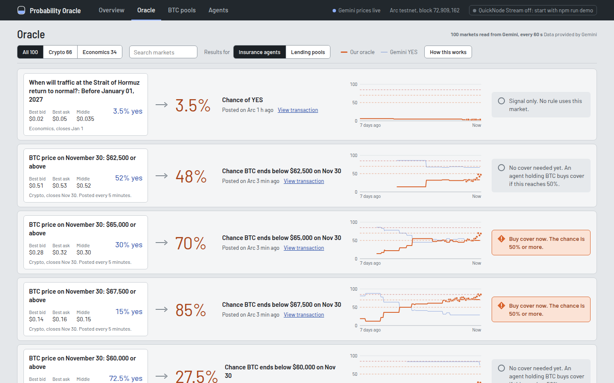
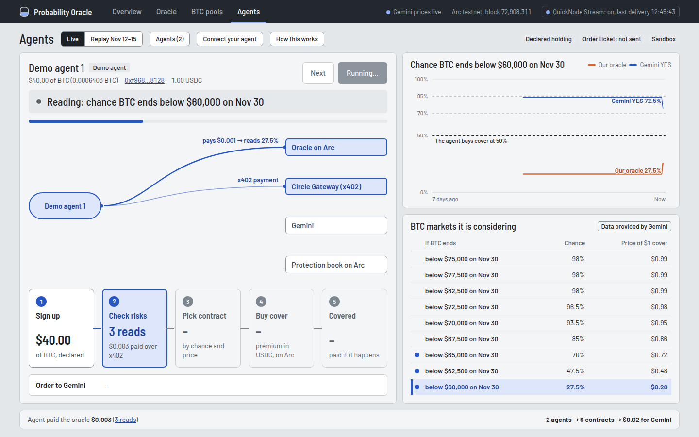
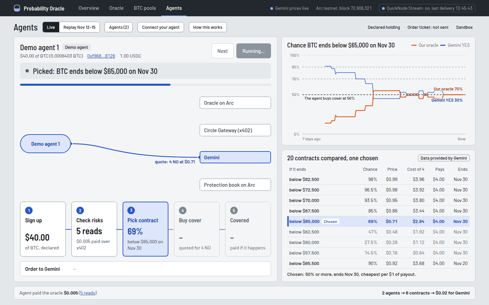
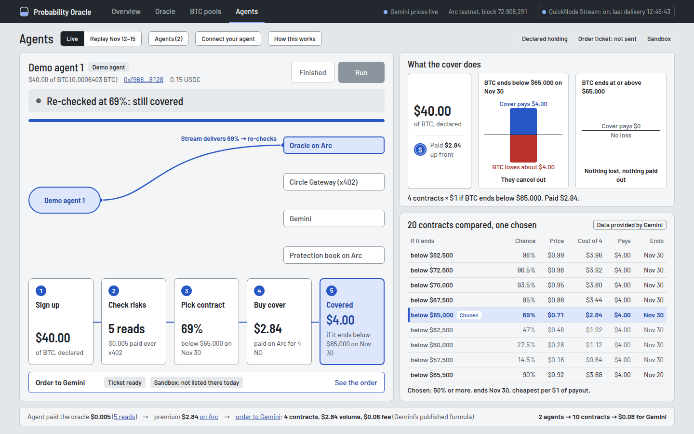
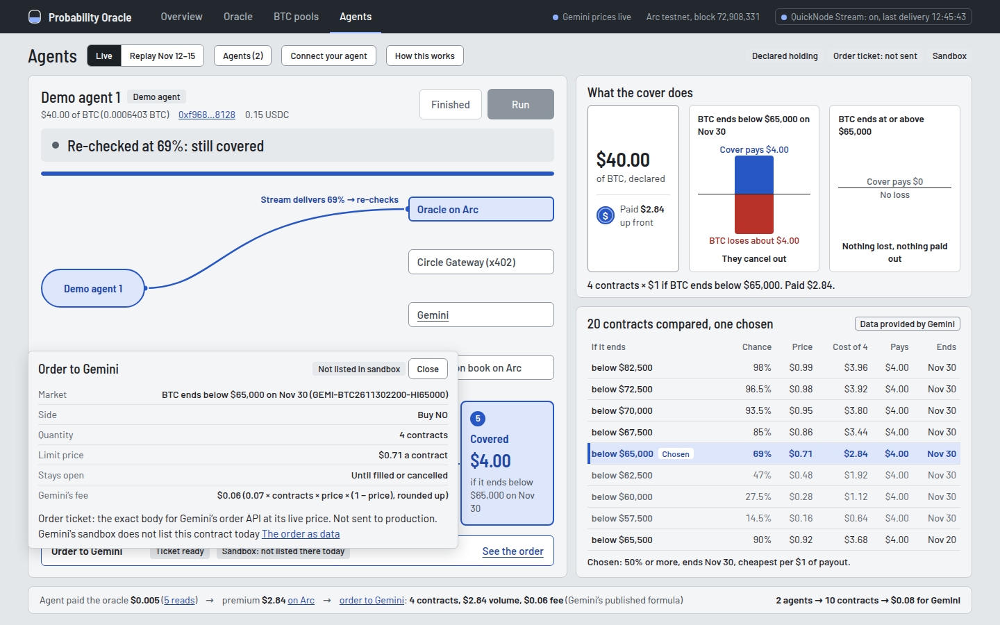
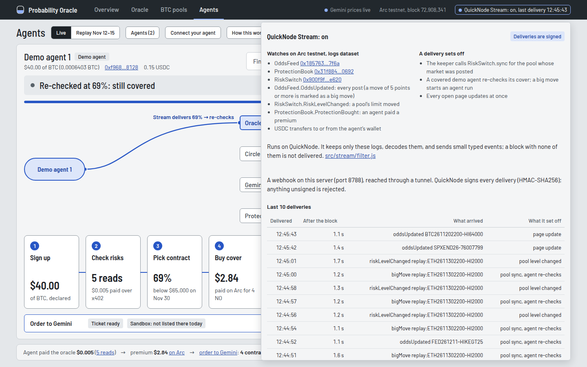
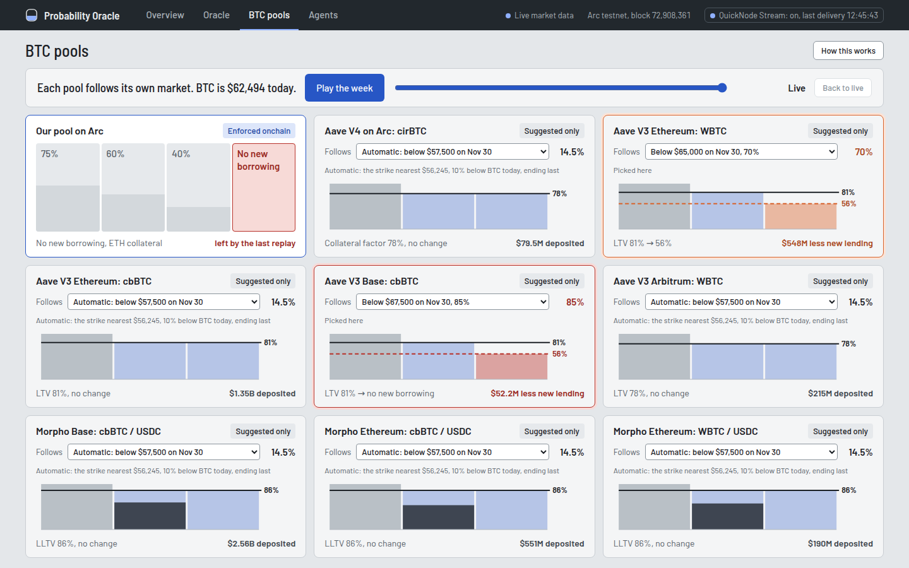
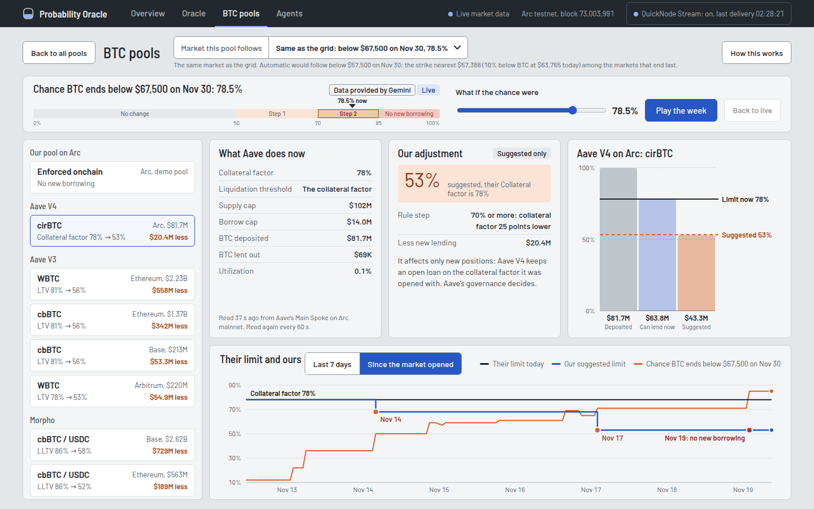

# Probability Oracle

**An oracle that puts Gemini's prediction-market prices on Arc as chances, so an AI agent can insure itself and a lending pool can tighten before the price falls.**

Built for UBC 2026 (Nov 12–20). Arc testnet and testnet USDC only. Working name in the code: Hedgehog.


## Run it

```
npm install && forge build --root contracts
npm run demo          # the site and the QuickNode Stream; Ctrl+C stops both
# then open http://localhost:8787
```

The first run needs Node 22, Foundry, and a `.env` with two funded testnet wallets: see [Setup details](#setup-details).

## How the oracle works

```mermaid
flowchart LR
    gemini[/"Gemini order books (100 markets)"/]
    subgraph server ["Our server, offchain"]
        readBook["Read best bid and ask ($0.14 / $0.16)"]
        thin{"Spread over 10 points?"}
        skip["Skip: too thin"]
        mid["Midpoint = chance of YES (15%)"]
        bps["Basis points (15% = 1500)"]
        publisher["Publisher wallet signs tx"]
    end
    subgraph arc ["Arc testnet, onchain"]
        guard{"From publisher and at most 10000?"}
        reverted["Reverted"]
        feed[("OddsFeed stores chance of YES")]
        evt(("Odds updated event"))
    end
    subgraph users ["Readers, each picks its own side"]
        riskSwitch["Risk switch: bad side is NO, so 85%"]
        pool["Pool loan limit tier"]
        api["Odds API with x402"]
        agents["Agents flip to their own risk"]
        qn["QuickNode Stream"]
        hook["Signed webhook to our server"]
    end
    gemini -->|"Every minute"| readBook
    readBook --> thin
    thin -->|"Yes"| skip
    thin -->|"No"| mid
    mid --> bps
    bps --> publisher
    publisher -->|"One tx per market, gas in USDC"| guard
    guard -->|"Yes"| feed
    guard -->|"No"| reverted
    feed -->|"Emits"| evt
    feed -->|"Free read: 1500"| riskSwitch
    riskSwitch -->|"Sets"| pool
    feed -->|"Serves value"| api
    api -->|"Paid read, 0.001 USDC"| agents
    evt -.->|"Watched by"| qn
    qn -.->|"Delivers in 1-2 s"| hook
    hook -.->|"Triggers sync"| riskSwitch
    hook -.->|"Triggers re-check"| agents
```



One real post, followed end to end (Nov 18, 19:46 UTC):

- **Read.** Gemini's "BTC at or above $67,500 on Nov 30" has YES at $0.14 bid, $0.16 ask.
- **Convert.** The midpoint is $0.15, so a 15% chance of YES, written as 1500 basis points. For a BTC holder the bad outcome is NO: an 85% chance BTC ends below $67,500.
- **Sign.** The publisher wallet `0x96fF…8400` signs a transaction calling `publish("GEMI-BTC2611302200-HI67500", 1500, …)`.
- **Check.** `OddsFeed` requires that the sender is the publisher and the value is at most 10000. Anything else reverts: [a post from another wallet](https://explorer.testnet.arc.io/tx/0x56cc92d70a76d369c38dc048379630188abbecb9e5ae0f75e803d33e1adf5d18), [a post of 100.01%](https://explorer.testnet.arc.io/tx/0x72b7060aa56cab83ec296ba7d1956ee6bf4a9225192fefeb26d5ec414eeedda6).
- **Store.** The value is stored as round 5 with its time, and `OddsUpdated` is emitted with the previous value, 1600: [the transaction](https://explorer.testnet.arc.io/tx/0xfc51ab1cb85157f068924d884fc4a4774d34de267c40031dee32286185fc66a0).

The feed always stores the chance of YES. Each reader flips it to its own bad outcome: the pages, the agent, and the pool's side in the risk switch.

Each market is its own transaction, about 0.0011 USDC of gas. One is sent only when the market has moved 0.5 points or more, once an hour as a heartbeat, or every 5 minutes for the nine main markets.

The transaction's signature is what proves a post came from our wallet. Arc recovers the sender from it and the contract compares that with the publisher; there is no second signature inside the data.

More: [architecture](docs/architecture.md) · [the audit of every claim](docs/oracle-audit.md).

## The pieces

**OddsFeed contract** · [`contracts/src/OddsFeed.sol`](contracts/src/OddsFeed.sol)

Per market it stores the chance of YES, the round, when we read Gemini, the block time and a hash of the source data. `publish` is ours alone; `latestBySymbol("GEMI-BTC2611302200-HI67500")` is free for any contract or explorer.

**Odds API (x402)** · [`src/server/index.ts`](src/server/index.ts), buyer in [`src/agent/inputs.ts`](src/agent/inputs.ts)

```
$ curl -i localhost:8787/odds/GEMI-BTC2611302200-HI67500
HTTP/1.1 402 Payment Required
PAYMENT-REQUIRED: <base64: scheme exact, eip155:5042002, USDC, amount 1000, payTo 0x96fF…8400>
```

Amount 1000 is $0.001. The agent signs the payment through Circle Gateway and repeats the call. It gets the chance, the round and the source hash, and checks them against `OddsFeed` for free before acting.

Gateway settles later in a batch: [two reads](https://gateway-api-testnet.circle.com/v1/x402/transfers/c683327d-fd42-4bff-ba62-809a38e48a16) settled in [one Arc transaction](https://explorer.testnet.arc.io/tx/0x20e3339be04d92bef7e0ac0a503a2b3933fc96e97f8e8a30b9cea5775993dfe0).

**QuickNode Stream** · [`src/stream/filter.js`](src/stream/filter.js), [docs/stream.md](docs/stream.md)

QuickNode reads the logs of every Arc block. Our filter keeps four event types (an odds update, a big move, a cover purchase, a change to the agent's wallet) and delivers them, signed, to our webhook 1 to 2 seconds after the block:

```json
[{ "type": "oddsUpdated", "symbol": "GEMI-BTC2611302200-HI67500", "probBps": 1500,
   "prevProbBps": 1500, "round": 17, "block": 72908775, "tx": "0xdf323ad2…0352" }]
```

Each delivery makes the keeper sync the pool that follows that market, makes a covered agent re-check ("Re-checked at 69%: still covered"), and updates the pages. A move of 5 points or more starts an agent run.

Why not polling: it would mean asking a rate-limited RPC for logs every second, all day. The Stream calls us only when one of our events happened. It bills per block (about 144,000 credits an hour), so it runs only during demos.

**Agent desk and MCP** · [`src/desk/desk.ts`](src/desk/desk.ts), [`src/desk/mcp.ts`](src/desk/mcp.ts)

We asked Claude Code, connected over MCP, to insure $60 of BTC. It signed up and got a wallet, then paid for five reads at $0.001 each ([one of them](https://gateway-api-testnet.circle.com/v1/x402/transfers/92fc7c71-d798-4058-aa53-35d95d601769)).

It picked "BTC ends below $60,000 on Nov 30" at a 27.5% chance, which our own rule (50% or more) would not pick. It paid [a $0.84 premium](https://explorer.testnet.arc.io/tx/0xebff2e19c4487122ba65bd9b3f056c2641f9689defc0c4761ddea6f81998dcc9) for 3 contracts that pay $3.

The desk wrote the order ticket: buy 3 NO at $0.28, good-til-cancel, Gemini fee $0.05. Gemini's sandbox did not list that contract; where it does, the same order is placed there (an ETH order that day is open as `145853902321789666`).

**BTC pools** · [`demo/pools.html`](demo/pools.html), `GET /api/pools`

Eight live Aave and Morpho BTC markets, read only. Example card, Aave V4 on Arc (cirBTC), at an 85% chance: collateral factor 78% → 53%, and no new borrowing beyond today's level. That is about $20 million less new lending against $80 million of collateral.

On Aave V4 a change applies to new positions only: an open loan keeps the factor it was opened with. Each card follows its own market, and "Play the week" replays 7 real days in 20 seconds.

**Risk switch and our demo pool** · [`contracts/src/RiskSwitch.sol`](contracts/src/RiskSwitch.sol), [`DemoLendingPool.sol`](contracts/src/DemoLendingPool.sol)

A pool opts in with its tiers: lend up to 75% of collateral normally, 60% at a 50% chance, 40% at 70%, and at 85% no new borrowing beyond today's level. Open loans carry on.

It is enforced onchain: a Stream delivery makes the keeper call `sync`, which reads the feed and moves the limit in one transaction. [The sync that reached the top tier](https://explorer.testnet.arc.io/tx/0x1be0c1a3f87dbc35eaeffa28fd983c905a1a35ee89ae3912b2757af21544562c).

## Screenshots

| | |
|---|---|
|  Oracle: about 100 markets, each posted on Arc |  An agent mid-run: a line to the platform it is calling, with the payment |
|  The contracts it compared, the chosen one marked |  Covered: what it holds, what it paid, the two outcomes |
|  The exact order to Gemini and its status |  The Stream: what it watches, its last 10 deliveries |
|  Replay of Nov 12–15: from watching to covered |  Our pool on Arc: the limit steps down as the chance rises |
|  BTC pools: each pool follows its own market |  One pool: its settings, our suggestion, the month so far |

## Tracks

| Track | What we use | Proof |
|---|---|---|
| Agentic Payments | Every odds read is a $0.001 x402 payment through Circle Gateway; the agent then pays its own USDC premium. Any MCP client can be the agent | [A read, in Circle's record](https://gateway-api-testnet.circle.com/v1/x402/transfers/92fc7c71-d798-4058-aa53-35d95d601769) · [Claude Code's premium](https://explorer.testnet.arc.io/tx/0xebff2e19c4487122ba65bd9b3f056c2641f9689defc0c4761ddea6f81998dcc9) |
| Arc | Four contracts; USDC is both the gas and the money, so a post costs a tenth of a cent. A live read of Aave V4 on Arc mainnet | [A post](https://explorer.testnet.arc.io/tx/0xfc51ab1cb85157f068924d884fc4a4774d34de267c40031dee32286185fc66a0) · [a sync](https://explorer.testnet.arc.io/tx/0x1be0c1a3f87dbc35eaeffa28fd983c905a1a35ee89ae3912b2757af21544562c) |
| Gemini | Live books of about 100 prediction markets, hourly candles, the published fee formula, exact order tickets, sandbox orders | [`src/oracle/gemini.ts`](src/oracle/gemini.ts) · [`src/desk/cover.ts`](src/desk/cover.ts) |
| QuickNode | A Stream on Arc testnet logs with a custom filter and a signed webhook; it triggers the keeper and the agents | [`src/stream/filter.js`](src/stream/filter.js) · [73 signed deliveries, one forgery rejected](docs/oracle-audit.md#103-the-stream-webhook) |

## Arc contracts

Arc testnet, chain 5042002. Sources in [`contracts/src`](contracts/src), tests in [`contracts/test`](contracts/test), addresses in [`deployments/arc-testnet.json`](deployments/arc-testnet.json).

| Contract | Address | What it does |
|---|---|---|
| [`OddsFeed`](contracts/src/OddsFeed.sol) | [`0x1857639d8e6b3db0c04aa1288afb278f848d7f6a`](https://explorer.testnet.arc.io/address/0x1857639d8e6b3db0c04aa1288afb278f848d7f6a) | The latest chance per market; free to read, only our publisher can post |
| [`ProtectionBook`](contracts/src/ProtectionBook.sol) | [`0x31f88462ddb390cfe8484674509fe83514110692`](https://explorer.testnet.arc.io/address/0x31f88462ddb390cfe8484674509fe83514110692) | Takes an agent's USDC premium and records each purchase |
| [`RiskSwitch`](contracts/src/RiskSwitch.sol) | [`0x900f9f4406884c75ba124e661f858d6a38e9e620`](https://explorer.testnet.arc.io/address/0x900f9f4406884c75ba124e661f858d6a38e9e620) | `sync` reads the feed and sets an opted-in pool's level |
| [`DemoLendingPool`](contracts/src/DemoLendingPool.sol), BTC market | [`0xc23095a7f8932c8947b0f898ec57ee30a12c6e1e`](https://explorer.testnet.arc.io/address/0xc23095a7f8932c8947b0f898ec57ee30a12c6e1e) | The demo pool: its loan limit follows the switch |
| The same pool, ETH replay | [`0xbfe83bbb52e808121b936ef63bf68e1ba371c132`](https://explorer.testnet.arc.io/address/0xbfe83bbb52e808121b936ef63bf68e1ba371c132) | "Our pool on Arc" on the BTC pools tab |
| The same pool, BTC replay and tests | [`0x201cb684…2289`](https://explorer.testnet.arc.io/address/0x201cb68496959ccf555be97df91dff46d1c82289), [`0xac1a328f…a742`](https://explorer.testnet.arc.io/address/0xac1a328fafede307c34981997e5a86a949f2a742) | Replay and test copies |

<details>
<summary>v1 addresses (Nov 16 to 18, replaced)</summary>

The first `OddsFeed` let any address post. Fixing that meant a new feed, switch and pools, because each holds the address of the one before. `ProtectionBook` was not replaced.

`OddsFeed` [`0xe83a5a53…c50d`](https://explorer.testnet.arc.io/address/0xe83a5a53dd68bf395337343cd25a0432a1acc50d) · `RiskSwitch` [`0x6a961276…2525`](https://explorer.testnet.arc.io/address/0x6a961276b85bc64214b4a7810a01256363552525) · `DemoLendingPool` [`0x46199416…149f`](https://explorer.testnet.arc.io/address/0x461994160526949cae165850a45c7a36e8e2149f) · ETH replay pool [`0xc011d750…f588`](https://explorer.testnet.arc.io/address/0xc011d750e2d86b299a6ac9d770fbf58e49d4f588) · BTC replay pool [`0x3a211c22…1ee6`](https://explorer.testnet.arc.io/address/0x3a211c22595425615754823e67928d4af9881ee6) · test pool [`0x9ff1c68b…158f`](https://explorer.testnet.arc.io/address/0x9ff1c68b935264add1a7251e107b9b85d860158f)

</details>

## Honest limits

- **Paper trades.** No order goes to Gemini's production exchange. An agent's cover is an order ticket at Gemini's live price, plus a sandbox order where the sandbox lists the contract. The USDC premium onchain is real testnet USDC.
- **Declared holdings.** An agent's BTC is a number it declares, valued at Gemini's spot price. Testnet has no BTC to hold.
- **Demo pool.** Our pool holds no deposits and lends nothing; it answers "would this loan be allowed now?". The Aave and Morpho numbers are advice, read only.
- **Replays.** The two 30-second demos play real past Gemini prices, labelled "Replay". Every transaction in them is real.
- **Single publisher.** One key, one source (Gemini), no smoothing, no dispute step. Each market is one transaction; batching is a possible next step.
- **Guardrails planned, not built.** An agent has no budget, maximum price or owner approval yet.

The full list is in [architecture](docs/architecture.md#stand-ins).

## Setup details

<details>
<summary>Requirements, environment variables, scripts</summary>

Node 22 and [Foundry](https://book.getfoundry.sh/). For the Stream: `cloudflared` and a QuickNode API key. Without them, use `npm run lab`; everything but the Stream runs.

```
npm run new-keys               # creates .env with two wallets and the desk's seed; prints addresses only
# fund both at https://faucet.circle.com (Arc Testnet): about 10 USDC for the deployer, 1 for the agent
npm run gateway:deposit -- 1   # once: the agent's balance for paid reads
npm run preflight              # seven PASS or FAIL lines
```

The contracts are already deployed and are used as they are.

| Variable in `.env` (see [`.env.example`](.env.example)) | For |
|---|---|
| `ARC_RPC_URL` | Arc testnet RPC, default `https://rpc.testnet.arc.io` |
| `DEPLOYER_KEY`, `AGENT_KEY`, `DESK_SEED` | The publisher, the agent, the desk's four wallets. Filled in by `new-keys` |
| `PORT`, `STREAM_PORT` | The site (8787) and the Stream webhook (8788) |
| `ORACLE_INTERVAL_S`, `AGENT_INTERVAL_S` | Loop intervals, 300 s |
| `QUICKNODE_API_KEY`, `STREAM_WEBHOOK_URL` | The Stream only |
| `GEMINI_SANDBOX_API_KEY`, `GEMINI_SANDBOX_API_SECRET` | Sandbox orders only |

| Script | What it does |
|---|---|
| `npm run demo` | The site and the Stream; Ctrl+C leaves 0 Streams |
| `npm run lab` | The site alone, at `http://localhost:8787` |
| `npm run oracle` | Posts the nine main markets every 5 minutes |
| `npm run replay -- agent \| protocol` | Starts a 30-second replay (also a button on the pages) |
| `npm run demo:reset` | Empties the Agents page and tops up the wallets |
| `npm run typecheck`, `npm test`, `forge test --root contracts` | The checks: 30 and 20 tests |

A running site posts to Arc and spends up to about 0.24 testnet USDC an hour. Every command is in [`CLAUDE.md`](CLAUDE.md).

</details>

## Credits

- **Circle Gateway Nanopayments.** The paid endpoint and the buyer follow Circle's [seller](https://developers.circle.com/gateway/nanopayments/quickstarts/seller) and [buyer](https://developers.circle.com/gateway/nanopayments/quickstarts/buyer) quickstarts and use `@circle-fin/x402-batching`. [circlefin/arc-nanopayments](https://github.com/circlefin/arc-nanopayments) shows the same pattern.
- **Aave.** Addresses from [aave-dao/aave-address-book](https://github.com/aave-dao/aave-address-book), function names from [aave/aave-v4](https://github.com/aave/aave-v4); V4's behaviour checked against [Risk Isolation](https://aave.com/blog/aave-v4-risk-isolation), [Position conditions](https://aave.com/docs/aave-v4/positions/conditions) and [the risk parameter analysis](https://governance.aave.com/t/aave-v4-new-features-and-risk-parameter-analysis/23443).
- **Morpho and Aave public APIs** for the BTC pools tab, read only.
- **Gemini.** Data provided by Gemini.
- **Model Context Protocol** [TypeScript SDK](https://github.com/modelcontextprotocol/typescript-sdk) and `zod`, **QuickNode Streams**, **viem**, **Foundry**, **Express**, [Chart.js](https://www.chartjs.org/), [Barlow](https://fonts.google.com/specimen/Barlow).
- Built with Claude Code. No code was copied from other projects.
