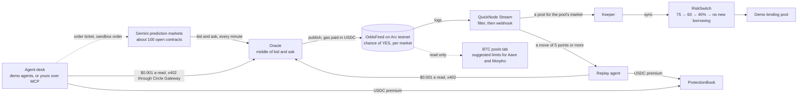

# Architecture

The long form of the [README](../README.md): how each part works, what limits it, and what is a stand-in. Everything runs on Arc testnet (chain 5042002) with testnet USDC. What was checked against the running system is in the [oracle correctness audit](oracle-audit.md); the Stream has its own page, [stream.md](stream.md).

## The parts

| Part | Code | What it does |
|---|---|---|
| Oracle | [`src/oracle/`](../src/oracle), the feed poster in [`src/server/index.ts`](../src/server/index.ts) | Reads Gemini, turns a book into a chance, posts it to `OddsFeed` |
| Contracts | [`contracts/src`](../contracts/src) | `OddsFeed`, `ProtectionBook`, `RiskSwitch`, the demo pools |
| Odds API | `GET /odds/:symbol` in the server | One read for $0.001 over x402 |
| Stream | [`src/stream/filter.js`](../src/stream/filter.js), the webhook in the server | Carries our events from the chain to the server |
| Agent | [`src/agent/`](../src/agent) | The replay agent: read, check, decide, buy |
| Agent desk | [`src/desk/`](../src/desk) | The same steps for any agent, and an MCP server |
| Pages | [`demo/`](../demo) | Overview, Oracle, BTC pools, Agents; the Lab at `/lab` |

How the parts connect, with both users and the money:

One Node process (`npm run lab`) is the server, the feed poster, the keeper, the x402 seller and the webhook. `npm run oracle` is a second process that posts the nine main markets every 5 minutes.

## How a value gets onchain

1. **Read.** Every 60 s the server reads every open contract in Gemini's Crypto, Economics, Economy and Finance categories from `GET /v1/prediction-markets/events` ([`src/oracle/gemini.ts`](../src/oracle/gemini.ts)): at the last count 111 events with 471 contracts. About 100 are kept for the feed (events closing within a day left out; per event the 10 contracts nearest 50%).
2. **Convert.** The chance of YES is the middle of the best bid and the best ask, in basis points ([`src/oracle/odds.ts`](../src/oracle/odds.ts), tests beside it). A book with a side missing, or more than 10 points between the sides, is too thin: nothing is posted and the last value stays.
3. **Send.** The publisher's wallet signs a transaction that calls `OddsFeed.publish(symbol, probBps, observedAt, sourceHash)`. `sourceHash` is the keccak256 of the Gemini data the value came from.
4. **Check and store.** The contract requires `msg.sender == publisher` and `probBps <= 10000`, stores the value with its round, the time we read Gemini and the block time, and emits `OddsUpdated` with the previous value.

### One transaction per market

Each market is posted in its own transaction. There is no batch call: `publish` takes one symbol and one value. A post costs about 0.0011 USDC of gas (45,274 gas at 25 gwei; [an example](https://explorer.testnet.arc.io/tx/0xfc51ab1cb85157f068924d884fc4a4774d34de267c40031dee32286185fc66a0)), and 0.0020 for a symbol's first post.

A transaction is sent in three cases only:

- **A move.** A feed market has moved 0.5 points or more since its last post.
- **The heartbeat.** A feed market has not been posted for an hour.
- **The 5-minute loop.** The nine markets of [`config/markets.json`](../config/markets.json) are posted every 5 minutes by `npm run oracle`, moved or not.

The feed poster sends at most two posts a minute and 120 in any hour, largest moves first, and none while a replay runs. So a running Lab spends up to about 0.13 USDC an hour on the feed and about 0.11 on the loop. All deployer sends, in any process, wait their turn on one lock (`asDeployer` in [`src/shared/chain.ts`](../src/shared/chain.ts), `logs/deployer.lock`), so nonces never collide.

### What proves a post is ours

The transaction's own signature. The payload carries no separate signature and the contract verifies none. Arc recovers the sender from the transaction signature, as every EVM chain does, and `publish` compares that sender with `publisher`, which is fixed at deployment (`0x96fF876149B830D473904957fe711b5eb4c28400`). Only the holder of that key can produce a transaction that passes.

Two posts that tried and failed: [one from the agent's wallet](https://explorer.testnet.arc.io/tx/0x56cc92d70a76d369c38dc048379630188abbecb9e5ae0f75e803d33e1adf5d18) ("only the publisher") and [one of 100.01% from the publisher itself](https://explorer.testnet.arc.io/tx/0x72b7060aa56cab83ec296ba7d1956ee6bf4a9225192fefeb26d5ec414eeedda6) ("above 100%").

What this does not prove: that the value matches Gemini. `sourceHash` and `observedAt` let anyone with the same Gemini response check it, but the contract cannot. One key, one source.

### Batching, a possible next step

A `publishMany(symbols, values, …)` call would post every market that moved in one transaction. It would save each post's fixed cost (about 21,000 of the 45,274 gas) and make a tick's posts land in one block with one nonce. It is not built: at two posts a minute the saving is small, and one transaction per market keeps each post's explorer link, event and revert separate.

### The flip to the bad outcome

Gemini lists "BTC $67,500 or above"; a holder cares about the opposite. `OddsFeed` stays neutral and always holds the chance of YES. Each reader flips it for itself: the pages show 100% − YES for an "or above" market, a pool opts in to the risk switch with a side (`NO` for the BTC and ETH pools), and the agent's risks in [`src/agent/threats.json`](../src/agent/threats.json) name theirs.

### What protects the oracle

Built on Nov 18 after the [audit](oracle-audit.md#findings-closed-in-phase-10) found each of these open:

- **Only our publisher can post**, and never a value above 100% (above).
- **Thin books are not posted**, by the feed, the loop or the paid read. The Oracle tab shows "Too thin to post".
- **Stale values are marked.** "Stale" appears where a posted value is over 15 minutes old and Gemini has since moved half a point or more away. The desk offers an agent neither thin nor stale markets.
- **The Stream webhook checks QuickNode's signature** on every delivery and answers 401 to anything else.

Still open:

- `RiskSwitch.sync` can be called by anyone, on purpose: it takes no value from the caller, only copies the feed, and a pool is never stuck waiting for one keeper.
- The publisher is one key and cannot be changed. There is no second source, no smoothing and no dispute step.
- The contract does not know a value's age. A contract reading the feed gets `publishedAt` and must set its own limit.
- A pool's stored level changes only when someone calls `sync`. The Lab does, on each Stream event; with no Stream up, the live demo pool waits.

## Gemini data

- **History.** Hourly closes come from `GET /v2/candles/<instrumentSymbol>/1hr`, for the 7-day charts, the replays and the pool view's month. A market's 7 days are kept on disk (`logs/candles/`) and one market is read again every 6 s, so a chart never waits for Gemini.
- **One month only.** Gemini's first month-long BTC market was listed on Oct 31. The pool view's "Since the market opened" shows that month and nothing invented.
- **A candle close is the last trade; the oracle posts the middle of the book.** On a wide book they differ. The charts show both and say which is which.
- **Limits.** Public calls are kept to one a second. "Data provided by Gemini" is on every page that shows Gemini's prices.

## The paid read (x402)

The seller is the server (`createGatewayMiddleware` from `@circle-fin/x402-batching`, network `eip155:5042002`, price $0.001). The buyer is `GatewayClient` in [`src/agent/inputs.ts`](../src/agent/inputs.ts).

- `GET /odds/:symbol` without a payment answers 402 with a `PAYMENT-REQUIRED` header: scheme `exact`, USDC on Arc testnet, amount `1000` (six decimals, so $0.001), pay to the deployer.
- The buyer signs an authorization and repeats the request. Gateway accepts it at once and settles on Arc later in a batch, so one read has a Gateway transfer id, not its own transaction. The Gateway Wallet contract is [`0x0077777d…19b9`](https://explorer.testnet.arc.io/address/0x0077777d7eba4688bdef3e311b846f25870a19b9).
- The answer: `symbol`, `probBps`, `prevProbBps`, `round`, `observedAt`, `sourceHash`, `method`, and `txHash` when the read caused a post.
- For the nine loop markets and the replays, a paid read returns the onchain value, and publishes first when Gemini has moved. For the other feed markets the desk's read returns the feed's Gemini value from the last minute, which can be a point or two ahead of the last post on Arc; the response says so (`"method": "feed"`).
- Settlement, as Circle's public record shows it: [two reads accepted five minutes apart](https://gateway-api-testnet.circle.com/v1/x402/transfers/c683327d-fd42-4bff-ba62-809a38e48a16) settled in [one transaction on Arc](https://explorer.testnet.arc.io/tx/0x20e3339be04d92bef7e0ac0a503a2b3933fc96e97f8e8a30b9cea5775993dfe0).

## The agent

The decision loop is [`src/agent/agent.ts`](../src/agent/agent.ts); the rule is the pure function `decide()` in [`src/agent/policy.ts`](../src/agent/policy.ts), with tests beside it. A run starts on a timer, or when the Stream reports a move of 5 points or more on a watched market or a USDC transfer touching the agent's wallet. For each risk in `threats.json`:

1. **Pay to read.** $0.001 through Circle Gateway for the chance and the feed's round.
2. **Check onchain.** It reads `OddsFeed.latestBySymbol` for free and stops if the round or the value differ from what it paid for.
3. **Decide.** Under the trigger (50%) it holds. At or above it, contracts needed = ceil(holding value × shock × hedge ratio), minus what it already holds.
4. **Buy.** It approves exactly the premium and calls `ProtectionBook.buyProtection`, which moves the USDC to the treasury and emits `ProtectionBought`. The contracts themselves are recorded as a paper trade at Gemini's live price (`logs/paper.jsonl`).

Every step is a line in `logs/agent.jsonl` and shows live on the Agents page (replay mode). A replay from Nov 18 with the Stream up: [the post that reached 50%](https://explorer.testnet.arc.io/tx/0xd16112f34c0fb6bac20325cb8f8c6be6f415802c310a5d16c8e33900ea2b0eb6), then [the 2 USDC premium for 4 contracts](https://explorer.testnet.arc.io/tx/0x71dbc20286c7d6b4d57ebe27de42e2f0d7226c3b0101e0bd5b49b7cf2a09df72). Agent wallet: [`0xFfc1A84E…cbCF`](https://explorer.testnet.arc.io/address/0xFfc1A84E7050fd8F6648483B79B18074d0cacbCF).

## The agent desk

[`src/desk/desk.ts`](../src/desk/desk.ts) opens the same loop to any agent, in six steps: sign up, check risks, list contracts, quote, buy, my cover. Every step is a line in `logs/desk.jsonl`. Two ways in:

- **A demo agent.** "Create demo agent" on `/agents` picks an asset and a holding; "Run" walks our built-in agent through the steps. Its rule: a chance of 50% or more, the latest end date, the cheapest per $1 of payout.
- **Your own agent.** The MCP server ([`src/desk/mcp.ts`](../src/desk/mcp.ts)) gives any MCP client six tools: `sign_up`, `check_risks`, `list_contracts`, `quote_cover`, `buy_cover`, `my_cover`. Each tool is one HTTP call to the desk.

How it works underneath:

- Each agent gets one of four reusable Arc testnet wallets, derived from `DESK_SEED`. The deployer tops a wallet up at sign-up and lends it the premium at a purchase; the premium returns to the deployer.
- `check_risks` pays $0.001 over x402 per read from that wallet.
- `buy_cover` pays the premium through `ProtectionBook`, writes an order ticket (the exact body for `POST /v1/prediction-markets/order` at Gemini's live price, not sent), and places the same order in Gemini's sandbox when the sandbox lists the contract.
- Gemini's fee follows its [published formula](https://www.gemini.com/fees/predictions): 0.07 × contracts × price × (1 − price), rounded up to the next cent ([`src/desk/cover.ts`](../src/desk/cover.ts), tests beside it).
- A covered demo agent keeps watching: each Stream post for its market makes it re-check ("Re-checked at 69%: still covered").

The page ([`demo/agents.html`](../demo/agents.html)) shows one agent on one stage: a map of the four platforms it calls with a labelled line to the one it is calling now, the contracts it compared, and the cover as a picture.

### Limits on the agent, as they are today

There is no spending budget, no maximum price and no owner approval. Those guardrails are planned (Phase 11 in [`PLAN.md`](../PLAN.md)) and not built. What does limit an agent now:

- The replay agent buys only what the rule computes, never more than the contracts still missing, so a second run buys nothing.
- It refuses to act if the paid value and the onchain value differ.
- Its USDC approval is for the exact premium of one purchase.
- One run at a time; a second trigger is skipped.
- The desk has no limits of its own: an agent that signs up can buy any cover it is quoted.
- Every wallet holds testnet USDC only, the keys never leave the server, and no order goes to Gemini's production exchange.
- The server listens on this machine only; only the Stream webhook port is ever tunnelled.

## The risk switch and the pools onchain

[`RiskSwitch`](../contracts/src/RiskSwitch.sol) turns a feed value into a level per protocol. A pool opts in once, in its constructor, with its market, its side and its tiers. `sync(pool)` reads the feed and stores the level; it is open to anyone because it only copies the feed.

| Chance of the bad outcome | The demo pool lends up to |
|---|---|
| under 50% | 75% of collateral |
| 50% | 60% |
| 70% | 40% |
| 85% | no new borrowing beyond today's level |

Open loans, repayments, deposits and withdrawals carry on at every tier. The audit walked a test pool through every boundary (49.99% and 50%, 69.99% and 70%, 84.99% and 85%). [The sync that reached the top tier in a replay](https://explorer.testnet.arc.io/tx/0x1be0c1a3f87dbc35eaeffa28fd983c905a1a35ee89ae3912b2757af21544562c).

The feed's address is immutable in the switch, and the switch's in each pool. Replacing the feed on Nov 18 therefore meant redeploying all of them; the first set stays in [`deployments/arc-testnet.json`](../deployments/arc-testnet.json) under `…V1` keys.

## BTC pools: the same rule as advice

`GET /api/pools` reads eight live BTC markets: Aave V4's cirBTC reserve on Arc mainnet (chain 5042, read onchain from the Main Spoke [`0xB843bdC3…134d`](https://explorer.arc.io/address/0xB843bdC3a87A05E77E07Df9FE48928b3A34b134d)), Aave V3 from Aave's API, Morpho from Morpho's API. Nothing is sent to any protocol.

The tiers become, per protocol:

- **Aave V4:** collateral factor 10 points lower, then 25, then no new borrowing (the 25-point cut stays and the borrow cap is held at what is borrowed today). V4 applies a new collateral factor to new positions only; an open loan keeps the one it was opened with.
- **Aave V3:** the same on the LTV. The liquidation threshold is not touched, so nobody is liquidated by it.
- **Morpho:** the LLTV can never change, so only new lending is limited: hold the vault cap at today's supply, then no new borrowing room beyond today's.

Each card has a "Follows" setting: automatic (the strike nearest 10% below today's BTC price among the markets that end last) or any BTC market in the feed. "Play the week" plays each followed market's real 7 days in about 20 s.

## Stand-ins

- **Paper trade.** The replay agent's Gemini contracts are recorded, not ordered. The price is Gemini's live price; the USDC premium onchain is real testnet USDC.
- **Order ticket and Sandbox.** At the desk the Gemini order is a ticket that is not sent, plus a sandbox order with test funds where the sandbox lists the contract. Sandbox prices are unrelated to real ones.
- **Demo wallets.** The desk's agents share four wallets whose keys the server holds. An agent does not bring its own key.
- **Declared holding.** An agent's BTC is a number it declares ([`src/agent/portfolio.json`](../src/agent/portfolio.json) for the replay agent), valued at Gemini's live spot price. Testnet has no real BTC to hold.
- **Demo pool.** `DemoLendingPool` holds no deposits and lends nothing; it answers "would this loan be allowed now?" and counts simulated loans.
- **Replay.** The two demos play back real Gemini hourly prices (BTC Nov 12–15, ETH Nov 9–15) in about 30 seconds under `replay:` symbols, because live markets do not move on cue. Every post, read, sync and purchase in a replay is a real testnet transaction.
- **Read-only advisor.** The Aave and Morpho numbers are read live; our limits there are suggestions.
- **Testnet.** All USDC is testnet USDC.

## What is next

- The agent guardrails: a daily budget, a maximum price, owner approval for large purchases.
- For the oracle: batched posts, smoothing, a second publisher, an age check a contract can call.
- The desk beyond this machine: a hosted MCP endpoint and agents that pay from their own wallets ([design notes](plan-agent-desk.md), [hosting plan](hosting-plan.md)).
- Real orders on Gemini in place of paper trades, once there is a funded account and Gemini's agreement on republishing its data.
