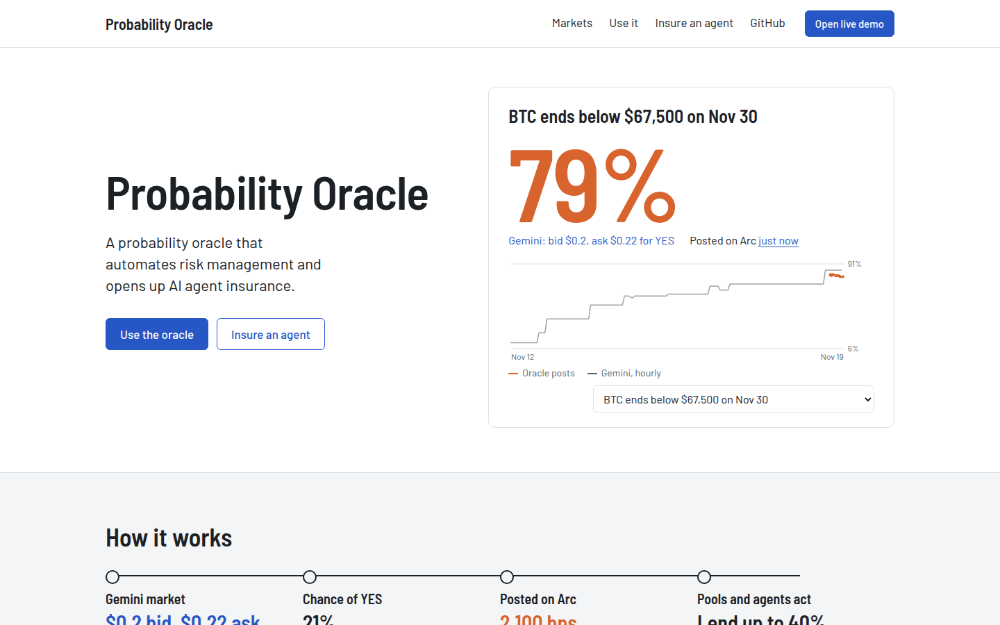
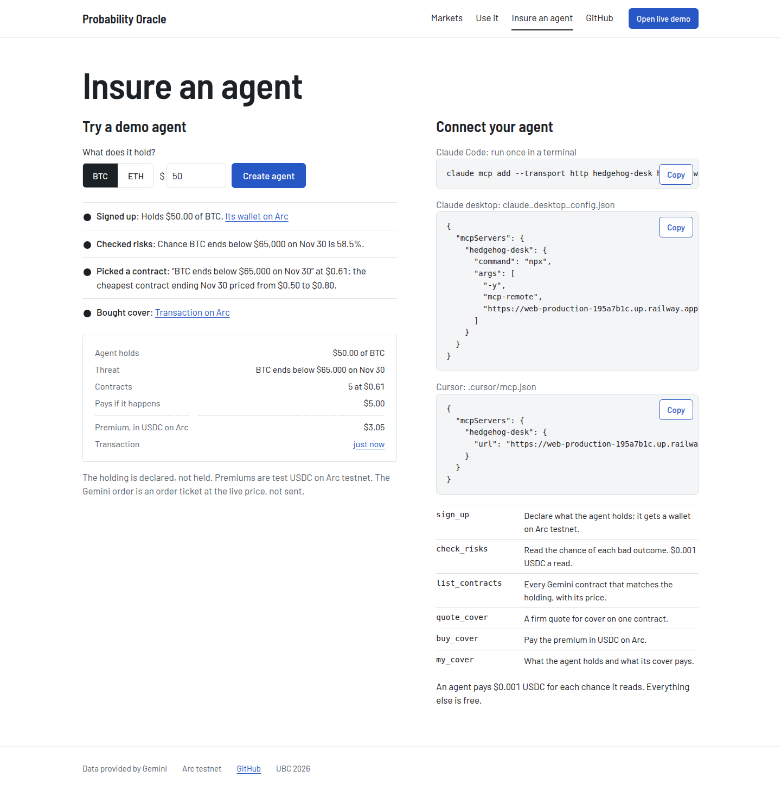

# Product website: report (Nov 19, 2026)

## Links

| | |
|---|---|
| Website | https://web-production-195a7b1c.up.railway.app |
| Markets | https://web-production-195a7b1c.up.railway.app/markets |
| Use it | https://web-production-195a7b1c.up.railway.app/use |
| Insure an agent | https://web-production-195a7b1c.up.railway.app/insure |
| Live demo (the app) | https://web-production-195a7b1c.up.railway.app/overview, then `/oracle`, `/pools`, `/agents` |

## Clean-up done first

- The older BTC agent now picks like the desk's agent: of the contracts on what it holds that its rule says to buy, the cheapest priced $0.50 to $0.80, or the closest to that range. A threat that is not on its holding (the Fed market it bought at $0.93) is logged as watched and never bought.
- The two "MCP check" agents are off the hosted desk (it lists a1, a2, a5, a6 and the new one from the check below). Done with a one-time `DESK_REMOVE=a3,a4` variable, removed again; the original log is kept on the volume beside the new one. A new agent's id now follows the highest id, so an id is never reused.
- Tagline in the README and `docs/submission.md`: "A probability oracle that automates risk management and opens up AI agent insurance."

## What was built

Plain HTML, CSS and JS in `site/`, served by the same Express server. No framework, no build step, no new dependency.

- **Home (`/`).** The hero fits above the fold at 1440×900 (it ends at 680 px). Left: the name, the tagline, two buttons. Right: one live market, its chance large in orange, Gemini's bid and ask in blue, a 7-day line (the oracle's posts in orange over Gemini's hourly price in grey), "Posted on Arc … ago" linking to the transaction, and a dropdown for the nine main markets. Then "How it works" (four nodes on one line, each with the live value for the hero's market), the two uses (a tier bar with today's marker; the last real cover as a receipt), and "Read it in one call" with Contract, API and Agent tabs.
- **Markets (`/markets`).** Search, category chips, one row per market (question, chance, 24-hour change, last post with its transaction, a 7-day line), newest post first. A row opens a side panel: the chart, the symbol and the feed id with Copy buttons, "Use this market".
- **Use it (`/use`).** Three numbered steps: pick a market (prefilled from `?symbol=`), pick Contract, API or Agent, copy the code, which carries that market, the OddsFeed address, chain 5042002 and the site's own URL.
- **Insure an agent (`/insure`).** Left: BTC or ETH and a dollar amount, "Create agent", then each step as it happens and the cover receipt; the agent's id is kept in `localStorage`, so a reload shows its cover. Right: the MCP config for Claude Code, Claude desktop and Cursor, the six tools, what a read costs.
- **Server.** `/` is the website and the Overview moved to `/overview`; the app's top bar says so and its brand links back to `/`. New: `GET /api/site/markets` (every feed market in one answer, from memory). `/api/markets/categories` is now open and cached for an hour.

The only motion is the hero number changing when a post arrives over SSE; it is off under `prefers-reduced-motion`.

## Every snippet was run

| Snippet | How | Result |
|---|---|---|
| Contract | `npm run site:snippets` writes the page's own text to `contracts/test/OddsReader.sol`; `contracts/test/SiteSnippet.t.sol` runs it on an Arc testnet fork against the real OddsFeed | PASS: 2200 bps YES, `chanceOfNo()` 7800, round 51 |
| API | the page's text, run once against the live site with the agent's test wallet | "21.5% chance of YES, round 52", $0.001 paid |
| Agent, HTTP (Claude Code, Cursor) | `npm run mcp:check -- <site>/mcp --list`, a real MCP client over Streamable HTTP | 6 tools listed |
| Agent, Claude desktop | an MCP client starting `npx -y mcp-remote <site>/mcp`, as the config does | 6 tools listed |

The fork test found a real fault: the address was lowercase, and Solidity refuses an address without its checksum. Fixed before shipping.

## Checked on the hosted site

- The hero updates: it went from 78.5% (2,150 bps) to 79% (2,100 bps) with a new transaction link, without a reload.
- Markets: the page answers in about 1.3 s the first time and the data (100 markets, 49 KB) in 0.3 s.
- The Use snippets are the same text that was tested (one source, `site/snippets.js`).
- One demo agent ran on `/insure` to a cover in 9 seconds: $50 of BTC, 5 contracts at $0.61 on "BTC ends below $65,000 on Nov 30", pays $5.00, premium $3.05, transaction `0x1a3741357b1b9c6035134cde2ca2a34f2496ab4ca6f044a41609be18525287da`. After a reload the receipt is still there.
- The old pages work at `/overview`, `/oracle`, `/pools`, `/agents` and `/pools/ours`, each still one screen at 1440×900 (the Oracle tab scrolls, as before). `/lab` stays 404.

## Screenshots

In `docs/screenshots/`, from the hosted site, at 1440×900 and 390×844: `site-home-1440.png`, `site-home-full-1440.png`, `site-markets-1440.png`, `site-market-panel-1440.png`, `site-use-1440.png`, `site-insure-1440.png`, `site-insure-covered-1440.png`, and the same names ending `-390`.

## Removed, one thing per page

- Home: the sentence under the tier bar (the marker and the outlined tier already say it).
- Markets: Gemini's bid and ask in the side panel.
- Use it: the symbol printed beside the picked market (it is in the code).
- Insure: the sentence repeating the purchase beside "Bought cover" (the receipt carries the numbers).

## Not sure about

- **Push.** This shell has no GitHub credentials (`could not read Username for 'https://github.com'`). `main` is ahead of `origin/main`; run `git push`.
- **`claude mcp add` was not run.** It would change this machine's Claude Code settings. The same endpoint and transport were proven with an MCP client instead.
- **The orange line is short on the host.** It shows only posts the hosted copy has on its volume (since it went live on Nov 19); the grey line is Gemini's full 7 days. It grows by itself.
- **Category chips.** Gemini lists 17 categories; the chips show only the ones the feed has markets in (today Crypto and Economics), so no chip leads to an empty list.
- **A line of stand-in wording on `/insure`.** The brief says no helper lines, but the project rule is that stand-ins stay visible, so one sentence says the holding is declared, the money is test USDC and the Gemini order is a ticket, not sent. Likewise one small line under "Chance of YES" on the home page says what that makes the chance of the bad outcome, since the hero shows that side.
- **The tier bar has four equal boxes**, not widths in proportion to 50, 70 and 85%, so "No new borrowing" stays readable at 390 px. The marker sits at the right place inside its box.
- **The contract snippet returns the chance of NO.** That is the bad side for every "X or above" price market. For a market where YES is the bad side, the comment says to use `probBps` as it is.
- **Each demo agent run from `/insure` appears on the Agents page too**, and counts against the hosted limit (20 an hour, 200 a day).
- **The local Docker build is still untested** (no Docker in this WSL); Railway builds the same Dockerfile.
